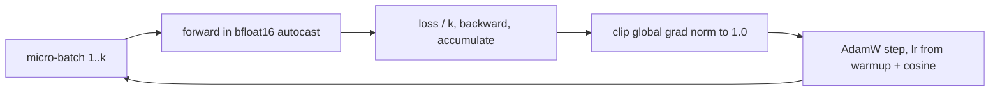

# Scaling Laws and Training at Scale

> Loss falls as a smooth power law in parameters, data and compute, until it hits the entropy of the data itself.

**Type:** Build
**Languages:** Python
**Prerequisites:** Phase 09 (LLMs: GPT from Scratch), Phase 02 (Training Deep Nets: SGD, Momentum and Adam, Learning Rate Schedules, Mixed Precision and Checkpointing)
**Time:** ~75 minutes

## Learning Objectives

- Train a family of GPTs of increasing size on the same token budget and fit `L(N) = a N^(-alpha) + L_inf`
- Compute the irreducible loss of a source exactly, and explain why no model can go below it
- Estimate training compute with `C ~= 6 N D` and use the Chinchilla rule of about 20 tokens per parameter
- Implement the training recipe used at scale: AdamW, warmup plus cosine decay, gradient clipping, gradient accumulation, bfloat16 autocast

## The Problem

Training a frontier model costs millions of dollars, and you get one shot. Before spending it you need to answer: how big should the model be, how much data does it need, and what loss will it reach? Trial and error at full size is impossible.

In 2020 Kaplan et al. at OpenAI found that the loss of a language model is a remarkably predictable function of model size, data size and compute, across seven orders of magnitude. In 2022 Hoffmann et al. at DeepMind (the Chinchilla paper) refined the picture and showed most large models of the time were undertrained. These scaling laws are why labs train small models first and extrapolate, and why model and data grew together.

You will reproduce the phenomenon in miniature, on a synthetic language whose true entropy you can compute.

## The Concept

### The power law

Kaplan et al. measured, for models trained to convergence on enough data:

```
L(N) = (N_c / N)^alpha_N           alpha_N ~= 0.076
L(D) = (D_c / D)^alpha_D           alpha_D ~= 0.095
```

`N` is non-embedding parameters, `D` is training tokens. On a log-log plot these are straight lines. Real data also has an irreducible part: text is not deterministic, so even a perfect model pays the entropy of the source. The general form is:

```
L(N) = a * N^(-alpha) + L_inf
```

and the Chinchilla paper fits both axes together:

```
L(N, D) = E + A / N^alpha + B / D^beta
```

### The irreducible loss

For natural language `L_inf` is unknown. For the synthetic grammar in this lesson you can compute it. Each sentence picks a subject, verb and object uniformly from 7 options each, adds a place with probability 0.6 (6 options) and a time with probability 0.4 (5 options):

```
H(sentence) = 3 ln 7 + [H(0.6) + 0.6 ln 6] + [H(0.4) + 0.4 ln 5]
L_inf       = H(sentence) / mean characters per sentence  ~= 0.207 nats per character
```

Once the model knows the grammar perfectly, every remaining nat of loss is a coin flip it cannot predict.

### Compute

A forward pass costs about `2N` FLOPs per token (one multiply and one add per weight), the backward pass about twice that, so:

```
C ~= 6 * N * D
```

For a fixed compute budget you can trade `N` against `D`. Chinchilla's answer: grow both equally, which works out to roughly 20 training tokens per parameter. A 70B model wants about 1.4 trillion tokens.

### The training recipe at scale



| Piece | Why |
|-------|-----|
| AdamW, betas (0.9, 0.95), weight decay 0.1 | The GPT-3 and Llama defaults; lower beta2 reacts faster to loss spikes |
| Linear warmup | Adam's second-moment estimates are noisy at step 0; large early steps can diverge |
| Cosine decay to 10% | Large steps explore, small steps settle; ending low gives a better final loss |
| Gradient clipping | One bad batch cannot blow up the weights |
| Gradient accumulation | Simulates a batch of millions of tokens on hardware that fits only a fraction |
| bfloat16 autocast | Halves memory and doubles throughput; bfloat16 keeps float32's exponent range so no loss scaling is needed |

Gradient accumulation is exact: the gradient of a mean over 32 examples equals the average of the gradients over 4 chunks of 8, as long as you divide each chunk loss by 4.

## Build It

```bash
uv run python phases/09-llms/04-scaling-laws-and-training-at-scale/code/main.py
```

### Step 1: An infinite-ish dataset

A tiny grammar produces 1.7 million characters, enough that no model here sees the same sentence twice in a meaningful way:

```
'her daughter carried a notebook on the hill in the morning. her daughter carried the stars. ...'
```

Scaling laws are about the regime where data is not the bottleneck; the 3.5 kB story from earlier lessons would be memorized instead.

### Step 2: Schedule and accumulation

```python
def warmup_cosine_lr(step, max_lr, warmup_steps, total_steps, min_ratio=0.1):
    if step < warmup_steps:
        return max_lr * (step + 1) / warmup_steps
    progress = (step - warmup_steps) / max(1, total_steps - warmup_steps)
    return max_lr * (min_ratio + (1 - min_ratio) * 0.5 * (1 + math.cos(math.pi * progress)))
```

```python
for xm, ym in zip(x.chunk(micro_batches), y.chunk(micro_batches)):
    (model(xm, ym) / micro_batches).backward()
```

The script compares the accumulated gradient with the full-batch one: they agree to about `1e-8`.

### Step 3: A family of models

Six GPTs from 888 to 200,064 non-embedding parameters, each trained for 400 steps of 32 x 32 tokens (409,600 tokens) with the same recipe:

```
N=    888 | tokens/param 461.3 | val loss 1.685
N=  3,312 | tokens/param 123.7 | val loss 0.820
N= 14,496 | tokens/param  28.3 | val loss 0.603
N= 25,472 | tokens/param  16.1 | val loss 0.474
N= 84,912 | tokens/param   4.8 | val loss 0.338
N=200,064 | tokens/param   2.0 | val loss 0.324
```

Every size step buys a predictable improvement, except the last. The 200k model has only 2 tokens per parameter, ten times fewer than Chinchilla recommends: it is undertrained, and a 2.4x larger model gains almost nothing. With a fixed data budget, extra parameters are wasted. This is the Chinchilla finding in a few seconds of compute.

### Step 4: Fit the law

```python
irreducible = source_entropy_per_char()
(scale, exponent), _ = curve_fit(lambda n, a, b: power_law(n, a, b, irreducible), n_values, losses, p0=(10.0, 0.3))
```

```
L_inf from the grammar itself: entropy 0.207 nats per character
a = 53.63, alpha = 0.532
fitting L_inf too: a = 121.41, alpha = 0.661, L_inf = 0.305
```

Fitting `L_inf` as a free parameter lands at 0.305, well above the true 0.207, because the undertrained largest model looks like a plateau. Labs face the same trap: a fitted floor can be an artifact of the data budget. The exponent here is much larger than the 0.076 measured for real text because the grammar is simple: a few thousand parameters capture most of it. The script saves `scaling_law.png`, where the reducible loss `L - L_inf` should fall on a line.

## Use It

You never write a schedule by hand in practice. `LambdaLR` wraps any function of the step:

```python
scheduler = torch.optim.lr_scheduler.LambdaLR(optimizer, lambda s: warmup_cosine_lr(s, 1.0, 50, 500))
```

It matches the hand schedule to `1e-19`. And mixed precision is one context manager:

```python
with torch.autocast(device_type=device, dtype=torch.bfloat16):
    loss = model(x, y)
```

```
loss in float32 3.2068 vs bfloat16 autocast 3.2067
```

At real scale you add the pieces that do not fit in one script: data parallelism (`torch.nn.parallel.DistributedDataParallel`), sharded optimizer states and parameters (`torch.distributed.fsdp`), activation checkpointing, and tensor or pipeline parallelism for models that do not fit on one GPU. The loss, the schedule and the optimizer are exactly the ones above.

## Exercises

1. **Easy.** Double the number of training steps for all six models. Which models improve the most? Relate the answer to tokens per parameter.
2. **Medium.** Fix the model at `embed_dim=32, num_layers=2` and vary the number of steps (100, 200, 400, 800, 1600). Fit `L(D) = b D^(-beta) + L_inf` with the known entropy.
3. **Hard.** For a fixed compute budget `C = 6 N D`, train three model sizes with steps chosen so that `N * steps` is constant. Find the compute-optimal size and compare the tokens-per-parameter ratio with Chinchilla's 20.

## Key Terms

| Term | What people say | What it actually means |
|------|----------------|----------------------|
| Scaling law | "Bigger is better" | An empirical power law `L = a N^(-alpha) + L_inf` relating loss to size, data or compute |
| Irreducible loss | "The floor" | The entropy of the data source; no model can predict below it |
| Non-embedding parameters | "Model size" | Parameters excluding embedding tables, the `N` used in Kaplan et al. |
| `6ND` | "Training FLOPs" | About 2 FLOPs per parameter per token forward, 4 backward |
| Chinchilla optimal | "20 tokens per parameter" | The compute-optimal ratio of data to parameters found by Hoffmann et al. |
| Warmup | "Ramp up the LR" | Linearly increasing the learning rate over the first steps to avoid early divergence |
| Gradient accumulation | "Fake big batch" | Summing gradients from several micro-batches before one optimizer step |
| bfloat16 | "Half precision" | 16-bit float with float32's exponent range and fewer mantissa bits |

## Further Reading

- [Kaplan et al. (2020): Scaling Laws for Neural Language Models](https://arxiv.org/abs/2001.08361) - the original power laws in N, D and C
- [Hoffmann et al. (2022): Training Compute-Optimal Large Language Models](https://arxiv.org/abs/2203.15556) - Chinchilla and the 20 tokens per parameter rule
- [Brown et al. (2020): Language Models are Few-Shot Learners](https://arxiv.org/abs/2005.14165) - GPT-3, with the training recipe (AdamW, warmup, cosine) used here
- [Andrej Karpathy: Let's reproduce GPT-2 (124M)](https://www.youtube.com/watch?v=l8pRSuU81PU) - the same recipe, plus bfloat16, fused kernels and DDP, on real hardware
