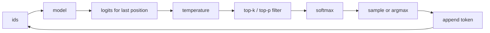

# Sampling and Decoding

> The model gives you a distribution. How you pick from it decides whether you get boring, broken or brilliant text.

**Type:** Build
**Languages:** Python
**Prerequisites:** Phase 09 (LLMs: Language Modeling and N-grams, GPT from Scratch)
**Time:** ~60 minutes

## Learning Objectives

- Implement greedy decoding, temperature sampling, top-k, top-p (nucleus) sampling and beam search on a trained GPT
- Explain what each filter does to the next-token distribution and why truncating the tail helps
- Measure the quality-diversity trade-off with log-likelihood, distinct n-grams and a real-word rate
- Sample from a categorical distribution with an inverse CDF and check it against `torch.multinomial`

## The Problem

A trained language model outputs logits over the vocabulary at each step. It does not output text. To generate, you must turn each distribution into one token, append it, and repeat. This decoding step has no training signal, yet it changes the output more than many architecture tweaks.

Always pick the most likely token and you get safe, bland text that often loops. Sample from the full distribution and the long tail of unlikely tokens, each individually rare but together a few percent of the mass, eventually derails every sentence. Every chat API exposes `temperature`, `top_k` and `top_p` because there is no single right answer: code completion wants near-greedy, brainstorming wants diversity.

## The Concept

### The decoding loop



### Greedy

`next = argmax(logits)`. Deterministic and locally optimal, but the most likely sequence is not built from the most likely next tokens, and greedy text tends to fall into repetitive loops once a phrase reinforces itself.

### Temperature

Divide the logits by `T` before the softmax:

```
p_i = exp(z_i / T) / sum_j exp(z_j / T)
```

| T | Effect |
|---|--------|
| T -> 0 | All mass on the argmax (greedy) |
| T < 1 | Sharper: likely tokens get likelier |
| T = 1 | The model's own distribution |
| T > 1 | Flatter: the tail gets more mass |

Temperature changes the shape but never removes any token: with `T = 1.5` every one of the 30 characters still has nonzero probability.

### Top-k

Keep the `k` largest logits, set the rest to `-inf`, renormalize. Simple, but `k` is fixed: when the model is sure (one plausible token) `k = 5` still admits four bad ones, and when it is unsure (many plausible tokens) `k = 5` cuts good ones.

### Top-p (nucleus)

Sort tokens by probability and keep the smallest set whose cumulative probability reaches `p`:

```
sorted probs: 0.25 0.23 0.22 0.08 0.07 0.05 0.04 ...
cumulative:   0.25 0.48 0.70 0.78 0.85 0.90 0.94 ...
p = 0.9  ->   keep the first 6
```

The cut adapts: a confident distribution keeps 1 or 2 tokens, a flat one keeps many. Holtzman et al. (2019) introduced it after showing that human text is not the most likely text under the model, but also never falls in the far tail.

### Beam search

Keep the `B` best partial sequences by total log-probability. At each step expand every beam by its top `B` tokens and keep the best `B` of the `B^2` candidates. It approximates the most likely full sequence. This is the right tool when there is one correct answer (translation, speech recognition, the captioning lesson in Phase 10), and the wrong one for open-ended text, where the most likely sequence is dull and often degenerate.

### Sampling from a distribution

Given probabilities `p`, draw `u ~ Uniform(0, 1)` and return the first index where the cumulative sum exceeds `u`. That is the inverse-CDF method, and it is what `torch.multinomial` does for a single draw.

## Build It

```bash
uv run python phases/09-llms/05-sampling-and-decoding/code/main.py
```

The script first trains the GPT from lesson 03 for 500 steps on the story (about 15 seconds on a GPU).

### Step 1: The filters

```python
def top_k_filter(logits, k):
    kth_value = torch.sort(logits, descending=True).values[..., k - 1 : k]
    return logits.masked_fill(logits < kth_value, float("-inf"))

def top_p_filter(logits, p):
    sorted_logits, sorted_index = torch.sort(logits, descending=True)
    sorted_probs = F.softmax(sorted_logits, dim=-1)
    cumulative = sorted_probs.cumsum(dim=-1)
    remove = cumulative - sorted_probs > p
    sorted_logits = sorted_logits.masked_fill(remove, float("-inf"))
    return torch.full_like(logits, float("-inf")).scatter(-1, sorted_index, sorted_logits)
```

`cumulative - sorted_probs > p` removes a token only if the tokens before it already reach `p`, so the most likely token is always kept. On the distribution after `"the keeper "`:

```
raw              nonzero 30/30 | 'g':0.25  'c':0.23  'w':0.22  'a':0.08
temperature 0.5  nonzero 30/30 | 'g':0.35  'c':0.30  'w':0.26  'a':0.04
top-k 3          nonzero  3/30 | 'g':0.36  'c':0.33  'w':0.31
top-p 0.9        nonzero  6/30 | 'g':0.28  'c':0.26  'w':0.24  'a':0.09
```

The model hesitates between `grew`, `climbed` and `wrote`: three plausible continuations of the story.

### Step 2: The sampler and the loop

```python
def sample_from_probs(probs, generator):
    cumulative = probs.cumsum(dim=-1)
    u = torch.rand(probs.shape[0], 1, generator=generator, device=probs.device)
    return torch.searchsorted(cumulative, u * cumulative[:, -1:]).clamp(max=probs.shape[-1] - 1)
```

`generate` applies temperature, then top-k, then top-p, then samples; greedy skips all of it and takes the argmax.

### Step 3: Beam search

```python
for score, ids in beams:
    log_probs = F.log_softmax(model.next_logits(ids), dim=-1)[0]
    top_log_probs, top_ids = log_probs.topk(beam_width)
    for log_prob, token in zip(top_log_probs.tolist(), top_ids.tolist()):
        candidates.append((score + log_prob, torch.cat([ids, ...])))
beams = sorted(candidates, key=lambda c: c[0], reverse=True)[:beam_width]
```

Sum log-probabilities, not probabilities, or long beams underflow.

### Step 4: Measure

For 4 continuations of 100 characters each (GPU run; CPU numbers differ slightly because the random streams differ):

```
strategy           logp/char distinct-4 real words unique
greedy                -0.179      0.959      0.818      1
temperature 0.5       -0.221      0.897      0.793      4
temperature 1.0       -0.435      0.925      0.738      4
temperature 1.5       -0.905      0.936      0.671      4
top-k 5               -0.359      0.858      0.770      4
top-p 0.9             -0.255      0.923      0.792      4
beam search (5)       -0.101      0.930      1.000      1
```

- `logp/char` is how likely the model finds its own output. Beam search maximizes it, high temperature destroys it.
- `real words` is the fraction of generated words that exist in the training text, a cheap quality proxy. It falls steadily with temperature.
- `unique` counts different continuations out of 4: greedy and beam search always produce the same one.
- Top-p 0.9 keeps almost the likelihood of temperature 0.5 with the same diversity: cutting the tail removes the junk without flattening the head.

Beam search reproduces the training text verbatim (`"the keeper climbed the stairs of the lighthouse. there were one hundred"`): for a model that memorized parts of its data, the most likely sequence is a quote. Temperature 1.5 produces `"ligghthouse"` and `"wre keeper hads"`: the tail at work.

## Use It

`torch.multinomial(probs, 1)` is the library sampler. Over 20,000 draws its frequencies and the hand-written inverse-CDF sampler agree within sampling noise (about 0.01). In Hugging Face Transformers the whole lesson is a set of arguments:

```python
model.generate(input_ids, do_sample=True, temperature=0.8, top_k=50, top_p=0.9, max_new_tokens=100)
model.generate(input_ids, num_beams=5, do_sample=False)
```

Other strategies you will meet: repetition and frequency penalties (subtract from logits of tokens already generated), min-p (keep tokens with probability at least `m` times the top one), and constrained decoding (mask logits so the output always parses as JSON). All of them are one more filter in the same loop.

## Exercises

1. **Easy.** Add a repetition penalty: divide the positive logits (multiply the negative ones) of every token already in the output by 1.3. Rerun greedy and compare the samples.
2. **Medium.** Implement min-p sampling with `m = 0.1` and add it to the table. Where does it land between top-k and top-p?
3. **Hard.** Add length normalization to beam search (divide each score by `length^alpha`), generate 150 characters with beam widths 1, 3 and 10, and measure how often the output repeats a 20-character substring.

## Key Terms

| Term | What people say | What it actually means |
|------|----------------|----------------------|
| Decoding | "Generation settings" | The rule that turns each next-token distribution into one token |
| Greedy decoding | "Temperature zero" | Always take the argmax; deterministic and prone to loops |
| Temperature | "Creativity" | Divides logits by T; reshapes the distribution without removing tokens |
| Top-k | "Keep the top k" | Zero out all but the k most likely tokens, then renormalize |
| Top-p / nucleus | "Keep the likely mass" | Keep the smallest set of tokens whose cumulative probability reaches p |
| Beam search | "Search for the best sentence" | Keep the B highest-scoring partial sequences at every step |
| Inverse CDF sampling | "Roll a die" | Draw u in [0, 1) and pick the first index whose cumulative probability exceeds u |

## Further Reading

- [Holtzman et al. (2019): The Curious Case of Neural Text Degeneration](https://arxiv.org/abs/1904.09751) - introduces nucleus sampling and explains why beam search degenerates
- [Fan, Lewis, Dauphin (2018): Hierarchical Neural Story Generation](https://arxiv.org/abs/1805.04833) - popularized top-k sampling
- [Hugging Face blog: How to generate text](https://huggingface.co/blog/how-to-generate) - greedy, beam, top-k and top-p side by side with the `generate` API
- [Dive into Deep Learning: Beam Search](https://d2l.ai/chapter_recurrent-modern/beam-search.html) - the search view of decoding, with complexity analysis
