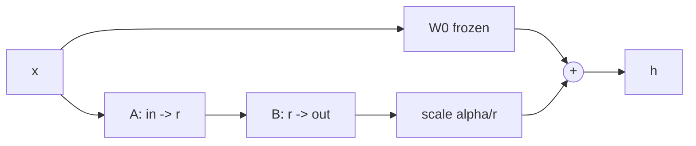

# Fine-Tuning and LoRA

> Freeze the giant, train a tiny low-rank correction next to it, and fold it back in when you are done.

**Type:** Build
**Languages:** Python
**Prerequisites:** Phase 09 (LLMs: GPT from Scratch), Phase 03 (CNNs: Transfer Learning)
**Time:** ~75 minutes

## Learning Objectives

- Adapt a pretrained GPT to a new text format with full fine-tuning and measure catastrophic forgetting
- Implement LoRA from scratch: a frozen `nn.Linear` plus a trainable `B A` update with `B` initialized to zero
- Compare trainable parameters, task loss and forgetting across full fine-tuning and LoRA ranks
- Merge LoRA adapters into the base weights for zero-overhead inference, and express the same update with `torch.nn.utils.parametrize`

## The Problem

Pretraining gives you a model that knows a lot of language. Your product needs something narrower: a support bot, a SQL writer, a model that fills in a log format. You fine-tune: keep training the pretrained weights on your own data.

Full fine-tuning updates every weight. For a 7B-parameter model in float32 with Adam that is 7B weights plus 7B gradients plus 14B optimizer moments, more than 100 GB of GPU memory, and every fine-tuned variant is another 28 GB checkpoint to store and serve. It also tends to overwrite what the model knew before.

LoRA (Hu et al., 2021) observed that the weight change needed for adaptation has low intrinsic rank. Instead of learning a full `d x k` update, learn two thin matrices whose product is that update. You train well under 1% of the parameters of a large model, the base stays frozen and shared, and an adapter is a few megabytes.

## The Concept

### Full fine-tuning

```
W  <-  W - lr * dL/dW        for every weight in the model
```

Same loop as pretraining, smaller learning rate, new data. The risk is catastrophic forgetting: gradients from the new task freely move weights the old behavior depended on.

### Low-rank adaptation

For a frozen weight `W0` of shape `(out, in)`:

```
h = W0 x + (alpha / r) * B A x

A: (r, in)    random init
B: (out, r)   zero init
```



Three details matter:

- **Zero init of B.** At step 0, `B A = 0`, so the adapted model is exactly the pretrained one. Training starts from the base, not from noise.
- **Parameter count.** A full update costs `out * in` parameters; LoRA costs `r * (out + in)`. For a `4096 x 4096` projection with `r = 8`, that is 16.8M versus 65k, a 256x reduction.
- **The scale `alpha / r`.** Keeps the update magnitude roughly constant when you change `r`, so you do not retune the learning rate for every rank.

### Where to put adapters

The original paper adapted only the query and value projections. Modern practice (QLoRA and most libraries' defaults) adapts every linear layer in attention and the MLP, which costs little and usually helps. Embeddings, LayerNorms and the output head usually stay frozen.

### Merging

After training, `W = W0 + (alpha / r) B A` is an ordinary matrix of the original shape. Replace each adapted layer by a plain `nn.Linear` with that weight and inference costs exactly what the base model costs. Or keep adapters separate and swap them per request on one shared base.

### What LoRA trades away

LoRA restricts the update to rank `r`. Biderman et al. (2024) summarize the empirical picture as "LoRA learns less and forgets less": it usually reaches a slightly worse loss on the new task than full fine-tuning, and damages the original abilities less. Your experiment reproduces both halves.

## Build It

```bash
uv run python phases/09-llms/06-fine-tuning-and-lora/code/main.py
```

### Step 1: A base model and a new task

The base GPT (108k parameters) is pretrained on the story. The new task is a keeper's logbook in a rigid format that the story never contains:

```
day 2: wind from the west, waves calm, rain, two boats came home.
```

Before fine-tuning, the base model has logbook loss 2.41 and, prompted with `"day 5: "`, keeps telling the story: `"the lighthouse stayed the same, and he waves..."`.

### Step 2: Full fine-tuning

Copy the base, train every weight for 300 steps at learning rate `1e-3` on the logbook:

```
trainable 108,288 (100%)
story loss 2.719 | logbook val loss 0.182
sample: 'day 5: wind from the east, waves calm, fog, two boats came home.'
```

It learned the format perfectly and lost the story: loss on it went from 0.54 to 2.72, worse than a model that knows only character frequencies.

### Step 3: LoRA by hand

```python
class LoRALinear(nn.Module):
    def __init__(self, base, rank, alpha):
        super().__init__()
        self.base = base
        self.scale = alpha / rank
        self.lora_a = nn.Parameter(torch.randn(rank, base.in_features) / math.sqrt(base.in_features))
        self.lora_b = nn.Parameter(torch.zeros(base.out_features, rank))

    def forward(self, x):
        return self.base(x) + (x @ self.lora_a.T @ self.lora_b.T) * self.scale
```

`add_lora` freezes every parameter of the model, then swaps each `qkv`, `proj`, `fc` and `out` linear in every block for a `LoRALinear` wrapping it. The script checks that the wrapped model gives exactly the base output before training. With rank 4:

```
trainable 8,192 (7.6%)
story loss 2.211 | logbook val loss 0.260
sample: 'day 5: wind from the north, waves rough, grey sky, three boats came'
```

The format is learned with 13x fewer trainable parameters (on a tiny model the ratio is modest; on a 7B model it is hundreds), the task loss is a little worse, and the story is damaged less (2.21 versus 2.72).

### Step 4: The rank knob

```
rank  1 | trainable  2,048 | story 1.702 | logbook val 0.576
rank  4 | trainable  8,192 | story 2.211 | logbook val 0.260
rank 16 | trainable 32,768 | story 2.657 | logbook val 0.192
```

Rank is a dial between "barely changes the model" and "full fine-tuning". Rank 16 nearly matches full fine-tuning on the task and forgets almost as much.

### Step 5: Merge

```python
def merged(self):
    merged = nn.Linear(self.base.in_features, self.base.out_features, bias=self.base.bias is not None)
    with torch.no_grad():
        merged.weight.copy_(self.base.weight + self.scale * self.lora_b @ self.lora_a)
        if self.base.bias is not None:
            merged.bias.copy_(self.base.bias)
    return merged
```

The merged model matches the adapter model to `5e-6` (float32 rounding) and has exactly the base parameter count.

## Use It

PyTorch has a built-in mechanism for "this weight is computed from other parameters": `torch.nn.utils.parametrize`. Register a module that maps `W0` to `W0 + scale * B A` and the existing `nn.Linear` uses it transparently:

```python
class LoRAParametrization(nn.Module):
    def forward(self, weight):
        return weight + self.scale * self.lora_b @ self.lora_a

parametrize.register_parametrization(layer, "weight", LoRAParametrization(a, b, scale))
```

With the trained adapter matrices it matches `LoRALinear` to `1e-6`. In real projects you would use Hugging Face PEFT:

```python
from peft import LoraConfig, get_peft_model
config = LoraConfig(r=8, lora_alpha=16, target_modules=["q_proj", "k_proj", "v_proj", "o_proj"], lora_dropout=0.05)
model = get_peft_model(model, config)
model.print_trainable_parameters()
model = model.merge_and_unload()
```

The same four ideas (frozen base, low-rank `B A`, zero-init `B`, merge) are all there. QLoRA adds one more: store the frozen base in 4-bit precision, which lets you fine-tune a 65B model on a single 48 GB GPU.

## Exercises

1. **Easy.** Rerun full fine-tuning with learning rate `3e-4`. How do task loss and forgetting compare with rank-4 LoRA at `1e-3`?
2. **Medium.** Adapt only `attn.qkv` (the original paper's choice of attention projections) and compare with adapting all four linears at the same total number of trainable parameters (pick ranks to match).
3. **Hard.** Train two adapters on two different formats (the logbook and, for example, a list of `"stair N: ..."` lines). Serve both from one frozen base by switching adapters, and check that each still produces its own format and that the base output is untouched.

## Key Terms

| Term | What people say | What it actually means |
|------|----------------|----------------------|
| Fine-tuning | "Training on my data" | Continuing gradient descent from pretrained weights on a new dataset |
| Catastrophic forgetting | "It got dumber" | Loss of earlier abilities because new gradients overwrite weights they relied on |
| LoRA | "Cheap fine-tuning" | Learning a low-rank update `B A` next to each frozen weight matrix |
| Rank r | "Adapter size" | Inner dimension of `B A`; controls capacity and parameter count `r (in + out)` |
| alpha | "LoRA scale" | Multiplies the update by `alpha / r` so its size is stable across ranks |
| Adapter | "The LoRA file" | The trained `A` and `B` matrices, stored separately from the base model |
| Merging | "Baking in the LoRA" | Adding `scale * B A` to `W0` so inference uses plain linear layers |
| PEFT | "Parameter-efficient fine-tuning" | Methods (LoRA, prefix tuning, adapters) that train a small fraction of the weights |

## Further Reading

- [Hu et al. (2021): LoRA: Low-Rank Adaptation of Large Language Models](https://arxiv.org/abs/2106.09685) - the original method and the low intrinsic rank argument
- [Dettmers et al. (2023): QLoRA: Efficient Finetuning of Quantized LLMs](https://arxiv.org/abs/2305.14314) - LoRA on a 4-bit frozen base
- [Biderman et al. (2024): LoRA Learns Less and Forgets Less](https://arxiv.org/abs/2405.09673) - a careful comparison with full fine-tuning
- [PyTorch tutorial: Parametrizations](https://pytorch.org/tutorials/intermediate/parametrizations.html) - the `register_parametrization` mechanism used in Use It
