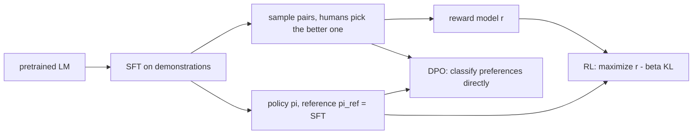

# RLHF and DPO

> You cannot write down what "good" means, but people can tell you which of two answers is better. Learn from that.

**Type:** Build
**Languages:** Python
**Prerequisites:** Phase 09 (LLMs: GPT from Scratch, Fine-Tuning and LoRA)
**Time:** ~90 minutes

## Learning Objectives

- Describe the three-stage alignment pipeline: supervised fine-tuning, reward modeling from pairwise preferences, and reinforcement learning with a KL penalty
- Train a reward model with the Bradley-Terry loss `-log sigmoid(r_chosen - r_rejected)`
- Optimize a policy with REINFORCE against the reward model and a KL penalty, and observe reward hacking when the penalty is removed
- Derive and implement Direct Preference Optimization (DPO), which skips the reward model and the RL loop entirely

## The Problem

A pretrained and fine-tuned model imitates its training data. Imitation is not the same as being helpful: the data contains good and bad answers, and the model reproduces both. You would like to optimize "how good is this answer", but no one can write that as a differentiable loss.

What humans can do cheaply is compare. Shown two answers to the same prompt, a labeler can say which one is better, even if they could not write the perfect answer themselves. InstructGPT (Ouyang et al., 2022), the recipe behind ChatGPT, turned such comparisons into a training signal with RLHF. DPO (Rafailov et al., 2023) later showed you can get the same objective with a simple classification loss, and it became the default for open models.

Real preferences are expensive, so this lesson uses a toy task with a hidden "human": responses are 8 digits, and the labeler prefers responses with more rising steps (`0 3 5 8` is good, `9 4 2 1` is bad). The policy never sees this rule, only noisy comparisons.

## The Concept

### The pipeline



### Bradley-Terry preferences

Assume each response `y` has a latent score `r(y)` and a labeler prefers `y_w` over `y_l` with probability:

```
P(y_w > y_l) = sigmoid(r(y_w) - r(y_l))
```

Fitting `r` by maximum likelihood on the labeled pairs gives the reward model loss:

```
L_RM = -log sigmoid(r(y_w) - r(y_l))
```

It is logistic regression on score differences. The reward model is usually the SFT model with its token head replaced by a scalar head.

### RLHF objective

```
maximize   E_{y ~ pi} [ r(y) ]  -  beta * KL(pi || pi_ref)
```

The KL term keeps the policy close to the SFT model. Without it the policy finds whatever inputs the imperfect reward model overrates (reward hacking) and collapses onto them. The per-sample estimate `log pi(y) - log pi_ref(y)` is subtracted from the reward.

The gradient of the expectation uses the score function (REINFORCE):

```
grad = E[ A(y) * grad log pi(y) ],     A(y) = R(y) - baseline
```

InstructGPT used PPO, which adds a clipped importance ratio so several gradient steps can reuse one batch of samples. The idea is the same.

### DPO

The KL-regularized objective has a closed-form optimum:

```
pi*(y) = pi_ref(y) * exp(r(y) / beta) / Z
```

Solve for the reward: `r(y) = beta * log(pi*(y) / pi_ref(y)) + beta * log Z`. Plug that into the Bradley-Terry loss; `Z` cancels in the difference:

```
L_DPO = -log sigmoid( beta * [ (log pi(y_w) - log pi_ref(y_w)) - (log pi(y_l) - log pi_ref(y_l)) ] )
```

No reward model, no sampling, no RL. The policy itself is the reward model: `beta * log(pi / pi_ref)` is its implicit reward. Larger `beta` keeps the policy closer to the reference.

## Build It

```bash
uv run python phases/09-llms/07-rlhf-and-dpo/code/main.py
```

### Step 1: SFT

The policy is a tiny GPT over 10 digits plus a `BOS` token. Trained on random demonstrations, it samples nearly uniform digit strings with an average true reward of 3.19 (the expected number of rising steps in 8 random digits is `7 x 0.45 = 3.15`).

### Step 2: Preferences

```python
first = sample(policy, num_pairs, device, generator)
second = sample(policy, num_pairs, device, generator)
prob_first_wins = torch.sigmoid(2.0 * (true_reward(first) - true_reward(second)))
first_wins = torch.rand(num_pairs, generator=generator, device=device) < prob_first_wins
```

The labeler is noisy on purpose: on pairs where one response really is better, it picks that one about 90% of the time.

### Step 3: Reward model

```python
margin = reward_model(chosen[index]) - reward_model(rejected[index])
loss = -F.logsigmoid(margin).mean()
```

The reward model is the SFT backbone with a scalar head on the last position. It ranks about 75% of held-out non-tied pairs correctly and scores `0 1 2 3 4 5 6 7` far above `7 6 5 4 3 2 1 0`. It is a decent but imperfect proxy, like every real reward model.

### Step 4: RLHF

```python
responses = sample(policy, 256, device, generator)
log_prob = sequence_log_prob(policy, responses)
with torch.no_grad():
    kl_per_sample = log_prob - sequence_log_prob(reference, responses)
    total_reward = reward_model(responses) - beta * kl_per_sample
    advantage = (total_reward - total_reward.mean()) / (total_reward.std() + 1e-6)
loss = -(advantage * log_prob).mean()
```

The batch mean is the baseline; normalizing the advantage keeps the step size stable.

### Step 5: DPO

```python
logits = beta * ((policy_chosen - reference_chosen) - (policy_rejected - reference_rejected))
loss = -F.logsigmoid(logits).mean()
```

Four log-probabilities per pair, two of them from the frozen reference.

### Results

GPU run (CPU numbers differ slightly because the random streams differ):

```
policy         true reward RM reward KL to SFT  samples
SFT                   3.22      0.63      0.00  03044740  00660200  71592062
RLHF beta=0.1         4.67      3.15      5.91  03044849  00230259  28023809
RLHF beta=0.0         4.98      3.39     15.51  03818139  13818239  13818139
DPO beta=0.1          5.93      2.68      8.91  03567916  01359258  13579017
DPO beta=0.5          5.35      2.40      3.94  03014780  00120258  11591569
```

- Every method raises the true reward the policy never saw. Preferences alone were enough.
- RLHF without the KL penalty collapses onto near-copies of one sequence (`13818139`): the reward model rates it highly, the policy found it, and diversity is gone. The KL to the SFT model is the highest in the table. That is reward hacking in miniature.
- DPO's `beta` behaves like RLHF's: `beta = 0.5` stays closer to the reference (KL 3.9) and gains less than `beta = 0.1`.
- In this toy, DPO beats RLHF on the true reward because it learns from the preference data directly instead of through an imperfect reward model. At scale the comparison is more nuanced, and well-tuned PPO is still competitive.

## Use It

DPO is binary logistic regression where the logit is the implicit reward margin. The script checks that `-F.logsigmoid(logits).mean()` equals `F.binary_cross_entropy_with_logits(logits, ones)`, and that the DPO policy's implicit reward ranks held-out pairs correctly about three quarters of the time: the policy became a reward model as a side effect.

In practice you would use Hugging Face TRL:

```python
from trl import DPOConfig, DPOTrainer
trainer = DPOTrainer(model=model, ref_model=ref_model, args=DPOConfig(beta=0.1), train_dataset=pairs, processing_class=tokenizer)
trainer.train()
```

The dataset has `prompt`, `chosen` and `rejected` columns; the trainer computes exactly the four log-probabilities you computed here, summed over response tokens only. TRL also ships `PPOTrainer` and `RewardTrainer` for the full RLHF pipeline, and newer variants like GRPO (used for reasoning models) replace the learned critic with group-relative baselines, the same trick as the batch-mean baseline above.

## Exercises

1. **Easy.** Run RLHF with `beta` equal to 0.5 and 1.0. Plot true reward against KL for all `beta` values of both methods. Which method gets more reward per nat of KL?
2. **Medium.** Make the reward model worse by training it on only 500 pairs. Rerun RLHF and DPO. Which one degrades more, and why?
3. **Hard.** Implement PPO's clipped objective: store `log pi_old` for a batch, take 4 gradient steps on `min(ratio * A, clip(ratio, 0.8, 1.2) * A)` where `ratio = exp(log pi - log pi_old)`, and compare sample efficiency with plain REINFORCE.

## Key Terms

| Term | What people say | What it actually means |
|------|----------------|----------------------|
| SFT | "Instruction tuning" | Supervised fine-tuning on demonstration responses; the starting policy and reference |
| Preference pair | "Thumbs up / thumbs down" | Two responses to the same prompt with a label for which one is better |
| Bradley-Terry | "Elo for answers" | Model where `P(a beats b) = sigmoid(r(a) - r(b))` |
| Reward model | "The judge" | A network trained on preference pairs to output a scalar score |
| KL penalty | "Stay close to SFT" | `beta * (log pi - log pi_ref)` subtracted from the reward to prevent drifting |
| Reward hacking | "Gaming the metric" | The policy exploiting errors of the reward model instead of improving |
| PPO | "The RL in RLHF" | Policy gradient with a clipped importance ratio for stable multi-step updates |
| DPO | "RLHF without RL" | Classification loss on preference pairs whose optimum equals the KL-regularized RLHF optimum |

## Further Reading

- [Ouyang et al. (2022): Training language models to follow instructions with human feedback](https://arxiv.org/abs/2203.02155) - InstructGPT, the SFT plus reward model plus PPO recipe
- [Christiano et al. (2017): Deep Reinforcement Learning from Human Preferences](https://arxiv.org/abs/1706.03741) - the original preference-based RL paper
- [Rafailov et al. (2023): Direct Preference Optimization: Your Language Model is Secretly a Reward Model](https://arxiv.org/abs/2305.18290) - the DPO derivation
- [Hugging Face blog: Illustrating Reinforcement Learning from Human Feedback](https://huggingface.co/blog/rlhf) - a visual walkthrough of the full pipeline
