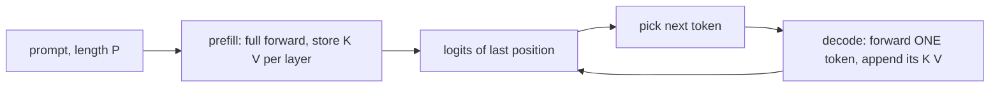

# Inference: The KV Cache

> Past tokens never change, so their keys and values never change. Compute them once and keep them.

**Type:** Build
**Languages:** Python
**Prerequisites:** Phase 09 (LLMs: GPT from Scratch, Sampling and Decoding), Phase 05 (Transformers: Efficient Attention)
**Time:** ~60 minutes

## Learning Objectives

- Explain why naive autoregressive generation recomputes the whole prefix at every step, and what that costs
- Implement a KV cache: a prefill pass over the prompt, then one-token decode steps that append to cached keys and values
- Verify that cached and uncached generation produce the same tokens and logits, and measure the speedup
- Compute the memory footprint of the cache and explain how grouped-query attention shrinks it

## The Problem

The generation loop from the GPT lesson calls `model(ids)` on the entire sequence for every new token. To produce token 300 it reprocesses tokens 0 to 299, even though their representations are identical to the last step: the causal mask guarantees that position `i` never depends on anything after it.

The total work is quadratic in the output length for the projections and MLPs (`1 + 2 + ... + T` positions) and cubic for attention. Every chat model, from your laptop to a data center, avoids this with the KV cache. It is the single most important inference optimization for transformers, and it turns the bottleneck from compute into memory.

## The Concept

### What can be reused

In each attention layer, position `t` produces a query `q_t`, a key `k_t` and a value `v_t` from its hidden state. The output at position `t` is:

```
out_t = softmax(q_t [k_0 .. k_t]^T / sqrt(d)) [v_0 .. v_t]
```

When you add token `t + 1`, the keys and values of positions `0..t` are unchanged (their hidden states depend only on earlier tokens). Only the new position needs its `q`, `k`, `v`, and only its output is needed to predict the next token.

### Prefill and decode



- **Prefill** runs the whole prompt in parallel (compute-bound, like training).
- **Decode** runs one position per step: query length 1, key length `P + t` (memory-bound: each step reads the entire cache).

### Shapes

Per layer, the cache holds two tensors of shape `(batch, heads, positions, head_dim)`. One new step:

```
x_new:   (B, 1, C)
q, k, v: (B, H, 1, D)
K = cat(K_cache, k)   (B, H, t+1, D)
scores = q K^T        (B, H, 1, t+1)
```

The causal mask is no longer needed for a single query: it may attend to everything in the cache. The position embedding must use the absolute position `t`, not 0.

### Cost

| | Positions through MLPs per sequence | Attention work |
|---|---|---|
| No cache | `sum_{t} (P + t)`, quadratic | cubic |
| KV cache | `P + T`, linear | quadratic |

### Memory

```
cache bytes = 2 (K and V) x layers x kv_heads x head_dim x positions x bytes per value
```

For a 7B-class model (32 layers, 32 heads of 128 dims) at 4096 tokens in fp16, that is 2 GB per sequence. A batch of 32 needs 64 GB, more than the weights. This is why long contexts are expensive and why inference servers manage the cache like virtual memory (vLLM's PagedAttention).

Grouped-query attention (GQA, used by Llama 2 70B, Llama 3, Mistral) shares each key/value head among several query heads. With 8 KV heads instead of 32 the cache is 4x smaller with almost no quality loss. Multi-query attention takes this to a single KV head.

## Build It

```bash
uv run python phases/09-llms/08-inference-kv-cache/code/main.py
```

### Step 1: Attention that accepts a cache

```python
def forward(self, x, cache=None):
    batch, length, embed_dim = x.shape
    q, k, v = self.qkv(x).view(batch, length, 3, self.num_heads, self.head_dim).permute(2, 0, 3, 1, 4)
    past_length = 0
    if cache is not None:
        past_k, past_v = cache
        past_length = past_k.shape[2]
        k = torch.cat([past_k, k], dim=2)
        v = torch.cat([past_v, v], dim=2)
    new_cache = (k, v)
    total_length = k.shape[2]
    scores = q @ k.transpose(-2, -1) / math.sqrt(self.head_dim)
    scores = scores.masked_fill(~self.mask[past_length:total_length, :total_length], float("-inf"))
    out = F.softmax(scores, dim=-1) @ v
    out = out.transpose(1, 2).reshape(batch, length, embed_dim)
    return self.proj(out), new_cache
```

The mask slice `[past_length:total_length, :total_length]` works for both cases: for prefill it is the usual lower triangle, for a one-token step it is a single all-true row. The same code serves both.

### Step 2: Positions with an offset

```python
past_length = 0 if caches is None else caches[0][0].shape[2]
positions = torch.arange(past_length, past_length + ids.shape[1], device=ids.device)
```

Forget this and every decoded token thinks it is at position 0: the output silently degrades.

### Step 3: Two generation loops

```python
def generate_cached(model, prompt_ids, max_new_tokens):
    logits, caches = model(prompt_ids)
    ids = prompt_ids
    for step in range(max_new_tokens):
        next_id = logits[:, -1].argmax(-1, keepdim=True)
        ids = torch.cat([ids, next_id], dim=1)
        if step < max_new_tokens - 1:
            logits, caches = model(next_id, caches)
    return ids
```

The naive loop calls `model(ids)` on the growing sequence. On the trained character model both produce the same 110 tokens, with logits equal to `5e-6` (float rounding from different summation orders).

### Step 4: Measure

On a wider random model with context 512, a batch of 8 sequences, 300 new tokens each:

```
CPU, 1 thread:
without cache  22.77s (  105 tokens/s)
with cache      0.96s ( 2500 tokens/s) | speedup 23.7x
GPU:
without cache   0.91s ( 2636 tokens/s)
with cache      0.55s ( 4403 tokens/s) | speedup 1.7x
positions pushed through the MLPs per sequence: naive 49,650 vs cached 315
```

The cache removes 99% of the work. On a GPU the speedup is small for this tiny model because each step is dominated by kernel launch overhead, not arithmetic; at real model sizes the GPU numbers look like the CPU ones.

### Step 5: Memory arithmetic

```
7B-class model, 4096 tokens, fp16:             2.00 GB per sequence
same model with grouped-query attention (8 KV): 0.50 GB per sequence
a batch of 32 with full multi-head attention:  64 GB
```

## Use It

Switch the attention to `F.scaled_dot_product_attention(q, k, v, attn_mask=mask)` with the same sliced boolean mask (`True` means attend) and generation is unchanged: same tokens, logits within `4e-6`. Fused kernels such as FlashAttention-2's decode path read the cache once per step, which is what makes decode fast on GPUs.

In Hugging Face Transformers the cache is on by default:

```python
out = model(input_ids, use_cache=True)
next_out = model(next_token, past_key_values=out.past_key_values, use_cache=True)
model.generate(input_ids, max_new_tokens=100)
```

Production servers (vLLM, TensorRT-LLM, SGLang) add paged cache allocation, prefix sharing between requests that start with the same system prompt, quantized (int8 or fp8) caches, and continuous batching that adds new requests to a running batch between decode steps.

## Exercises

1. **Easy.** Remove the position offset (always use positions starting at 0) and compare cached and naive outputs. How many tokens match before they diverge?
2. **Medium.** Implement grouped-query attention: project to 4 query heads but only 2 key/value heads, and repeat each KV head twice before the score computation. Verify the cache shape halves and generation still works after training.
3. **Hard.** Implement a sliding-window cache that keeps only the last 64 positions (as in Mistral). Train with a matching banded attention mask and measure memory and output quality for 500 generated tokens.

## Key Terms

| Term | What people say | What it actually means |
|------|----------------|----------------------|
| KV cache | "Caching the context" | Stored keys and values of all previous positions in every layer |
| Prefill | "Processing the prompt" | One parallel forward pass over the prompt that fills the cache |
| Decode step | "Generating a token" | A forward pass of one new position that reads and appends to the cache |
| Memory-bound | "Waiting on memory" | Speed limited by reading weights and cache, not by arithmetic |
| Grouped-query attention | "GQA" | Several query heads share one key/value head, shrinking the cache |
| Multi-query attention | "MQA" | All query heads share a single key/value head |
| PagedAttention | "vLLM's trick" | Allocating the cache in fixed-size blocks to avoid fragmentation and share prefixes |

## Further Reading

- [Pope et al. (2022): Efficiently Scaling Transformer Inference](https://arxiv.org/abs/2211.05102) - prefill versus decode, memory bandwidth and partitioning
- [Ainslie et al. (2023): GQA: Training Generalized Multi-Query Transformer Models](https://arxiv.org/abs/2305.13245) - grouped-query attention and its cache savings
- [Kwon et al. (2023): Efficient Memory Management for Large Language Model Serving with PagedAttention](https://arxiv.org/abs/2309.06180) - the vLLM paper
- [Hugging Face docs: KV cache strategies](https://huggingface.co/docs/transformers/kv_cache) - dynamic, static and quantized caches in practice
