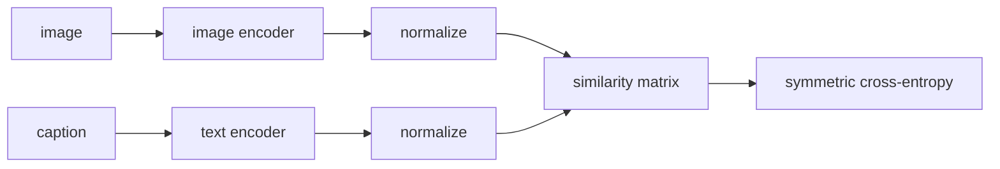

# Image-Text Embeddings (CLIP)

> Put images and sentences in the same space, pull matching pairs together, push everything else apart, and classification becomes a text query.

**Type:** Build
**Languages:** Python
**Prerequisites:** Phase 06 (Autoencoders and Self-Supervised: Contrastive Learning, Representation Learning and Embeddings), Phase 04 (Sequence Models: Word Embeddings)
**Time:** ~60 minutes

## Learning Objectives

- Build a two-tower model: an image encoder and a text encoder that map into one normalized embedding space
- Implement the symmetric InfoNCE loss over a batch of image-caption pairs, with a learnable temperature
- Classify images zero-shot by embedding one caption per class, and use prompt ensembles and unseen prompts
- Explain the false-negative floor of contrastive loss and evaluate embeddings with a linear probe

## The Problem

A classifier trained on ten labels can only ever say one of those ten labels. To add a class you collect labeled images and retrain. Meanwhile the internet is full of images with free-form text next to them: alt text, captions, titles.

CLIP (Radford et al., 2021) trained on 400 million such image-text pairs with one simple objective: given a batch, figure out which caption belongs to which image. The result is an image encoder and a text encoder whose outputs are comparable. You can classify with classes you invent at test time ("a photo of a lighthouse"), search images with sentences, and condition image generators on text embeddings (lesson 04). It is the foundation of most vision-language systems.

You will build the same thing on a small scale: the 8 x 8 handwritten digits from scikit-learn, each paired with a generated caption like `"a handwritten seven"` or `"someone wrote a four"`.

## The Concept

### Two towers



Both encoders output a `d`-dimensional vector, L2-normalized, so the dot product is cosine similarity. The towers never see each other's input; they only meet in the loss.

### The contrastive loss

For a batch of `N` pairs, compute the `N x N` similarity matrix scaled by a temperature `tau`:

```
logits[i, j] = cos(image_i, text_j) / tau
```

```
            text_0  text_1  text_2  text_3
image_0   [  high    low     low     low  ]
image_1   [  low     high    low     low  ]
image_2   [  low     low     high    low  ]
image_3   [  low     low     low     high ]
```

Each row is a classification problem over `N` captions whose correct answer is the diagonal; each column is the same problem from the text side. The loss averages both cross-entropies:

```
L = 1/2 * [ CE(rows, diagonal) + CE(columns, diagonal) ]
CE row i = logsumexp_j(logits[i, j]) - logits[i, i]
```

A random model scores about `ln N`. The temperature is learned (CLIP initializes `tau = 0.07` and parameterizes `log(1 / tau)`), because how peaked the softmax should be depends on how separable the embeddings become.

### False negatives

The loss assumes every off-diagonal caption is wrong. With ten digit classes and a batch of 128, each image shares its class with about 13 other captions that describe it just as well. The model cannot tell them apart, so the best it can do is split probability evenly across them, and the loss floor is roughly `ln 14 ~= 2.6`. That is exactly where your training curve plateaus. On web data, duplicates and near-duplicate captions cause the same effect at a smaller scale.

### Zero-shot classification

Turn each class into text, embed it, and pick the class whose text embedding is closest to the image:

```
class_embedding[c] = normalize(text_encoder("a handwritten " + name[c]))
prediction = argmax_c  cos(image, class_embedding[c])
```

Prompt ensembling averages the embeddings of several templates per class, which CLIP found worth a few points of accuracy on ImageNet.

## Build It

```bash
uv run python phases/10-multimodal/01-image-text-embeddings-clip/code/main.py
```

### Step 1: Captions and a word tokenizer

```python
TRAIN_TEMPLATES = ["a handwritten {}", "the digit {}", "a scan of the number {}", "a small picture of a {}", "someone wrote a {}"]

def make_captions(labels, rng):
    templates = rng.integers(0, len(TRAIN_TEMPLATES), size=len(labels))
    return [TRAIN_TEMPLATES[t].format(DIGIT_NAMES[y]) for t, y in zip(templates, labels)]
```

Every training step draws fresh templates, so the same image is seen with different captions. The tokenizer is a word list with `<pad>` and `<unk>`.

### Step 2: The towers

The image encoder is an MLP on the 64 pixels. The text encoder averages word embeddings over non-padding tokens and passes them through an MLP. Real CLIP uses a ViT or ResNet and a transformer; for this caption grammar, bag-of-words is enough.

```python
def forward(self, images, ids):
    scale = self.logit_scale.exp().clamp(max=100)
    return scale * self.encode_image(images) @ self.encode_text(ids).T
```

The clamp at 100 (temperature 0.01) is the same safeguard CLIP uses against an exploding scale.

### Step 3: The loss by hand

```python
def symmetric_info_nce(logits):
    diagonal = logits.diagonal()
    image_to_text = (torch.logsumexp(logits, dim=1) - diagonal).mean()
    text_to_image = (torch.logsumexp(logits, dim=0) - diagonal).mean()
    return (image_to_text + text_to_image) / 2
```

Training for 600 steps with batch 128:

```
step   0 | loss 6.162 (chance ln 128 = 4.85)
step 150 | loss 2.686
step 600 | loss 2.608 | captions per batch sharing the image's class 13.9
```

The plateau at 2.6 is the false-negative floor `ln 14`, not a failure to learn.

### Step 4: Zero-shot and retrieval

```
prompt 'a handwritten {}'        test accuracy 0.975
ensemble of 5 training prompts  test accuracy 0.975
unseen prompt 'a blurry drawing of the number {}': 0.967
```

The unseen prompt contains two words the model never saw (`blurry`, `drawing` map to `<unk>`), and still works because the digit name dominates the averaged text embedding. Text-to-image retrieval returns ten correct images for `"a handwritten seven"`, `"the digit zero"` and `"someone wrote a four"`. In the shared space, an image has cosine 0.84 with its own class prompt and 0.06 with another class's.

## Use It

The hand loss equals the standard implementation, which is plain cross-entropy with `arange(N)` targets applied to the matrix and its transpose:

```python
targets = torch.arange(N)
loss = (F.cross_entropy(logits, targets) + F.cross_entropy(logits.T, targets)) / 2
```

A linear probe (scikit-learn logistic regression on frozen image embeddings) reaches 0.972, roughly the zero-shot accuracy and above logistic regression on raw pixels (0.96): the contrastive objective organized the image space by class without ever seeing a label, only captions.

With real data you would load a pretrained model from OpenCLIP or Hugging Face:

```python
from transformers import CLIPModel, CLIPProcessor
model = CLIPModel.from_pretrained("openai/clip-vit-base-patch32")
inputs = processor(text=["a photo of a cat", "a photo of a dog"], images=image, return_tensors="pt", padding=True)
probs = model(**inputs).logits_per_image.softmax(dim=1)
```

`logits_per_image` is your `logits` matrix. SigLIP replaces the softmax with an independent sigmoid per pair, which removes the need for the full batch normalization and handles false negatives more gracefully.

## Exercises

1. **Easy.** Train with batch sizes 16, 64 and 256. Predict the loss floor for each from the expected number of same-class captions, then check.
2. **Medium.** Replace the bag-of-words text encoder with a one-layer transformer (hand-written attention from Phase 05) and add captions where word order matters, such as `"a three, not a five"`. Does bag-of-words fail on them?
3. **Hard.** Remove every image of a nine and every caption containing `nine` from training. Show that zero-shot classification fails for that class (the word maps to `<unk>`), then discuss why CLIP can only recognize concepts that appeared, in some form, in its image-text pairs, and what web-scale data changes about that.

## Key Terms

| Term | What people say | What it actually means |
|------|----------------|----------------------|
| CLIP | "The image-text model" | Contrastive Language-Image Pre-training: two encoders trained so matching pairs have high cosine similarity |
| Two-tower model | "Dual encoder" | Separate encoders per modality that interact only through a similarity score |
| InfoNCE | "Contrastive loss" | Cross-entropy that picks the matching pair out of all pairs in the batch |
| Temperature | "Logit scale" | Divisor of the cosine similarities; controls how peaked the softmax is |
| Zero-shot classification | "No training needed" | Classifying by comparing the image with embeddings of class descriptions |
| Prompt ensembling | "Multiple templates" | Averaging text embeddings of several phrasings of each class |
| False negatives | "Duplicates in the batch" | Off-diagonal pairs that actually match, which the loss wrongly pushes apart |
| Linear probe | "Frozen features test" | A linear classifier trained on frozen embeddings to measure their quality |

## Further Reading

- [Radford et al. (2021): Learning Transferable Visual Models From Natural Language Supervision](https://arxiv.org/abs/2103.00020) - the CLIP paper, including prompt engineering and ensembling
- [van den Oord, Li, Vinyals (2018): Representation Learning with Contrastive Predictive Coding](https://arxiv.org/abs/1807.03748) - where the InfoNCE loss comes from
- [Zhai et al. (2023): Sigmoid Loss for Language Image Pre-Training](https://arxiv.org/abs/2303.15343) - SigLIP, the pairwise sigmoid alternative
- [OpenCLIP](https://github.com/mlfoundations/open_clip) - open reproductions of CLIP with training code and pretrained weights
