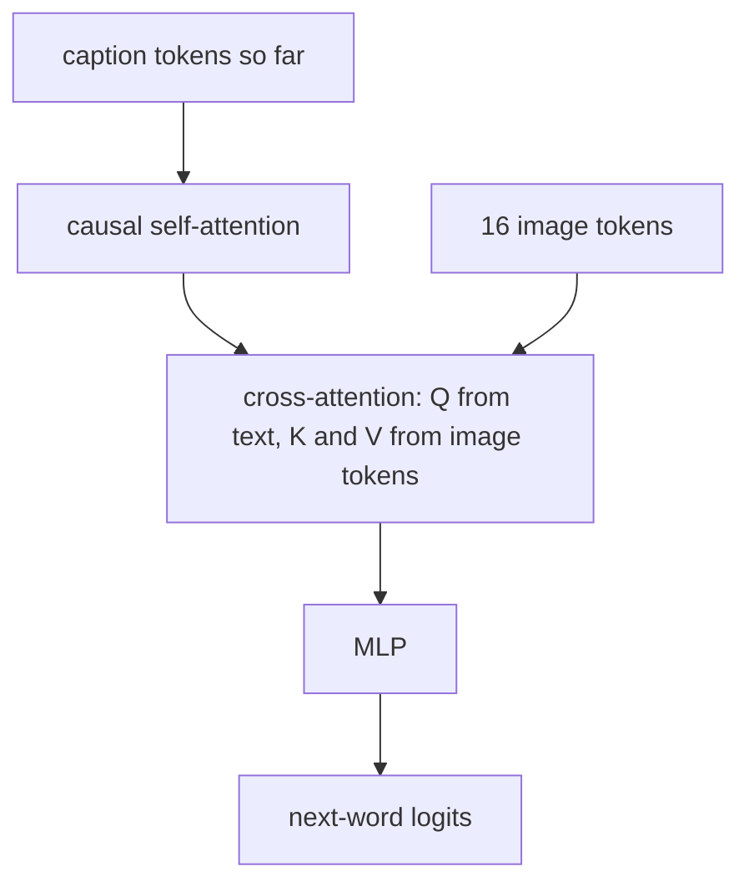

# Image Captioning

> An image encoder turns pixels into a set of vectors; a text decoder writes a sentence by attending to them one word at a time.

**Type:** Build
**Languages:** Python
**Prerequisites:** Phase 04 (Sequence Models: Seq2Seq, Attention), Phase 05 (Transformers: The Transformer Block, Encoders vs Decoders), Phase 03 (CNNs)
**Time:** ~75 minutes

## Learning Objectives

- Build an encoder-decoder captioner: a CNN that outputs a grid of image tokens and a transformer decoder with causal self-attention and cross-attention
- Train with teacher forcing (shifted caption tokens) and generate with greedy decoding
- Evaluate with exact match and per-word accuracy, and test compositional generalization on colour-shape pairs never seen in training
- Inspect cross-attention weights to see where the decoder looks, and rebuild the decoder with `nn.TransformerDecoder`

## The Problem

CLIP from the previous lesson can tell you which caption fits an image best, but only from a list you provide. To describe an image you need a model that writes. Captioning is the simplest image-to-text generation task, and its architecture, a vision encoder whose outputs a language decoder attends to, is the template for many vision-language models, from Show, Attend and Tell (2015) to Flamingo and BLIP.

To keep everything trainable in seconds, the images are 16 x 16 synthetic scenes rendered with NumPy: one shape (circle, square, triangle) in one of four colours, small or big, on the left or the right. The caption describes it: `"a big blue triangle on the left"`. Two colour-shape pairs (green triangle, blue square) never appear in training, so you can ask whether the model learned the concepts separately or just memorized combinations.

## The Concept

### Encoder: pixels to a set of tokens

A CNN downsamples the image twice with stride-2 convolutions:

```
(3, 16, 16) -> conv -> (32, 16, 16) -> conv s2 -> (64, 8, 8) -> conv s2 -> (64, 4, 4)
flatten:  16 image tokens of dimension 64, plus a learned position embedding
```

Each token summarizes one region of the image. Keeping a grid instead of pooling to a single vector is what lets the decoder look at different places for different words.

### Decoder: a GPT that can read the image

Each decoder block has three sublayers:



Cross-attention is ordinary attention where the queries come from the text and the keys and values come from the image:

```
Q = text_hidden W_q        (T x d)
K = image_tokens W_k       (16 x d)
V = image_tokens W_v       (16 x d)
out = softmax(Q K^T / sqrt(d)) V       no causal mask: every word may see the whole image
```

### Teacher forcing

Caption tokens: `<bos> a big blue triangle on the left <eos>`. Feed everything except the last token, predict everything except the first:

```
input:   <bos>  a    big   blue      triangle  on   the   left
target:  a      big  blue  triangle  on        the  left  <eos>
```

The model always conditions on the true previous words during training. At test time it conditions on its own predictions, decoding greedily until `<eos>`.

### Compositional generalization

The training set contains green circles, green squares, blue triangles and blue circles, but no green triangles and no blue squares. A model that represents colour and shape separately should caption them anyway. A model that learned "green things are circles or squares" will not. Neural networks are often worse at this than people expect, and this lesson measures it directly.

## Build It

```bash
uv run python phases/10-multimodal/02-image-captioning/code/main.py
```

### Step 1: Render the data

```python
def render(shape, colour, size, side, rng):
    radius = rng.uniform(2.0, 2.8) if size == "small" else rng.uniform(4.0, 4.8)
    cx = rng.uniform(3.5, 5.0) if side == "left" else rng.uniform(11.0, 12.5)
    cy = rng.uniform(5.0, 11.0)
    y, x = np.mgrid[0:IMAGE_SIZE, 0:IMAGE_SIZE] + 0.5
    if shape == "circle":
        mask = (x - cx) ** 2 + (y - cy) ** 2 <= radius**2
    ...
```

Random radius, centre and pixel noise make every image different. The vocabulary has 17 words including `<pad>`, `<bos>` and `<eos>`.

### Step 2: Attention with an optional causal mask

```python
def forward(self, x, context, causal):
    q = self.q(x).view(batch, length, self.num_heads, self.head_dim).transpose(1, 2)
    k, v = self.kv(context).view(batch, context.shape[1], 2, self.num_heads, self.head_dim).permute(2, 0, 3, 1, 4)
    scores = q @ k.transpose(-2, -1) / math.sqrt(self.head_dim)
    if causal:
        mask = torch.ones(length, context.shape[1], dtype=torch.bool, device=x.device).tril()
        scores = scores.masked_fill(~mask, float("-inf"))
    weights = F.softmax(scores, dim=-1)
    return self.proj((weights @ v).transpose(1, 2).reshape(batch, length, embed_dim))
```

One module serves both roles: self-attention passes the text as `context` with `causal=True`; cross-attention passes the image tokens with `causal=False`.

### Step 3: The decoder block

```python
def forward(self, x, image_tokens):
    h = self.ln1(x)
    x = x + self.self_attn(h, h, causal=True)
    x = x + self.cross_attn(self.ln2(x), image_tokens, causal=False)
    return x + self.mlp(self.ln3(x))
```

### Step 4: Train and decode

800 steps of AdamW, batch 64, cross-entropy on shifted tokens. Loss falls from 2.9 to below 0.01. Greedy decoding:

```python
ids = torch.ones(len(images), 1, dtype=torch.long)
for _ in range(max_length):
    next_id = model.decode_step(ids, image_tokens)[:, -1].argmax(-1, keepdim=True)
    ids = torch.cat([ids, next_id], dim=1)
```

The image is encoded once; only the decoder runs per word.

### Step 5: Evaluate

```
test exact match 0.938 | per word size 0.992, colour 1.000, shape 0.946, side 1.000
novel exact match 0.330 | per word size 1.000, colour 1.000, shape 0.330, side 1.000
```

On familiar combinations, almost everything is right; the remaining errors are small circles and squares, which differ by a handful of pixels at 16 x 16. On the held-out combinations colour, size and side are still perfect, but shape collapses: a green triangle is usually called a green square or circle. The model learned a correlation ("green goes with circle or square") as much as it learned the concept "triangle". The novel-pair number swings a lot between runs and devices (anything from near 0 to about 0.45), another sign that nothing in the training objective pins it down.

### Step 6: Look at cross-attention

For each test image, sum the cross-attention weight on the left two columns of the 4 x 4 grid while the model predicts the colour word:

```
layer 1 predicting the colour word: attention mass on the left half 0.82 (shape on the left) vs 0.16 (shape on the right)
```

Without any supervision on location, the decoder learned to look at the region containing the object when it needs its colour. Exact values vary between runs.

## Use It

PyTorch's `nn.TransformerDecoderLayer` is exactly this block (self-attention, cross-attention, MLP), with `norm_first=True` for pre-LayerNorm:

```python
layer = nn.TransformerDecoderLayer(embed_dim, num_heads, 4 * embed_dim, dropout=0.0, activation="gelu", batch_first=True, norm_first=True)
decoder = nn.TransformerDecoder(layer, num_layers, norm=nn.LayerNorm(embed_dim))
mask = nn.Transformer.generate_square_subsequent_mask(T)
out = decoder(text_embeddings, image_tokens, tgt_mask=mask, tgt_is_causal=True)
```

`memory` (the second argument) is the image tokens. Trained the same way it reaches a similar test exact match and shows the same failure on novel pairs: the limitation is in the data and objective, not your implementation.

Pretrained captioners such as BLIP or GIT follow the same recipe with a ViT encoder and a much larger decoder, pretrained on hundreds of millions of image-text pairs. Captioning quality is usually reported with BLEU, METEOR, CIDEr or SPICE, which compare n-grams or scene graphs with several reference captions; exact match only works here because the grammar is fixed.

## Exercises

1. **Easy.** Replace greedy decoding with beam search (width 3) from Phase 09 (LLMs: Sampling and Decoding). Does exact match change on this fixed-grammar task? Why?
2. **Medium.** Pool the 16 image tokens into a single vector (mean) and feed that as the only cross-attention token. Compare accuracy on the side word and explain the result.
3. **Hard.** Try to improve compositional generalization: add colour jitter augmentation, train separate classification heads for colour and shape on the encoder output, or render more shape variety. Report which intervention moves novel-pair shape accuracy the most across three seeds.

## Key Terms

| Term | What people say | What it actually means |
|------|----------------|----------------------|
| Encoder-decoder | "Seq2seq for images" | A model whose encoder produces a set of vectors that a decoder attends to while generating |
| Image tokens | "Patch features" | The flattened spatial grid of encoder features, one vector per region |
| Cross-attention | "Looking at the image" | Attention with queries from the decoder and keys and values from the encoder output |
| Teacher forcing | "Training on ground truth" | Feeding the true previous tokens during training instead of the model's own predictions |
| Exposure bias | "Train/test mismatch" | At inference the model conditions on its own possibly wrong outputs, which it never saw in training |
| Compositional generalization | "Mixing known concepts" | Correctly handling new combinations of attributes seen separately in training |
| CIDEr / BLEU | "Caption scores" | Metrics comparing n-grams of a generated caption with human references |

## Further Reading

- [Vinyals et al. (2015): Show and Tell: A Neural Image Caption Generator](https://arxiv.org/abs/1411.4555) - CNN encoder plus LSTM decoder
- [Xu et al. (2015): Show, Attend and Tell](https://arxiv.org/abs/1502.03044) - the first captioner with attention over image regions
- [Li et al. (2022): BLIP: Bootstrapping Language-Image Pre-training](https://arxiv.org/abs/2201.12086) - a modern captioner with a ViT encoder and cross-attention decoder
- [PyTorch docs: nn.TransformerDecoderLayer](https://pytorch.org/docs/stable/generated/torch.nn.TransformerDecoderLayer.html) - the library block used in Use It
