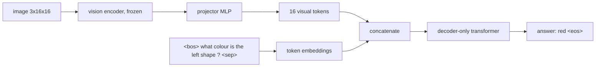

# Vision-Language Models

> Turn image features into a few extra "words" and let a language model read them like text.

**Type:** Build
**Languages:** Python
**Prerequisites:** Phase 10 (Multimodal: Image-Text Embeddings, Image Captioning), Phase 09 (LLMs: GPT from Scratch)
**Time:** ~75 minutes

## Learning Objectives

- Build a LLaVA-style vision-language model: a frozen vision encoder, an MLP projector, and a decoder-only language model that reads image tokens as a prefix
- Format visual question answering as next-token prediction and compute the loss on answer tokens only
- Measure accuracy per question type and compare with a blind, question-only baseline to expose language priors
- Explain the two-stage training recipe (align the projector, then tune the language model) and why the frozen encoder caps accuracy

## The Problem

The captioner from the previous lesson writes one kind of sentence about an image. A useful assistant answers arbitrary questions: how many, which colour, is there a, what is on the left. You could train a separate head per question, but language models already handle open-ended questions and answers. The question is how to feed them an image.

The answer used by LLaVA, Qwen-VL, PaliGemma, and many others is surprisingly direct: run the image through a vision encoder, map each output vector into the language model's embedding space with a small projector, and concatenate those vectors in front of the text embeddings. The language model sees a sequence that starts with "visual words", then the question, and predicts the answer with its ordinary next-token objective. No new attention mechanism, no cross-attention layers.

You will build that pipeline at miniature scale. Each image has up to two shapes (one on the left, one on the right), and questions come from four templates: count, colour of a side, shape on a side, and whether a colour is present.

## The Concept

### Architecture



The full input sequence for one example:

```
[v1 v2 ... v16] <bos> what colour is the left shape ? <sep> red <eos>
 \___image___/  \___________________question__________/  \_answer_/
```

### The projector

The vision encoder's output lives in its own space (here 64 dimensions, from a CNN trained on a different task). The language model expects vectors that look like its token embeddings. LLaVA-1.5 uses a two-layer MLP for this translation:

```
visual_token = W2 GELU(W1 v + b1) + b2
```

It is the only genuinely new component. Everything else is a vision model and a language model that already exist.

### Loss on the answer only

The image and question are given; you do not want the model to spend capacity predicting question words. The loss covers just the answer token and the `<eos>` after it:

```
L = CE(logits at <sep>, answer) + CE(logits at answer, <eos>)
```

Large VLMs do the same: system prompt and user turn are masked, assistant tokens are trained.

### Two-stage training

LLaVA trains in two stages:

| Stage | Trainable | Data | Purpose |
|------|-----------|------|---------|
| 1. Feature alignment | projector only | image-caption pairs | Make visual tokens readable by the frozen LLM |
| 2. Visual instruction tuning | projector + LLM | question-answer conversations | Teach the model to follow visual instructions |

The vision encoder (CLIP ViT in LLaVA) stays frozen in both. Here, the "pretrained" vision encoder is a small CNN trained on a proxy task (predict shape and colour of each side), then frozen, and the language model is trained from scratch together with the projector, which corresponds to stage 2.

### Language priors

A VQA model can score well without looking. If most "is there a ... shape" answers are "no", answering "no" always is right two thirds of the time. The standard check is a blind baseline: the same model with the image removed. The gap between the two is the part of accuracy that actually comes from vision.

## Build It

```bash
uv run python phases/10-multimodal/03-vision-language-models/code/main.py
```

### Step 1: Scenes and questions

```python
def ask(slots, rng):
    kind = rng.choice(["count", "colour", "shape", "exists"])
    if kind == "count":
        return kind, "how many shapes are there ?", ["zero", "one", "two"][sum(v is not None for v in slots.values())]
    ...
```

Each side holds a random shape with probability 0.7; questions about an empty side have the answer `none`. 20,000 training triples are generated in a second.

### Step 2: A frozen vision encoder

A three-layer CNN outputs a `4 x 4` grid of 64-dimensional features. It is trained for 400 steps to predict the shape and colour on each side, then frozen:

```
held-out attribute accuracy: left shape 0.957, left colour 1.000, right shape 0.932, right colour 1.000
```

Remember these numbers: they cap what the VLM can know about shapes.

### Step 3: The VLM forward pass

```python
def forward(self, images, ids, blind=False):
    with torch.no_grad():
        visual = self.vision_encoder(images)
    visual_tokens = self.projector(visual)
    if blind:
        visual_tokens = torch.zeros_like(visual_tokens)
    x = torch.cat([visual_tokens, self.token_embedding(ids)], dim=1)
    x = x + self.position_embedding(torch.arange(x.shape[1], device=x.device))
    logits = self.head(self.ln_final(self.blocks(x)))
    return logits[:, visual_tokens.shape[1] :]
```

The transformer blocks are the causal GPT blocks from Phase 09 with hand-written attention. Visual tokens sit at positions 0 to 15, so every text position can attend to all of them.

### Step 4: Answer-only loss

```python
def answer_loss(logits, ids, answer_position):
    rows = torch.arange(len(ids), device=ids.device)
    answer_logits = logits[rows, answer_position - 1]
    eos_logits = logits[rows, answer_position]
    return (F.cross_entropy(answer_logits, ids[rows, answer_position]) + F.cross_entropy(eos_logits, ids[rows, answer_position + 1])) / 2
```

Only the projector and the language model receive gradients: 114k trainable parameters on top of a 56k frozen encoder.

### Step 5: Evaluate, then remove the image

```
VLM:   overall 0.965 | count 1.000 | colour 0.996 | shape 0.872 | exists 0.988
blind: overall 0.420 | count 0.581 | colour 0.226 | shape 0.182 | exists 0.678
```

Read the blind row as the language prior: two thirds of "is there a red shape" questions are answered "no", so the blind model gets 0.68 without looking, and counting gets 0.58 by always answering the more common count. The image adds 55 points overall.

Colour questions are essentially perfect; shape questions sit just below the frozen encoder's own shape accuracy. The language model cannot recover information the encoder threw away. This is why real VLMs care so much about the vision tower (higher resolution, better CLIP or SigLIP encoders, multiple crops) and why LLaVA-NeXT and Qwen-VL invest in dynamic resolution.

## Use It

The script swaps the hand-written attention for `F.scaled_dot_product_attention(q, k, v, is_causal=True)` in the trained model; logits agree to about `5e-6`.

With Hugging Face Transformers, a real LLaVA follows exactly this structure:

```python
from transformers import AutoProcessor, LlavaForConditionalGeneration
model = LlavaForConditionalGeneration.from_pretrained("llava-hf/llava-1.5-7b-hf")
processor = AutoProcessor.from_pretrained("llava-hf/llava-1.5-7b-hf")
prompt = "USER: <image>\nWhat colour is the shape on the left? ASSISTANT:"
inputs = processor(images=image, text=prompt, return_tensors="pt")
output = model.generate(**inputs, max_new_tokens=20)
```

Inside, `model.vision_tower` is a CLIP ViT-L/14, `model.multi_modal_projector` is a two-layer MLP, and `model.language_model` is a Llama-family LLM. The `<image>` placeholder is replaced by 576 projected patch embeddings, your 16 visual tokens scaled up. The other big family (Flamingo, Llama 3.2 Vision) instead inserts cross-attention layers into the LLM, closer to the captioner from lesson 02.

## Exercises

1. **Easy.** Count the training questions by answer and compute the accuracy of always predicting the most common answer per question template. Compare with the blind baseline.
2. **Medium.** Unfreeze the vision encoder in stage 2 (give it its own learning rate of `1e-4`). Does shape accuracy go above the frozen encoder's attribute accuracy?
3. **Hard.** Replace the 16 visual tokens with a single pooled token and then with 4 tokens (2 x 2 pooling). Plot accuracy per question type against the number of visual tokens, and explain which questions need spatial detail.

## Key Terms

| Term | What people say | What it actually means |
|------|----------------|----------------------|
| VLM | "Multimodal LLM" | A language model that conditions on images, usually through projected visual tokens |
| Vision encoder | "Vision tower" | A pretrained image model (often CLIP or SigLIP ViT) whose patch features feed the LLM |
| Projector | "Adapter" or "connector" | A small MLP mapping vision features into the LLM's token embedding space |
| Visual tokens | "Image embeddings in the prompt" | Projected image features placed in the input sequence like word embeddings |
| Visual instruction tuning | "LLaVA training" | Fine-tuning on image-question-answer conversations so the model follows visual instructions |
| Answer-only loss | "Masking the prompt" | Cross-entropy computed only on response tokens |
| Language prior | "Answering without looking" | Accuracy obtainable from the question alone; measured with a blind baseline |

## Further Reading

- [Liu et al. (2023): Visual Instruction Tuning](https://arxiv.org/abs/2304.08485) - LLaVA: frozen CLIP encoder, projector, LLM, two-stage training
- [Liu et al. (2023): Improved Baselines with Visual Instruction Tuning](https://arxiv.org/abs/2310.03744) - LLaVA-1.5 and the MLP projector
- [Alayrac et al. (2022): Flamingo: a Visual Language Model for Few-Shot Learning](https://arxiv.org/abs/2204.14198) - the cross-attention alternative
- [Goyal et al. (2017): Making the V in VQA Matter](https://arxiv.org/abs/1612.00837) - language priors in VQA and how balanced data fights them
