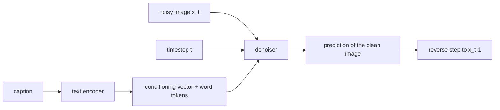

# Text-to-Image Conditioning

> A diffusion model learns to draw; conditioning tells it what. Encode the caption, inject it into every denoising step, and use guidance to turn the volume up.

**Type:** Build
**Languages:** Python
**Prerequisites:** Phase 08 (Diffusion Models: DDPM from Scratch, Classifier-Free Guidance, Latent Diffusion), Phase 10 (Multimodal: Image-Text Embeddings)
**Time:** ~75 minutes

## Learning Objectives

- Encode a caption into a conditioning vector and per-word tokens with a small text encoder trained jointly with the denoiser
- Inject text into a denoiser with FiLM (feature-wise scale and shift), and explain cross-attention conditioning as used in Stable Diffusion
- Train with caption dropout so one network is both conditional and unconditional, then sample with classifier-free guidance
- Grade generated images automatically with a classifier, and read the trade-off between prompt adherence and sample quality as guidance grows

## The Problem

An unconditional diffusion model from Phase 08 generates images that look like the training set, but you cannot ask for anything in particular. Text-to-image systems (DALL-E 2, Imagen, Stable Diffusion) add one ingredient: every denoising step also sees an encoding of the prompt. The model learns `p(image | text)` instead of `p(image)`.

Two questions decide how well this works. How does the text get into the network? And how strongly should the sampler follow it? This lesson answers both on a scale you can train in under a minute: 12 x 12 images of one coloured shape, captions like `"a red triangle on the left"`, 24 possible prompts.

## The Concept

### The pipeline



In Stable Diffusion the text encoder is a frozen CLIP text transformer (lesson 01 of this phase), the denoiser is a U-Net operating on VAE latents (Phase 08: Latent Diffusion), and the conditioning enters through cross-attention. Here the text encoder is tiny and trained jointly, the denoiser is an MLP on raw pixels, and the conditioning enters through FiLM.

### FiLM: scale and shift every feature

Feature-wise Linear Modulation computes, from the conditioning vector `c`, a scale and a shift for every hidden unit:

```
gamma, beta = W c + b
h = SiLU( (W_h x) * (1 + gamma) + beta )
```

The same mechanism injects the timestep (as in most diffusion models), so here `c = time_embedding(t) + text_embedding(caption)`. It is cheap and works well when the condition is a global property ("red", "triangle", "left").

### Cross-attention: let pixels look up words

When prompts are long and different words matter for different regions, a single vector is a bottleneck. Stable Diffusion lets every spatial position of the U-Net attend to the sequence of text tokens:

```
Q = image_tokens W_q        (H*W x d)
K = word_tokens  W_k        (L x d)
V = word_tokens  W_v        (L x d)
out = softmax(Q K^T / sqrt(d)) V
```

The region where the triangle is drawn can attend to the word "triangle", the background to nothing in particular. It is exactly the cross-attention from the captioning lesson with the roles reversed: there text queried the image, here the image queries the text.

### Classifier-free guidance

During training, replace the caption with a null caption 10% of the time. The same network then knows both `p(x | text)` and `p(x)`. At sampling time, extrapolate from the unconditional prediction toward the conditional one:

```
pred = pred_uncond + w * (pred_cond - pred_uncond)
```

| w | Meaning |
|---|---------|
| 0 | Unconditional: ignores the prompt |
| 1 | Plain conditional model |
| > 1 | Exaggerates whatever distinguishes the prompt from "anything" |

Large `w` buys prompt adherence at the cost of diversity and, eventually, saturated colours and artifacts. Stable Diffusion's default is 7.5.

### Predicting the clean image

Phase 08 trained the network to predict the noise `eps`. This lesson predicts the clean image `x0` instead, and uses the DDPM posterior to take the reverse step:

```
mean = [ sqrt(abar_{t-1}) beta_t x0_hat + sqrt(alpha_t) (1 - abar_{t-1}) x_t ] / (1 - abar_t)
```

The two parameterizations are equivalent in theory (`x0 = (x_t - sqrt(1 - abar_t) eps) / sqrt(abar_t)`), but they behave differently with a small network. An MLP whose hidden layer is narrower than the 432 pixels cannot pass enough information through to reproduce 432 independent noise values, while the clean images lie on a tiny manifold that it can easily represent. Guidance works the same way on `x0` predictions.

## Build It

```bash
uv run python phases/10-multimodal/04-text-to-image-conditioning/code/main.py
```

### Step 1: Data and a grader

Shapes are rendered with NumPy and scaled to `[-1, 1]`. A small CNN with three heads (colour, shape, side) is trained on real images and reaches about 0.99 to 1.00 on each attribute. It will grade whether generated images match their prompts.

### Step 2: The text encoder

```python
class TextEncoder(nn.Module):
    def forward(self, ids):
        tokens = self.word_embedding(ids) + self.position_embedding(torch.arange(ids.shape[1], device=ids.device))
        return self.mlp(tokens.flatten(1)), tokens
```

It returns a pooled conditioning vector (for FiLM) and per-word tokens (what cross-attention would use). Word id 0 is `<null>`: the dropped caption is six `<null>` tokens.

### Step 3: FiLM layers and the denoiser

```python
class FiLMLayer(nn.Module):
    def forward(self, h, cond):
        scale, shift = self.film(cond).chunk(2, dim=-1)
        return F.silu(self.linear(h) * (1 + scale) + shift)

def forward(self, x, t, ids):
    text, _ = self.text_encoder(ids)
    cond = self.time_mlp(timestep_embedding(t, self.cond_dim)) + text
    h = x.flatten(1)
    for layer in self.layers:
        h = layer(h, cond)
    return self.out(h).view_as(x) + self.skip(x.flatten(1)).view_as(x)
```

The linear skip from `x_t` to the output gives the network an easy path for the nearly-clean images at small `t`.

### Step 4: Train with caption dropout

```python
drop = torch.rand(len(batch), device=device) < drop_probability
caption = caption.masked_fill(drop.unsqueeze(1), 0)
t = torch.randint(0, diffusion.steps, (len(batch),), device=device)
noise = torch.randn_like(x0)
loss = F.mse_loss(model(diffusion.add_noise(x0, t, noise), t, caption), x0)
```

100 diffusion steps (the standard 1000-step linear schedule rescaled), 2000 training steps.

### Step 5: Sample with guidance

```python
x0_cond = model(x, t, ids)
x0_uncond = model(x, t, null_ids)
x0 = (x0_uncond + guidance * (x0_cond - x0_uncond)).clamp(-1, 1)
```

Each of the 24 captions is sampled 8 times per guidance scale and graded:

```
guidance 0.0 | colour 0.224 shape 0.349 side 0.484 | all three 0.047 | pixel std across seeds 0.247
guidance 1.0 | colour 1.000 shape 0.974 side 1.000 | all three 0.974 | pixel std across seeds 0.093
guidance 3.0 | colour 1.000 shape 1.000 side 1.000 | all three 1.000 | pixel std across seeds 0.112
guidance 5.0 | colour 1.000 shape 1.000 side 1.000 | all three 1.000 | pixel std across seeds 0.131
```

(CPU run; GPU numbers differ slightly.) With `w = 0` the model draws a random shape, so each attribute is at chance (1/4, 1/3, 1/2). At `w = 1` the prompt is already followed almost perfectly: this task is easy. Pushing `w` higher fixes the last few shapes but the samples get noisier (`pixel std across seeds` rises) and, in `guidance_grid.png`, colours saturate and speckle appears around the shapes. On real prompts, where `w = 1` follows the text poorly, that trade-off is why `w` around 5 to 10 is the sweet spot.

## Use It

The script also implements cross-attention conditioning by hand (`cross_attention`: 9 image tokens query the 6 word tokens of the trained text encoder) and checks it against `nn.MultiheadAttention(128, 4, batch_first=True, bias=False)` with the same weights: they agree to `3e-7`. Swapping FiLM for that module inside a token-based denoiser is how Stable Diffusion's U-Net and most diffusion transformers condition on text.

With Hugging Face Diffusers, the whole lesson is two arguments:

```python
from diffusers import StableDiffusionPipeline
pipe = StableDiffusionPipeline.from_pretrained("stable-diffusion-v1-5/stable-diffusion-v1-5")
image = pipe("a red triangle on the left, flat illustration", guidance_scale=7.5, num_inference_steps=30).images[0]
```

`pipe.text_encoder` is the CLIP text transformer, `pipe.unet` takes `encoder_hidden_states` (your word tokens) and attends to them in its cross-attention layers, and `guidance_scale` is your `w`. Newer models (Stable Diffusion 3, FLUX) feed text tokens and image tokens through joint attention in a transformer, but the CFG formula is unchanged.

## Exercises

1. **Easy.** Train with `drop_probability=0.0` and try guidance 3. What happens, and why does classifier-free guidance need caption dropout?
2. **Medium.** Hold out the captions `"a green triangle on the left"` and `"a blue square on the right"` from training. Can the model generate them? Compare with the compositional generalization result of the captioning lesson.
3. **Hard.** Replace the MLP with a tiny transformer over 9 patches of 4 x 4 pixels, conditioned through cross-attention on the word tokens instead of FiLM. Compare prompt adherence at `w = 1` and `w = 3` with the FiLM model.

## Key Terms

| Term | What people say | What it actually means |
|------|----------------|----------------------|
| Conditioning | "Telling the model what to draw" | Extra inputs (text, class, image) the denoiser receives at every step |
| Text encoder | "The CLIP part" | Network mapping the prompt to a vector and/or a sequence of token embeddings |
| FiLM | "Scale and shift" | Feature-wise modulation `h * (1 + gamma(c)) + beta(c)` computed from the condition |
| Cross-attention conditioning | "How Stable Diffusion reads the prompt" | Image features as queries attending to text tokens as keys and values |
| Caption dropout | "Null prompt training" | Replacing the condition with a null token for a fraction of training examples |
| Classifier-free guidance | "CFG scale" | `uncond + w (cond - uncond)`; extrapolates toward the prompt |
| x0-prediction | "Predict the clean image" | Denoiser parameterization that outputs `x0` instead of the noise `eps` |

## Further Reading

- [Ho and Salimans (2022): Classifier-Free Diffusion Guidance](https://arxiv.org/abs/2207.12598) - caption dropout and the guidance formula
- [Rombach et al. (2022): High-Resolution Image Synthesis with Latent Diffusion Models](https://arxiv.org/abs/2112.10752) - Stable Diffusion: latents plus cross-attention text conditioning
- [Perez et al. (2017): FiLM: Visual Reasoning with a General Conditioning Layer](https://arxiv.org/abs/1709.07871) - the original FiLM paper
- [Saharia et al. (2022): Photorealistic Text-to-Image Diffusion Models with Deep Language Understanding](https://arxiv.org/abs/2205.11487) - Imagen, showing that a stronger text encoder matters more than a bigger denoiser
