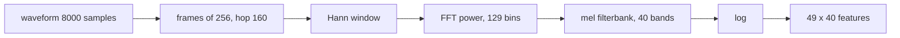

# Audio and Speech Models

> Turn sound into a picture of frequencies over time, then let a network read it frame by frame and CTC sort out the alignment.

**Type:** Build
**Languages:** Python
**Prerequisites:** Phase 03 (CNNs: Convolution from Scratch), Phase 04 (Sequence Models: RNN from Scratch, Seq2Seq), Phase 09 (LLMs: Sampling and Decoding)
**Time:** ~90 minutes

## Learning Objectives

- Compute a log-mel spectrogram from scratch: framing, Hann window, FFT power, a triangular mel filterbank, and a log
- Build a convolutional acoustic model that outputs a distribution over units plus a blank for every frame
- Implement the CTC loss with the forward (alpha) recursion in log space, and decode with greedy collapse-and-remove-blanks
- Verify the STFT against `torch.stft` and the loss against `F.ctc_loss`, and place the pipeline in the landscape of Whisper, wav2vec 2.0 and audio tokenizers

## The Problem

Audio is a long one-dimensional signal: 16,000 numbers per second for speech, 44,100 for music. Raw samples are a poor input for learning: a vowel is defined by which frequencies are loud, not by the exact waveform, and the same word spoken twice has completely different samples.

Speech recognition adds a second problem. You have a transcript (`"oaeuu"`) and a sequence of 49 frames, but nobody tells you which frames belong to which unit. Labeling every frame by hand is impractical. Connectionist Temporal Classification (CTC, Graves et al., 2006) trains the model by summing over every possible alignment, and it remains the loss behind many production recognizers and the alignment-free half of hybrid systems.

Since real recordings are not allowed here, you will synthesize speech-like sounds. Five units, named after vowels, are each defined by two formant frequencies, the resonances that make an "a" sound different from an "i" in real voices. An utterance is 2 to 5 units at a random pitch with heavy background noise.

## The Concept

### From waveform to log-mel spectrogram



- **Framing.** Cut the signal into overlapping windows of 32 ms (256 samples at 8 kHz), one every 20 ms. Speech is roughly stationary over that span.
- **Window.** Multiply each frame by a Hann window `0.5 - 0.5 cos(2 pi n / N)` so its edges fade to zero; otherwise the cut creates spurious high frequencies.
- **FFT power.** `|rfft(frame)|^2` gives energy in 129 frequency bins from 0 to 4 kHz.
- **Mel scale.** Human pitch perception is roughly logarithmic above 1 kHz. `mel = 2595 log10(1 + hz / 700)`. Forty triangular filters, evenly spaced in mel, pool the FFT bins into bands that are narrow at low frequencies and wide at high ones.
- **Log.** Loudness perception is logarithmic too, and the log turns multiplicative gain into an additive offset that normalization removes.

The result is an image: time on one axis, frequency on the other. Most audio models, Whisper included, start here.

### Frame-level outputs and the blank

The acoustic model emits, for each of the 49 frames, a distribution over 6 symbols: the 5 units plus a special blank `-`. A path is one symbol per frame:

```
path:        o o o - - - - a a a a - - - e e e e - - - u u u u - - - - u u u - - -
collapse:    o - a - e - u - u
drop blanks: o a e u u
```

The mapping `B` collapses repeated symbols and then removes blanks. The blank does two jobs: it fills frames where nothing is being said, and it separates genuine repeats (`u u` needs a blank between the two `u` runs, otherwise they collapse into one).

### The CTC loss

The probability of a transcript `y` is the sum over all paths that collapse to it:

```
P(y | x) = sum over paths pi with B(pi) = y of  prod_t p_t(pi_t)
L_CTC = -log P(y | x)
```

There are exponentially many paths, but dynamic programming handles them. Insert blanks around every label to get an extended sequence of length `2L + 1`:

```
y = o a e         extended: - o - a - e -
```

`alpha_t(s)` is the total probability of all path prefixes of length `t + 1` that end at extended position `s`. A path can stay at `s`, advance from `s - 1`, or skip from `s - 2` (only onto a label that differs from the one two back, so a blank between identical labels is never skipped):

```
alpha_t(s) = [ alpha_{t-1}(s) + alpha_{t-1}(s-1) + skip_ok(s) * alpha_{t-1}(s-2) ] * p_t(ext_s)
P(y | x) = alpha_{T-1}(2L) + alpha_{T-1}(2L - 1)
```

In log space every `+` becomes `logsumexp` and every `*` becomes `+`. The cost is `O(T x L)` per utterance.

### Decoding

Greedy CTC decoding takes the argmax symbol per frame and applies `B`. Beam search with a language model over units (or words) improves real systems, exactly as in the decoding lesson of Phase 09.

## Build It

```bash
uv run python phases/10-multimodal/05-audio-and-speech-models/code/main.py
```

### Step 1: Synthesize

```python
harmonics = np.arange(1, int(3600 / pitch) + 1) * pitch
envelope = np.exp(-((harmonics - first) ** 2) / (2 * 110**2)) + 0.7 * np.exp(-((harmonics - second) ** 2) / (2 * 140**2)) + 0.02
wave = (envelope[:, None] * np.sin(2 * np.pi * harmonics[:, None] * t[None, :] + phases[:, None])).sum(0)
```

A voiced sound is a sum of harmonics of the pitch `f0`; the formants decide which harmonics are loud. This is the source-filter model of speech in three lines. Formants are jittered by up to 15% per utterance and Gaussian noise with standard deviation 0.3 is added, so the waveform plot in `speech.png` looks like static.

### Step 2: Features by hand

```python
def stft_power(audio):
    frames = frame_signal(audio, FRAME_LENGTH, HOP_LENGTH) * hann_window(FRAME_LENGTH)
    return torch.fft.rfft(frames, dim=-1).abs() ** 2

def log_mel_spectrogram(audio, filters):
    return torch.log(stft_power(audio) @ filters.T + 1e-6)
```

`frame_signal` builds an index matrix so all frames are gathered in one tensor operation. `mel_filterbank` builds the 40 x 129 matrix of triangles. Each 1-second clip becomes a 49 x 40 feature map.

### Step 3: The acoustic model

Three 1D convolutions over time (kernel 5, the last one dilated) and a linear layer to 6 log-probabilities per frame. Its receptive field covers 17 frames (340 ms), enough to see a whole unit and its neighbors.

### Step 4: CTC by hand

```python
for t in range(1, num_frames):
    stay = alpha
    advance = F.pad(alpha, (1, 0), value=impossible)[:, :-1]
    skip = torch.where(can_skip, F.pad(alpha, (2, 0), value=impossible)[:, :-2], neg_inf)
    alpha = torch.logsumexp(torch.stack([stay, advance, skip]), dim=0) + emissions[:, t]
```

The whole batch moves through time together. Impossible states hold `-1e9` instead of `-inf`: `logsumexp` of three `-inf` values is fine in the forward pass, but its gradient is `0/0 = NaN`, which silently kills training. (`F.ctc_loss` has the same issue and exposes `zero_infinity=True` for it.)

### Step 5: Train and decode

500 steps of AdamW. The loss falls from 22 to near zero, and on 300 new utterances:

```
unit error rate 0.008 | exact transcripts 0.977
predicted oaeuu  truth oaeuu
frame-level argmax for the first clip: ooo----aaaa---eeee---uuuu----uuu-----------------
```

The frame-level output shows the classic CTC behavior: short runs of each unit separated by blanks, and blank everywhere else, including the trailing silence. The two `u`s stay separate because a blank sits between them. Nobody told the model where the units were; CTC found the alignment.

## Use It

`torch.stft(audio, 256, 160, window=hann_window(256), center=False, return_complex=True)` gives exactly the same power spectrum as the hand version (difference 0), and `F.ctc_loss(log_probs.transpose(0, 1), targets, input_lengths, target_lengths, blank=0)` matches the hand CTC to six decimals. `torchaudio.transforms.MelSpectrogram` packages the whole feature pipeline (it is not a dependency of this repo).

Where this sits in modern speech and audio models:

| Model | Input | Training signal | Output |
|-------|-------|-----------------|--------|
| CTC models (DeepSpeech, Conformer-CTC) | log-mel | CTC | characters per frame |
| wav2vec 2.0 / HuBERT | raw waveform | self-supervised masked prediction, then CTC fine-tuning | characters |
| Whisper | 80-band log-mel, 30 s | supervised encoder-decoder on 680k hours | text tokens with timestamps |
| EnCodec / SoundStream | waveform | reconstruction with a quantized bottleneck | discrete audio tokens |

The last row connects to the next lesson: once audio is a sequence of discrete tokens, a language model can read and generate it like text.

```python
import torchaudio
mel = torchaudio.transforms.MelSpectrogram(sample_rate=16000, n_fft=400, hop_length=160, n_mels=80)(waveform)
```

## Exercises

1. **Easy.** Remove the log from the features (use raw mel energies, normalized). How do the loss curve and the unit error rate change?
2. **Medium.** Replace the convolutional model with a bidirectional GRU (`nn.GRU(..., bidirectional=True)`) over the 40-dimensional frames, and compare unit error rates at noise levels 0.3 and 0.6.
3. **Hard.** Implement CTC prefix beam search with width 4 and a bigram prior over units estimated from the training transcripts. Make the task harder (noise 0.8) and report whether beam search plus the prior reduces the unit error rate.

## Key Terms

| Term | What people say | What it actually means |
|------|----------------|----------------------|
| STFT | "Spectrogram" | FFTs of overlapping windowed frames; magnitude over time and frequency |
| Hann window | "Smoothing the frame" | Taper `0.5 - 0.5 cos(2 pi n / N)` that reduces spectral leakage |
| Mel scale | "Perceptual frequency" | `2595 log10(1 + f / 700)`; roughly linear below 1 kHz, logarithmic above |
| Log-mel spectrogram | "Audio features" | Log of FFT power pooled by triangular mel filters; the standard input of speech models |
| Formant | "Vowel color" | A resonance of the vocal tract; the first two largely determine which vowel you hear |
| CTC | "Alignment-free loss" | Negative log of the summed probability of all frame paths that collapse to the transcript |
| Blank | "The epsilon symbol" | Extra output meaning "no new symbol", which also separates repeated labels |
| Unit error rate | "WER for units" | Edit distance between predicted and true sequences divided by the true length |

## Further Reading

- [Graves et al. (2006): Connectionist Temporal Classification](https://www.cs.toronto.edu/~graves/icml_2006.pdf) - the original CTC paper with the forward-backward algorithm
- [Hannun (2017): Sequence Modeling with CTC](https://distill.pub/2017/ctc/) - an illustrated walkthrough of the alignment lattice
- [Radford et al. (2022): Robust Speech Recognition via Large-Scale Weak Supervision](https://arxiv.org/abs/2212.04356) - Whisper, a log-mel encoder-decoder trained on 680k hours
- [Baevski et al. (2020): wav2vec 2.0](https://arxiv.org/abs/2006.11477) - self-supervised speech representations fine-tuned with CTC
