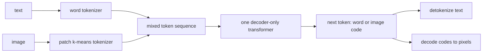

# Any-to-Any Models

> Tokenize every modality into the same kind of integers, and one next-token predictor can read and write all of them.

**Type:** Build
**Languages:** Python
**Prerequisites:** Phase 09 (LLMs: Tokenization and BPE, GPT from Scratch, Sampling and Decoding), Phase 10 (Multimodal: Image Captioning, Vision-Language Models)
**Time:** ~75 minutes

## Learning Objectives

- Build a discrete image tokenizer: split images into patches and map each patch to the nearest of K learned codes (k-means vector quantization)
- Design a shared vocabulary and sequence format with task and modality markers so one model handles text-to-image and image-to-text
- Train a single decoder-only transformer on both directions with the loss restricted to the output modality
- Generate in both directions with constrained sampling, and grade generated images with an independent classifier

## The Problem

So far each multimodal lesson has its own architecture: two towers for CLIP, an encoder-decoder for captioning, a projector plus LLM for VQA, a diffusion model for generation. Each new input or output modality means a new design.

Any-to-any models (DALL-E 1, Chameleon, Gemini, GPT-4o, the Unified-IO family) take a different route. Convert every modality into discrete tokens: BPE for text, a vector-quantized codebook for images, a neural audio codec for sound. Then put everything into one vocabulary and train a single autoregressive transformer on mixed sequences. Text-to-image, image-to-text and interleaved conversations become the same problem: predict the next token. The model you already know from Phase 09 does all of it.

You will build the smallest version: 8 x 8 handwritten digits as 16 image tokens, short captions as text tokens, and one GPT that goes both ways.

## The Concept

### Step one: tokenize images

A text tokenizer maps strings to integers and back. An image tokenizer must do the same for pixels:

```
image 8x8 -> 16 patches of 2x2 -> each patch replaced by the index of its nearest code -> 16 integers
16 integers -> look up the 16 code vectors -> reassemble patches -> image 8x8
```

The codebook is learned with k-means on training patches: 48 centroids in the 4-dimensional patch space. This is vector quantization, the core of VQ-VAE and VQGAN, where an encoder network produces the vectors being quantized and a decoder network reconstructs the image. Here the "encoder" is the identity on 2 x 2 patches and the "decoder" is pasting the centroids back, which is enough at this resolution: a classifier trained on real digits still reads 94% of tokenized-then-decoded test images correctly.

### Step two: one vocabulary

```
ids 0..5     special:  <pad> <t2i> <i2t>  <txt> <eos>
ids 6..20    words:    a digit eight five ... two zero  (sorted alphabetically)
ids 21..68   image:    <code0> ... <code47>
```

Image codes are just more vocabulary entries. The embedding table and the output softmax cover all 69 ids.

### Step three: one sequence format

```
text -> image:  <t2i> a handwritten seven  c c c c c c c c c c c c c c c c <eos>
image -> text:  <i2t> c c c c c c c c c c c c c c c c <txt> a handwritten seven <eos>
```

The first token tells the model which task it is doing; the modality markers `` and `<txt>` tell it what comes next. The loss is computed only on the part after the marker (the output), exactly as the VLM lesson computed it only on the answer.



### Constrained decoding

At generation time the model could, in principle, emit a word in the middle of an image. You prevent it by masking: after `` only image codes are allowed for 16 steps; after `<txt>` only words and `<eos>`. Production systems do the same with modality-aware sampling.

### Why this works and what it costs

Advantages: one architecture, one loss, one scaling recipe; modalities can be interleaved freely; everything the LLM ecosystem built (KV cache, sampling, RLHF) carries over. Costs: images become long token sequences (Chameleon uses 1024 tokens per 512 x 512 image), quantization loses detail, and generating pixels token by token is slower than a diffusion model. Several recent systems mix the two approaches: autoregressive tokens for text and understanding, a diffusion head for image output.

## Build It

```bash
uv run python phases/10-multimodal/06-any-to-any-models/code/main.py
```

### Step 1: The image tokenizer

```python
def kmeans(points, k, iterations, generator):
    centroids = points[torch.randperm(len(points), generator=generator)[:k]].clone()
    for _ in range(iterations):
        assignment = torch.cdist(points, centroids).argmin(1)
        for j in range(k):
            members = points[assignment == j]
            if len(members) > 0:
                centroids[j] = members.mean(0)
    ...

class ImageTokenizer:
    def encode(self, images):
        patches = image_to_patches(images)
        return torch.cdist(patches, self.centroids.unsqueeze(0).expand(len(patches), -1, -1)).argmin(-1)

    def decode(self, codes):
        return patches_to_image(self.centroids[codes])
```

```
one 8x8 image = 16 tokens | reconstruction mse 0.0080 (pixel variance 0.1414)
a digit classifier trained on real pixels scores 0.939 on tokenized-then-decoded test images
```

### Step 2: Sequences with a masked target

```python
def make_batch(vocab, codes, labels, rng, length):
    ...
    task = "t2i" if rng.random() < 0.5 else "i2t"
    caption = TEMPLATES[rng.integers(len(TEMPLATES))].format(DIGIT_NAMES[label])
    prefix, target = build_sequence(vocab, task, caption, image_codes)
    sequence = prefix + target
    ids[row, : len(sequence)] = torch.tensor(sequence)
    targets[row, len(prefix) - 1 : len(sequence) - 1] = torch.tensor(target)
```

Every other target position is `-100`, which `F.cross_entropy(..., ignore_index=-100)` skips. Each batch mixes both directions at random.

### Step 3: Train one model

The transformer is the GPT from Phase 09 with hand-written causal attention: embedding size 64, 2 layers, 110k parameters, 1000 steps. The loss settles around 1.0 nats per output token. It cannot go to zero: image tokens are genuinely uncertain (many ways to write a seven), and so is the caption template (`a handwritten`, `the digit`, `number`).

### Step 4: Image to text

Feed `<i2t>`, the 16 codes and `<txt>`, then decode greedily with only words and `<eos>` allowed:

```
caption names the right digit for 0.886 of 297 test images
true 7: number seven
true 4: number seven
```

### Step 5: Text to image

Feed `<t2i> a handwritten seven `, sample 16 codes with only image codes allowed, decode to pixels, and ask the real-pixel classifier what it sees:

```
temperature 0.7: classifier agrees with the requested digit on 0.970 of 200 generated images
temperature 1.0: classifier agrees with the requested digit on 0.895 of 200 generated images
```

(CPU run; GPU numbers differ slightly.) Lower temperature trades diversity for fidelity, as in the sampling lesson of Phase 09. `any_to_any.png` shows real, tokenized and generated digits for every class.

## Use It

The script compares the hand k-means with `sklearn.cluster.KMeans`: scikit-learn reaches a lower inertia (about 633 versus 767) because it initializes with k-means++ (spread-out seeds) instead of random points. In real any-to-any models the codebook is learned end to end:

- **VQ-VAE / VQGAN**: a CNN encoder, a codebook updated with a straight-through gradient or exponential moving averages, and a decoder trained with reconstruction plus perceptual and adversarial losses. Used by DALL-E 1 (dVAE), Parti, Chameleon.
- **Finite scalar quantization (FSQ)** and **lookup-free quantization**: simpler codebooks without the collapse problems of k-means-style VQ.
- **Neural audio codecs** (SoundStream, EnCodec): residual vector quantization of audio frames, the audio counterpart used by AudioLM and many speech LLMs.

With those tokenizers in place, the training loop is exactly the one you wrote: one vocabulary, task and modality markers, next-token cross-entropy, constrained sampling.

## Exercises

1. **Easy.** Change `CODEBOOK_SIZE` to 8 and 128. Report reconstruction MSE, the tokenized-image classifier accuracy, and the text-to-image accuracy. Where is the bottleneck?
2. **Medium.** Add a third task, image completion: `<fill>` followed by the first 8 codes of an image, and the model must produce the last 8. Train on all three tasks and show completions for a few test digits.
3. **Hard.** Implement k-means++ initialization by hand and check that it closes the inertia gap with scikit-learn. Then replace k-means with a tiny VQ-VAE (a linear encoder per 2 x 2 patch, a codebook trained with the straight-through estimator) and compare reconstructions.

## Key Terms

| Term | What people say | What it actually means |
|------|----------------|----------------------|
| Any-to-any model | "Omni model" | One model that can take and produce several modalities, usually as a single token stream |
| Vector quantization | "Discretizing images" | Replacing each vector with the index of its nearest codebook entry |
| Codebook | "Visual vocabulary" | The set of K learned vectors whose indices are the image tokens |
| VQ-VAE / VQGAN | "Image tokenizer" | Encoder plus quantizer plus decoder trained so images survive the round trip through discrete codes |
| Modality marker | "Special tokens" | Tokens like `` and `<txt>` that announce which modality comes next |
| Constrained decoding | "Masking the vocabulary" | Setting logits of disallowed tokens to minus infinity before sampling |
| Early fusion | "Mixed-modal tokens" | Combining modalities at the input token level rather than through separate encoders |

## Further Reading

- [van den Oord, Vinyals, Kavukcuoglu (2017): Neural Discrete Representation Learning](https://arxiv.org/abs/1711.00937) - VQ-VAE, the standard way to learn image codebooks
- [Ramesh et al. (2021): Zero-Shot Text-to-Image Generation](https://arxiv.org/abs/2102.12092) - DALL-E 1, a transformer over text tokens followed by image tokens
- [Esser, Rombach, Ommer (2021): Taming Transformers for High-Resolution Image Synthesis](https://arxiv.org/abs/2012.09841) - VQGAN plus an autoregressive transformer
- [Chameleon Team (2024): Chameleon: Mixed-Modal Early-Fusion Foundation Models](https://arxiv.org/abs/2405.09818) - one token stream for interleaved text and images at scale
