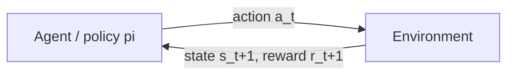
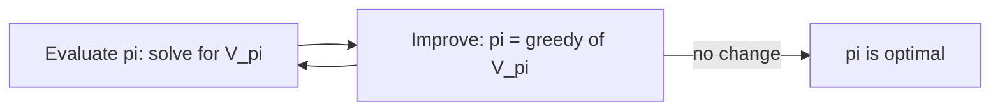

# RL Basics: Markov Decision Processes

> An agent, a world, a reward and a discount: once you write those four things down, "behave well" becomes a fixed point you can compute.

**Type:** Build
**Languages:** Python
**Prerequisites:** Phase 00 (Tensors and Autodiff: Tensors and Broadcasting), Classic ML from Scratch Phase 03 (Probability and Statistics)
**Time:** ~70 minutes

## Learning Objectives

- Describe a problem as a Markov decision process: states, actions, transition probabilities, rewards and a discount factor
- Write the Bellman expectation and optimality equations and explain why they define value functions
- Implement policy evaluation, value iteration and policy iteration on a stochastic gridworld with NumPy
- Verify Bellman values with Monte Carlo rollouts and with a closed-form linear solve
- See how changing the reward changes the optimal behavior

## The Problem

Everything you trained so far had a teacher. Each input came with a label, and the loss told the network exactly how wrong it was. Many problems do not look like that. A robot that walks, a program that plays a game, a controller that keeps a pole balanced: nobody can tell you the right motor torque at every millisecond. You only learn, much later, whether things went well.

Reinforcement learning (RL) is the framework for this. An agent acts, the world changes, and a scalar reward arrives now and then. The goal is to pick actions that maximize the total reward over time, including rewards that only show up many steps later because of what you did now.

Before you can learn any of this with neural networks (the rest of this phase), you need the vocabulary and the exact math of the easy case: a small world where you know every transition probability. In that case you can compute the optimal behavior directly. Every deep RL algorithm, from DQN to Dreamer, is an approximation of what you build in this lesson.

## The Concept

### The agent-environment loop



At each step the agent sees a state `s`, chooses an action `a`, and the environment returns a new state `s'` and a reward `r`. The loop repeats until a terminal state, or forever.

### The MDP

A Markov decision process is the tuple `(S, A, P, R, gamma)`:

| Symbol | Meaning | In this lesson |
|--------|---------|----------------|
| `S` | set of states | 20 free cells of a 5x5 grid |
| `A` | set of actions | up, right, down, left |
| `P(s' \| s, a)` | transition probability | 80% you move as intended, 10% you slip to each side |
| `R(s, a)` | expected reward | -0.04 per step, +1 at the goal, -1 at the pit |
| `gamma` | discount factor in [0, 1) | 0.95 |

"Markov" means the next state depends only on the current state and action, not on the path that got you there. The whole model fits in a tensor `P` of shape `(S, A, S)` and a matrix `R` of shape `(S, A)`.

```
S . . . #        S start, G goal (+1), P pit (-1), # wall
. # . . P        moving into a wall or the border leaves you in place
. . . # .        intended move with prob 0.8, slip left/right with 0.1 each
. # . . .
. . . # G
```

### Returns, policies and values

The return is the discounted sum of future rewards:

```
G_t = r_{t+1} + gamma r_{t+2} + gamma^2 r_{t+3} + ...
```

A discount below 1 keeps the sum finite and makes the agent prefer reward sooner. A policy `pi(a | s)` gives the probability of each action in each state. Its value function is the expected return when you start in `s` and follow `pi`:

```
V_pi(s)    = E[ G_t | s_t = s ]
Q_pi(s, a) = E[ G_t | s_t = s, a_t = a ]
```

### The Bellman equations

The return has a recursive structure: `G_t = r_{t+1} + gamma G_{t+1}`. Taking expectations gives the Bellman expectation equation:

```
Q_pi(s, a) = R(s, a) + gamma * sum_s' P(s' | s, a) V_pi(s')
V_pi(s)    = sum_a pi(a | s) Q_pi(s, a)
```

With arrays this is one line: `Q = R + gamma * P @ V`. The optimal value function satisfies the Bellman optimality equation, where the average over actions becomes a max:

```
V*(s) = max_a [ R(s, a) + gamma * sum_s' P(s' | s, a) V*(s') ]
```

Once you have `V*`, the optimal policy is greedy: in each state pick the action with the largest `Q*(s, a)`.

### Three ways to solve it

- **Policy evaluation:** start with `V = 0`, apply `V <- sum_a pi (R + gamma P V)` until it stops changing. Each sweep shrinks the error by at least a factor `gamma` (the Bellman operator is a contraction), so it always converges.
- **Value iteration:** apply the optimality update `V <- max_a (R + gamma P V)` repeatedly, then read off the greedy policy.
- **Policy iteration:** alternate full evaluation of the current policy and greedy improvement. It converges in a handful of improvements because each one can only make the policy better.



For a fixed policy the Bellman equation is linear, so you can also solve it exactly: `V_pi = (I - gamma P_pi)^-1 R_pi`. That works for 20 states. It does not work for the states of a video game, which is why the next lessons replace tables with neural networks and exact sums with samples.

## Build It

### Step 1: The environment as tensors

`GridWorld` parses the layout and builds `P` and `R` once. For every free cell and every action, it loops over the three possible outcomes (intended move and the two slips):

```python
def build_model(self):
    P = np.zeros((self.n_states, self.n_actions, self.n_states))
    R = np.zeros((self.n_states, self.n_actions))
    for s, cell in enumerate(self.cells):
        for a in range(self.n_actions):
            if s in self.terminal:
                P[s, a, s] = 1.0
                continue
            for actual, prob in self.outcomes(a):
                s_next = self.index[self.move(cell, actual)]
                P[s, a, s_next] += prob
                R[s, a] += prob * (self.step_reward + self.terminal.get(s_next, 0.0))
    return P, R
```

Terminal states loop back to themselves with zero reward, so the math does not need a special "done" case. The script checks that every row of `P` sums to 1.

### Step 2: Policy evaluation

```python
def policy_evaluation(env, policy, gamma, tol=1e-8):
    V = np.zeros(env.n_states)
    sweeps = 0
    while True:
        sweeps += 1
        Q = env.R + gamma * env.P @ V
        V_new = (policy * Q).sum(axis=1)
        if np.max(np.abs(V_new - V)) < tol:
            return V_new, sweeps
        V = V_new
```

`env.P @ V` contracts the last axis of `P` with `V`, giving the expected next value for every `(s, a)` pair. The uniformly random policy takes about 240 sweeps and its start value is about -0.80: wandering randomly, you fall into the pit far more often than you reach the goal.

### Step 3: Value iteration and the greedy policy

```python
def value_iteration(env, gamma, tol=1e-8):
    V = np.zeros(env.n_states)
    history = []
    while True:
        Q = env.R + gamma * env.P @ V
        V_new = Q.max(axis=1)
        delta = np.max(np.abs(V_new - V))
        history.append(delta)
        V = V_new
        if delta < tol:
            return V, history
```

The only change from evaluation is `max` instead of the policy-weighted average. The printed grid shows the result: values grow toward `G`, the arrows route around the walls, and from the start the optimal value is about +0.27.

### Step 4: Policy iteration

`policy_iteration` starts from the random policy, evaluates it, takes the greedy policy, and repeats until nothing changes. It stabilizes after 4 improvements and finds exactly the same policy and values as value iteration. Notice how the first evaluation is expensive (243 sweeps) and later ones are cheap: a good policy reaches the terminal states quickly.

### Step 5: Check against reality with rollouts

Bellman values are predictions of the average discounted return. You can test them by simulating thousands of episodes with `env.step` and averaging:

```python
for name, policy, V in [("random", random_policy, V_random), ("optimal", pi_star, V_star)]:
    mean, stderr = monte_carlo_return(env, policy, gamma, 2000, rng)
```

The Monte Carlo averages land within a standard error or two of the Bellman numbers. This is the bridge to model-free RL: when you do not know `P`, you can still estimate values from samples.

### Step 6: The reward defines the behavior

The script reruns value iteration with three living costs. With no cost per step the agent is patient and takes safe detours. With a cost of -0.6 per step, living is so expensive that from the cell next to the pit the optimal action is to jump in and end the episode. Same world, different reward, different optimal behavior. Designing rewards is a big part of applied RL.

## Use It

For a fixed policy, the Bellman equation is a linear system, so NumPy can solve it in one call:

```python
P_pi = np.einsum("sa,sat->st", pi_star, env.P)
R_pi = (pi_star * env.R).sum(1)
V_solve = np.linalg.solve(np.eye(env.n_states) - gamma * P_pi, R_pi)
```

It matches the iterative answer to about `1e-8`. A direct solve costs `O(S^3)` and needs the whole model in memory, so it is only an option for small tabular problems. Libraries such as Gymnasium standardize the environment interface (`reset`, `step`, `observation_space`, `action_space`) that the `GridWorld.step` method imitates, and RL libraries build on that interface. The algorithms here are the same ones you find in Sutton and Barto, chapter 4.

## Exercises

1. **Easy.** Set `slip=0.0`. How do the optimal values and the path change? Why does the agent no longer avoid cells next to the pit?
2. **Medium.** Implement modified policy iteration: instead of evaluating each policy to convergence, run only `k` evaluation sweeps before improving. Plot the total number of sweeps needed for `k = 1, 3, 10, inf`. Which value of `k` recovers value iteration?
3. **Hard.** Make the grid 30x30 with random walls and measure how the runtime of value iteration and of the linear solve scale with the number of states. At what size does the linear solve stop being practical?

## Key Terms

| Term | What people say | What it actually means |
|------|----------------|----------------------|
| MDP | "The RL setup" | A tuple `(S, A, P, R, gamma)` whose transitions depend only on the current state and action |
| Policy | "What the agent does" | A distribution `pi(a \| s)` over actions for each state |
| Return | "Total reward" | The discounted sum `sum_k gamma^k r_{t+k+1}` of future rewards |
| Value function | "How good a state is" | Expected return from a state (`V`) or state-action pair (`Q`) under a policy |
| Bellman equation | "The recursive formula" | `V = R_pi + gamma P_pi V`: today's value is reward plus discounted value of tomorrow |
| Value iteration | "Dynamic programming for RL" | Repeated application of the Bellman optimality update until it converges to `V*` |
| Policy iteration | "Evaluate then improve" | Alternating exact evaluation and greedy improvement until the policy stops changing |
| Discount factor | "How far ahead it looks" | `gamma` weights a reward `k` steps away by `gamma^k`; it sets the effective horizon near `1/(1-gamma)` |

## Further Reading

- [Sutton and Barto, Reinforcement Learning: An Introduction (2nd ed.)](http://incompleteideas.net/book/the-book-2nd.html) - chapters 3 and 4 cover MDPs and dynamic programming; the standard reference
- [David Silver's RL course, lectures 2 and 3](https://www.davidsilver.uk/teaching/) - MDPs, Bellman equations and dynamic programming with clear slides
- [OpenAI Spinning Up: Key Concepts in RL](https://spinningup.openai.com/en/latest/spinningup/rl_intro.html) - compact notation guide that connects these ideas to deep RL
