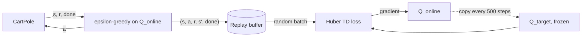

# Q-Learning and DQN

> You do not need the rules of the world to act well in it: sample a transition, nudge your Q-value toward reward plus the best guess of what comes next, and repeat.

**Type:** Build
**Languages:** Python
**Prerequisites:** RL Basics: MDPs (this phase), Phase 01 (Neural Networks), Phase 02 (Training Deep Nets: SGD, Momentum and Adam)
**Time:** ~80 minutes

## Learning Objectives

- Derive the Q-learning update from the Bellman optimality equation and explain why it needs no transition model
- Balance exploration and exploitation with an epsilon-greedy schedule
- Implement a cart-pole simulator from its physics equations
- Build DQN from scratch: Q-network, replay buffer, target network, Huber loss, and the TD target with terminal masking
- Recognize DQN's instability and use checkpoint selection to deal with it

## The Problem

In the previous lesson you had the full transition tensor `P` and could sweep over all states. Real environments do not hand you `P`. A game emulator, a robot or a physics engine gives you only one thing: call `step(action)` and see what happens. You need an algorithm that learns from these samples.

The second problem is size. The gridworld had 20 states; you could store a value for each. Cart-pole, the classic control benchmark, has four continuous numbers as its state: cart position, cart velocity, pole angle and pole angular velocity. There is no table with a row for every real number. You need a function that generalizes from states you have seen to states you have not, which is exactly what a neural network does.

Q-learning solves the first problem. Deep Q-Networks (DQN), the algorithm DeepMind used to play Atari games from pixels in 2013-2015, solve the second one, and add two tricks that make neural networks and bootstrapped targets get along.

## The Concept

### From Bellman to a sample update

The optimal action value satisfies

```
Q*(s, a) = E[ r + gamma * max_a' Q*(s', a') ]
```

The expectation is over the random next state. You cannot compute it without `P`, but every transition `(s, a, r, s')` you observe is one sample of it. So move `Q(s, a)` a little toward that sample:

```
td_target = r + gamma * max_a' Q(s', a')        (just r if s' is terminal)
Q(s, a)  <- Q(s, a) + alpha * (td_target - Q(s, a))
```

The difference `td_target - Q(s, a)` is the temporal-difference (TD) error. This is Q-learning. It is off-policy: the target uses the greedy `max` no matter which action the agent actually takes next, so the agent can explore freely and still learn the optimal values.

### Exploration

If you always take the action with the highest current estimate, you never try the others and never discover they were better. Epsilon-greedy takes a random action with probability `epsilon`, otherwise the greedy one. You start with `epsilon = 1` (pure exploration) and decay it to a small floor like 0.05.

### From tables to networks

Replace the table with a network `Q_theta(s)` that outputs one value per action. Treat the TD target as a label and minimize the regression loss:

```
L(theta) = Huber( Q_theta(s, a) - [ r + gamma (1 - done) max_a' Q_target(s', a') ] )
```

Two things go wrong if you do this naively, and DQN fixes both:

| Problem | Why it hurts | DQN fix |
|---------|-------------|---------|
| Consecutive samples are highly correlated | SGD assumes roughly independent samples; the network overfits to the current stretch of the episode | **Replay buffer:** store transitions, train on random mini-batches from it |
| The target moves every time you update | You chase your own tail; values can oscillate or diverge | **Target network:** a frozen copy `Q_target` used for the targets, refreshed every N steps |

The Huber loss is quadratic for small errors and linear for large ones, so a single surprising transition cannot produce a huge gradient.



### Terminal versus truncated

Cart-pole ends in two ways: the pole falls (`done`, a real terminal state with no future reward) or the 200-step time limit is reached (`truncated`). Only a real terminal zeroes the bootstrap term. If you also zeroed it at the time limit, you would teach the network that perfectly balanced states at step 200 are worth nothing.

## Build It

### Step 1: Tabular Q-learning

The gridworld is reused, but now the agent only calls `env.step`. It never reads `P`.

```python
for steps in range(1, 201):
    a = epsilon_greedy(Q[s], epsilon, rng)
    s_next, reward, done = env.step(s, a, rng)
    target = reward + (0.0 if done else gamma * Q[s_next].max())
    Q[s, a] += alpha * (target - Q[s, a])
    s = s_next
    if done:
        break
```

After 3000 episodes, episodes shrink from about 72 to about 11 steps, the learned start value (+0.29) is close to value iteration's +0.27, and the greedy action matches the optimal one in most states. The mismatches are in rarely visited cells or cells where two actions are nearly tied.

### Step 2: Cart-pole from the equations of motion

`CartPole.step` implements the classic Barto, Sutton and Anderson (1983) dynamics with Euler integration at `dt = 0.02`: compute the pole's angular acceleration from gravity and the push force, then the cart's acceleration, then update positions and velocities. The episode fails if the pole tilts beyond 12 degrees or the cart leaves `|x| < 2.4`. Every surviving step gives reward 1, so the return is the episode length (maximum 200).

### Step 3: Replay buffer

Preallocated NumPy arrays and a circular pointer. `sample` returns a random batch as tensors.

```python
def add(self, state, action, reward, next_state, done):
    i = self.pointer
    self.states[i], self.actions[i], self.rewards[i] = state, action, reward
    self.next_states[i], self.dones[i] = next_state, done
    self.pointer = (self.pointer + 1) % self.capacity
    self.size = min(self.size + 1, self.capacity)
```

### Step 4: The DQN loss

```python
def dqn_loss(online, target, batch, gamma):
    states, actions, rewards, next_states, dones = batch
    q_taken = online(states).gather(1, actions[:, None]).squeeze(1)
    with torch.no_grad():
        next_q = target(next_states).max(dim=1).values
        td_target = rewards + gamma * (1.0 - dones) * next_q
    return huber(q_taken - td_target), q_taken, td_target
```

`gather` picks the Q-value of the action actually taken. The target is computed under `no_grad`, so gradients only flow through `q_taken`. The `huber` function is written by hand with `torch.where`.

### Step 5: The training loop

`train_dqn` runs 18,000 environment steps. Epsilon decays linearly from 1 to 0.05 over the first 40%, learning starts after 500 warm-up steps, each step does one Adam update on a batch of 64, and the target network is refreshed every 500 steps with `load_state_dict`. Every 2000 steps the greedy policy is evaluated on 5 episodes, and the best checkpoint is kept.

The log shows what DQN practitioners know well: the greedy policy reaches 200 around step 6000, then degrades and recovers. The final network averages about 130 steps on fresh episodes, while the best checkpoint averages about 187. Q-learning with function approximation and bootstrapping has no convergence guarantee, so keeping the best evaluated checkpoint is standard practice. Improvements such as Double DQN, dueling heads and prioritized replay were invented largely to tame this.

## Use It

PyTorch ships the Huber loss as `F.smooth_l1_loss` (with `beta=1`, identical to Huber with `delta=1`):

```python
loss, q_taken, td_target = dqn_loss(online, target, batch, 0.99)
library_loss = F.smooth_l1_loss(q_taken, td_target)
```

Both print the same number. In real projects you would not write the agent or the environment loop yourself: Gymnasium provides `CartPole-v1` with the same physics, and libraries such as Stable-Baselines3 or CleanRL provide tested DQN implementations whose hyperparameters (replay size, target update period, exploration schedule) map one-to-one to the arguments of `train_dqn`.

## Exercises

1. **Easy.** Set `target_every=1` so the target network is just the online network. Run it a few times with different seeds. How does the learning curve change?
2. **Medium.** Implement Double DQN: choose the next action with the online network and evaluate it with the target network, `Q_target(s', argmax_a Q_online(s', a))`. Compare the average predicted Q-value at the start state with the true return (about `(1 - gamma^200) / (1 - gamma)` for a perfect policy). Which one overestimates?
3. **Hard.** Change the replay buffer so `done` is also set at the 200-step time limit. Explain what the network learns about states near the end of an episode and measure the effect on the final policy.

## Key Terms

| Term | What people say | What it actually means |
|------|----------------|----------------------|
| Q-learning | "Learn Q from experience" | Off-policy TD control: move `Q(s,a)` toward `r + gamma max_a' Q(s',a')` from sampled transitions |
| TD error | "The surprise" | `r + gamma max Q(s') - Q(s,a)`: the gap between the bootstrapped target and the current estimate |
| Bootstrapping | "Using your own guess" | Building the target from the model's current estimate of the next state's value |
| Epsilon-greedy | "Mostly greedy, sometimes random" | Take a uniformly random action with probability epsilon, otherwise the argmax |
| Replay buffer | "Experience memory" | A store of past transitions sampled at random to decorrelate mini-batches |
| Target network | "The frozen copy" | A lagged copy of the Q-network used to compute TD targets so they do not move every step |
| DQN | "Deep Q-learning" | Q-learning with a neural network, a replay buffer and a target network |
| Truncation | "Time limit" | Ending an episode for an external reason; unlike a terminal state, the future value is not zero |

## Further Reading

- [Mnih et al., Human-level control through deep reinforcement learning (2015)](https://www.nature.com/articles/nature14236) - the Nature DQN paper; the earlier workshop version is [arXiv:1312.5602](https://arxiv.org/abs/1312.5602)
- [van Hasselt, Guez and Silver, Deep Reinforcement Learning with Double Q-learning (2015)](https://arxiv.org/abs/1509.06461) - why the max in the target overestimates and how to fix it
- [Sutton and Barto, Reinforcement Learning: An Introduction, chapter 6](http://incompleteideas.net/book/the-book-2nd.html) - TD learning and tabular Q-learning
- [PyTorch DQN tutorial](https://pytorch.org/tutorials/intermediate/reinforcement_q_learning.html) - a reference DQN on CartPole with Gymnasium
