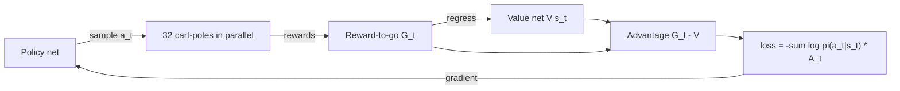

# Policy Gradients

> Do more of what worked: raise the log-probability of each action in proportion to how good things turned out after it.

**Type:** Build
**Languages:** Python
**Prerequisites:** Q-Learning and DQN (this phase), Phase 00 (Tensors and Autodiff), Phase 01 (Neural Networks: Loss Functions for Networks)
**Time:** ~75 minutes

## Learning Objectives

- Derive the REINFORCE gradient with the log-derivative trick
- Turn the gradient into a "surrogate loss" that autograd can differentiate
- Reduce variance with reward-to-go and a learned value baseline, and measure the reduction
- Simulate many cart-poles in parallel with batched tensor operations
- Compute log-probabilities by hand and match them against `torch.distributions.Categorical`

## The Problem

DQN learns values and derives a policy by taking the argmax. That works when there are two actions. It becomes awkward when actions are continuous (a torque, a steering angle), because the max over infinitely many actions is itself an optimization problem. It is also indirect: you care about behavior, but you are fitting numbers whose only purpose is to be compared.

Policy gradient methods optimize the policy directly. The network outputs a distribution over actions, you sample from it, and you adjust its parameters to make high-return trajectories more likely. This is the family behind PPO, the algorithm used for robotics benchmarks and for RLHF in Phase 09 (LLMs).

There is a catch. The return depends on the environment, which you cannot differentiate through. You need a way to get a gradient of expected return from samples alone, and a way to keep that gradient from being drowned in noise.

## The Concept

### The objective

A stochastic policy `pi_theta(a | s)` and the environment together define a distribution over trajectories `tau = (s_0, a_0, r_1, s_1, a_1, ...)`. You want to maximize

```
J(theta) = E_{tau ~ pi_theta} [ R(tau) ]
```

### The log-derivative trick

For any distribution, `grad p(x) = p(x) grad log p(x)`. Applying it to the expectation:

```
grad J = E[ R(tau) * grad log p_theta(tau) ]
```

The probability of a trajectory is a product of initial-state, policy and transition terms. Only the policy terms depend on `theta`, so the unknown dynamics drop out of the gradient:

```
grad log p_theta(tau) = sum_t grad log pi_theta(a_t | s_t)

grad J = E[ sum_t grad log pi_theta(a_t | s_t) * R(tau) ]
```

This is REINFORCE (Williams, 1992). You estimate the expectation by averaging over sampled episodes. To use autograd, build a surrogate loss whose gradient is this estimate:

```
loss = - mean_episodes sum_t log pi_theta(a_t | s_t) * weight_t        (weight is a constant)
```

### Three choices of weight

All three give an unbiased estimate of the same gradient, but with very different noise:

| Weight | Formula | Why it is valid |
|--------|---------|-----------------|
| Total return | `R(tau)` for every step | The direct formula |
| Reward-to-go | `G_t = sum_{k>=t} gamma^(k-t) r_{k+1}` | An action cannot affect rewards that came before it, so those terms average to zero |
| Reward-to-go minus baseline | `G_t - V(s_t)` | Subtracting anything that depends only on the state keeps the expectation unchanged, because `E[grad log pi] = 0` |

The baseline turns the weight into an advantage: "was this better or worse than usual from this state?" Without it, in cart-pole every return is positive, so every sampled action gets pushed up and the signal comes only from the differences in how much.



### On-policy

The gradient formula is an expectation under the current policy. After one update, old trajectories come from a different policy, so REINFORCE throws them away and collects fresh ones. That is why it needs many more environment steps than DQN, and why the batched simulator matters.

## Build It

### Step 1: A batched cart-pole

`BatchedCartPole` is the same physics as the previous lesson, but every quantity is a tensor of shape `(n_envs,)`. An `alive` mask tracks which poles have fallen; fallen environments keep stepping but get reward 0, which keeps every tensor rectangular.

```python
rewards = self.alive.float()
fell = (self.state[:, 0].abs() > self.x_limit) | (self.state[:, 2].abs() > self.theta_limit)
self.alive = self.alive & ~fell
```

Collecting 32 episodes of 200 steps is 200 batched forward passes instead of 6400 single ones.

### Step 2: Log-probabilities and sampling by hand

```python
def log_prob_of(logits, actions):
    log_probs = logits - torch.logsumexp(logits, dim=-1, keepdim=True)
    return log_probs.gather(-1, actions[..., None]).squeeze(-1)


def sample_actions(logits, generator):
    probs = torch.softmax(logits, dim=-1)
    return torch.multinomial(probs, 1, generator=generator).squeeze(-1)
```

`logits - logsumexp(logits)` is a numerically stable log-softmax.

### Step 3: Reward-to-go

```python
def rewards_to_go(rewards, gamma):
    returns = torch.zeros_like(rewards)
    running = torch.zeros(rewards.shape[0])
    for t in reversed(range(rewards.shape[1])):
        running = rewards[:, t] + gamma * running
        returns[:, t] = running
    return returns
```

Walking backward in time computes every discounted suffix sum in one pass.

### Step 4: The surrogate loss and the three variants

```python
def advantage_weights(variant, states, rewards, value, gamma):
    if variant == "total return":
        return rewards_to_go(rewards, gamma)[:, :1].expand_as(rewards)
    returns = rewards_to_go(rewards, gamma)
    if variant == "reward-to-go":
        return returns
    return returns - value(states).squeeze(-1).detach()


def surrogate_loss(policy, states, actions, weights, mask):
    log_probs = log_prob_of(policy(states), actions)
    return -(log_probs * weights * mask).sum(1).mean()
```

The `mask` (the reward tensor, 1 while alive) removes steps after the pole fell. The value baseline is `detach`ed: it is a constant as far as the policy gradient is concerned. The value network is trained separately with a masked MSE toward the reward-to-go in `fit_value`.

### Step 5: Train and compare

Each variant trains for 120 iterations of 32 episodes with Adam at `lr=1e-2`, from the same seed. In the run you should see:

- total return: slow and erratic, around 170 after 120 iterations
- reward-to-go: first reaches 195+ at iteration 15, but wobbles
- reward-to-go + baseline: reaches 195+ at iteration 15 and stays at 200

### Step 6: Measure the variance directly

Learning curves mix many effects, so `variance_experiment` freezes one random policy, fits a value net to it, and then computes 30 independent gradient estimates (16 episodes each) per variant. The noise-to-signal ratio `||std of gradients|| / ||mean gradient||` drops from about 2.2 (total return) to 0.9 (reward-to-go) to 0.7 (with baseline). Same expected gradient, less than a third of the noise.

## Use It

`torch.distributions.Categorical` packages the log-softmax, sampling and entropy:

```python
dist = Categorical(logits=logits)
dist.log_prob(actions)
dist.entropy()
```

The printed log-probabilities match the hand-written ones exactly. For continuous actions you would use `torch.distributions.Normal` and the rest of the code would not change. Production algorithms build on this exact loss: A2C replaces the reward-to-go with a bootstrapped advantage estimate, and PPO (Schulman et al., 2017) adds a clipped ratio so you can take several gradient steps on the same batch without the policy moving too far.

## Exercises

1. **Easy.** Remove the advantage baseline but keep reward-to-go, and lower the learning rate to `1e-3`. How many iterations does it take to reach 195 now? What does that tell you about the noise?
2. **Medium.** Add an entropy bonus `- beta * dist.entropy().mean()` to the loss. Plot the policy entropy over training for `beta = 0, 0.01, 0.1`. When does the bonus help and when does it hurt?
3. **Hard.** Implement generalized advantage estimation (GAE): `A_t = sum_k (gamma lambda)^k delta_{t+k}` with `delta_t = r_t + gamma V(s_{t+1}) - V(s_t)`. Measure the gradient noise-to-signal ratio for `lambda = 0, 0.9, 1` with the same `variance_experiment` setup.

## Key Terms

| Term | What people say | What it actually means |
|------|----------------|----------------------|
| Policy gradient | "Optimize the policy directly" | Gradient ascent on expected return using `E[grad log pi(a\|s) * weight]` |
| REINFORCE | "The basic policy gradient" | The Monte Carlo policy gradient estimator from Williams (1992) |
| Log-derivative trick | "The likelihood ratio trick" | `grad p = p grad log p`, which turns the gradient of an expectation into an expectation you can sample |
| Surrogate loss | "The PG loss" | A scalar whose gradient equals the policy gradient estimate; its value itself has no meaning |
| Reward-to-go | "Future return" | The discounted sum of rewards from step t onward; drops terms an action cannot influence |
| Baseline | "Subtract the average" | A state-dependent quantity subtracted from the return; leaves the gradient unbiased and reduces variance |
| Advantage | "How much better than usual" | `Q(s,a) - V(s)`, estimated here by `G_t - V(s_t)` |
| On-policy | "Fresh data only" | The estimator needs samples from the current policy, so data is discarded after each update |

## Further Reading

- [Williams, Simple statistical gradient-following algorithms for connectionist reinforcement learning (1992)](https://link.springer.com/article/10.1007/BF00992696) - the original REINFORCE paper
- [OpenAI Spinning Up: Intro to Policy Optimization](https://spinningup.openai.com/en/latest/spinningup/rl_intro3.html) - a clean derivation of reward-to-go and baselines, very close to this lesson
- [Schulman et al., Proximal Policy Optimization Algorithms (2017)](https://arxiv.org/abs/1707.06347) - the clipped policy gradient used in most modern RL and in RLHF
- [Schulman et al., High-Dimensional Continuous Control Using Generalized Advantage Estimation (2015)](https://arxiv.org/abs/1506.02438) - the bias-variance knob behind exercise 3
