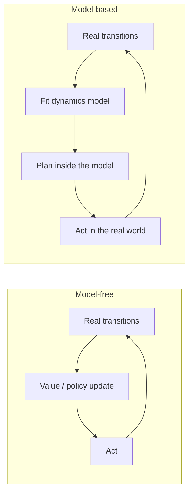

# Model-Based RL

> Learn how the world moves, then think before you act: a few hundred transitions and a planner can beat thousands of trial-and-error episodes.

**Type:** Build
**Languages:** Python
**Prerequisites:** Q-Learning and DQN, Policy Gradients (this phase), Phase 02 (Training Deep Nets)
**Time:** ~75 minutes

## Learning Objectives

- Explain the difference between model-free and model-based RL and when each one pays off
- Train a neural network to predict the next state as a normalized delta
- Measure compounding error when a learned model is rolled out on its own predictions
- Implement model predictive control with the cross-entropy method (CEM)
- Evaluate an ensemble of models in one call with `torch.func.vmap` and use their disagreement as an uncertainty signal

## The Problem

DQN needed 18,000 environment steps to balance a pole, and REINFORCE used even more. On a simulator that is fine. On a real robot, every step is wall-clock time, wear on motors, and sometimes a broken pole. Model-free methods learn behavior directly from reward, and they throw away most of what each transition tells them: not just "this was good", but "this is how the cart moved when I pushed it".

Model-based RL keeps that information. You fit a dynamics model `s_{t+1} = f(s_t, a_t)` from a small amount of data, and then you use the model instead of the real world to evaluate candidate plans. Every imagined rollout is free. The price is that the model is wrong in places, and a planner is an optimizer: it will find and exploit exactly those places if you let it.

## The Concept

### Model-free versus model-based



| | Model-free (DQN, PPO) | Model-based (this lesson) |
|---|---|---|
| What is learned | values or a policy | how the world changes |
| Sample efficiency | low | high |
| Compute per action | one forward pass | many simulated rollouts |
| Main failure mode | slow, unstable learning | model errors that the planner exploits |

### Predict deltas, in normalized units

The next state is almost equal to the current one, so predicting it directly wastes capacity on copying the input. Predict the change instead, and normalize inputs and targets so every dimension has a similar scale:

```
input   = [ (s - mu_s) / sigma_s ,  a ]
target  = ( (s' - s) - mu_delta ) / sigma_delta
s'_pred = s + net(input) * sigma_delta + mu_delta
```

### Compounding error

A model with a tiny one-step error can still be useless for long plans, because each prediction is fed back in as the next input:

```
s_1' = f(s_0)        error e
s_2' = f(s_1')       error from the model + error from the wrong input
...                  errors grow, often exponentially in unstable systems
```

Cart-pole is unstable (an upright pole falls on its own), which makes this especially visible. Planning horizons are therefore kept short.

### Model predictive control with CEM

Instead of learning a policy, you plan at every step:

1. Sample `N` action sequences of length `H` from a distribution (here an independent Bernoulli per step).
2. Roll each sequence through the model and score it with the known reward.
3. Keep the top `K` sequences (the elites), refit the distribution to them, and repeat a few times.
4. Execute only the first action, observe the real next state, and plan again from there.

```
probs = [0.5, 0.5, ..., 0.5]                 one entry per step of the horizon
repeat 2 times:
    actions ~ Bernoulli(probs)               (128 candidates, 15 steps)
    score   = sum_t alive_t * reward(s_t)    simulated in the model
    probs   = 0.2 probs + 0.8 mean(elite actions)
act: probs[0] > 0.5
```

Re-planning every step (receding horizon) is what makes this robust: the plan only needs to be good for the next action, and model errors get corrected by real observations.

### Uncertainty from ensembles

Where the model has seen data, independently trained models agree. Where it has not, they make different guesses. The spread of an ensemble is a cheap, practical measure of epistemic uncertainty, used by PETS, MBPO and many others to keep planners away from regions the model does not know.

## Build It

### Step 1: Random data

`collect_random` runs 20 cart-poles with random actions for 20 steps from widely scattered starting states, resetting any that fall. That is 400 transitions, about 2% of what DQN used.

### Step 2: The dynamics model

```python
class DynamicsModel(nn.Module):
    def forward(self, state, action):
        inputs = torch.cat([(state - self.state_mean) / self.state_std, (action.float()[..., None] * 2 - 1)], -1)
        return self.net(inputs)

    def predict(self, state, action):
        return state + self(state, action) * self.delta_std + self.delta_mean
```

Normalization statistics are stored with `register_buffer`, so they move with the model and appear in its `state_dict` without being trained. `train_model` fits the normalized delta with MSE, Adam and a cosine schedule.

### Step 3: Open-loop rollout error

`rollout_error` starts 200 poles near upright, applies the same random action sequence in the real simulator and in the model, and compares pole angles. One step is essentially exact (0.002 degrees), but the error grows to about 1 degree after 30 steps. This is why the planner uses a 15-step horizon.

### Step 4: CEM planning

```python
def cem_plan(dynamics, state, generator, horizon=15, candidates=128, elites=16, iterations=2):
    probs = torch.full((horizon,), 0.5)
    for _ in range(iterations):
        actions = (torch.rand(candidates, horizon, generator=generator) < probs).long()
        sim = state.expand(candidates, 4)
        total, alive = torch.zeros(candidates), torch.ones(candidates)
        for t in range(horizon):
            sim = dynamics(sim, actions[:, t])
            alive = alive * (~has_fallen(sim)).float()
            total = total + alive * planning_reward(sim)
        best = actions[total.topk(elites).indices].float()
        probs = 0.2 * probs + 0.8 * best.mean(0)
    return int(probs[0] > 0.5)
```

`dynamics` can be the true simulator or `model.predict`; the planner does not care. The reward rewards staying alive and penalizes pole angle and cart offset, and the `alive` product stops counting reward after a simulated fall. All 128 candidates are simulated in parallel as one batch.

Results: random actions survive about 17 steps, CEM on the true simulator reaches 200, and CEM on the learned model also reaches 200. The planner never saw a reward signal during model training; it only needed to know how the world moves.

### Step 5: How little data is enough

The sweep retrains the model on 8, 16 and 40 transitions. With 8 the model is wrong by hundreds of degrees after 20 steps and the planner fails within 10 steps. With 16 it is shaky, and with 40 (two short random episodes) it already balances for the full 200 steps. Cart-pole near upright is close to linear, which is why so little data works; harder systems need more data and the full loop described in the exercises.

## Use It

Training several models and running them one after another is slow and clumsy. `torch.func` lets you stack their parameters and evaluate all of them as one batched function:

```python
params, buffers = stack_module_state(members)
base = copy.deepcopy(members[0]).to("meta")

def call_member(p, b, s, a):
    return functional_call(base, (p, b), (s, a), {}) * b["delta_std"] + b["delta_mean"] + s

ensemble = vmap(call_member, in_dims=(0, 0, None, None))
```

The output matches a Python loop over the members. On states like the training data the four members agree to about `2e-4`; on fast-spinning states the model never saw, their disagreement is roughly 80 times larger. A planner can subtract this disagreement from its score to stay where the model is trustworthy. Libraries such as `mbrl-lib` package dynamics ensembles, CEM and MPC loops in the same structure.

## Exercises

1. **Easy.** Raise the planning horizon to 40 steps on the learned model. Does performance improve or degrade? Relate your answer to the rollout error table.
2. **Medium.** Replace CEM with pure random shooting (one iteration, no refit) and plot episode length against the number of candidates (16, 64, 256). How much does the CEM refit buy you?
3. **Hard.** Implement the full model-based loop starting from the 8-transition model: plan, add each real transition the planner experiences to the dataset, refit every 20 steps. Track how many real transitions it takes to balance for 200 steps, and add an ensemble-disagreement penalty to the planner's score to see if it gets there faster.

## Key Terms

| Term | What people say | What it actually means |
|------|----------------|----------------------|
| Dynamics model | "The world model" | A learned function `f(s, a) -> s'` (or a distribution over `s'`) |
| Model-based RL | "Learn the simulator" | RL that fits a model of the environment and uses it for planning or for generating training data |
| Compounding error | "Drift" | Errors accumulate when a model's predictions are fed back as its own inputs |
| MPC | "Re-plan every step" | Optimize an action sequence over a short horizon, execute the first action, repeat |
| CEM | "Iterated best-of-N" | Sample candidates, keep the elites, refit the sampling distribution to them, repeat |
| Ensemble disagreement | "Uncertainty" | Spread of predictions across independently trained models; large where data is missing |
| Sample efficiency | "Data efficiency" | How many real environment steps an algorithm needs to reach a given performance |

## Further Reading

- [Chua et al., Deep Reinforcement Learning in a Handful of Trials using Probabilistic Dynamics Models (PETS, 2018)](https://arxiv.org/abs/1805.12114) - ensembles plus CEM-based MPC, the direct ancestor of this lesson
- [Nagabandi et al., Neural Network Dynamics for Model-Based Deep RL with Model-Free Fine-Tuning (2017)](https://arxiv.org/abs/1708.02596) - delta prediction, normalization and random-shooting MPC
- [Janner et al., When to Trust Your Model: Model-Based Policy Optimization (MBPO, 2019)](https://arxiv.org/abs/1906.08253) - short model rollouts to generate data for a model-free learner
- [PyTorch docs: Model ensembling with torch.func](https://pytorch.org/tutorials/intermediate/ensembling.html) - the `stack_module_state` and `vmap` pattern used in Use It
