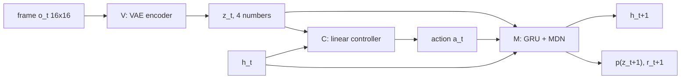

# World Models (VAE + RNN)

> Compress what you see, predict what comes next, and you can practice inside your own head: the agent learns to act in a dream and then wakes up and does it for real.

**Type:** Build
**Languages:** Python
**Prerequisites:** Model-Based RL (this phase), Phase 06 (Autoencoders and Self-Supervised: Variational Autoencoders), Phase 04 (Sequence Models: LSTM and GRU)
**Time:** ~90 minutes

## Learning Objectives

- Describe the V-M-C architecture of Ha and Schmidhuber's World Models
- Train a VAE that compresses image observations into a small latent `z`
- Build an MDN-RNN that predicts a mixture-of-Gaussians distribution over the next latent, plus the reward
- Train a controller with an evolution strategy using only imagined rollouts, then transfer it to the real environment
- Match a hand-written mixture density loss against `torch.distributions.MixtureSameFamily`

## The Problem

The dynamics model in the previous lesson worked on four clean numbers: position, velocity, angle, angular velocity. Real agents rarely get that. A robot sees camera images; a game agent sees pixels. You could train a dynamics model on raw pixels, but predicting 256 or 50,000 pixel values per step is expensive and most of them carry no information about what matters.

There is a second problem: a single frame is not a full state. A picture of a ball does not tell you which way it is moving. The agent needs memory.

World Models (Ha and Schmidhuber, 2018) split the problem in three. A vision model compresses each frame into a few numbers. A memory model, a recurrent network, learns how those numbers evolve given the agent's actions, and in doing so builds the missing state (like velocity) into its hidden state. A tiny controller then picks actions from the compressed code and the memory. Because the memory model can generate futures on its own, the controller can be trained entirely in this "dream".

## The Concept

### V, M and C



| Part | Network | Trained on | Objective |
|------|---------|-----------|-----------|
| V | MLP VAE, 256 pixels to `z` in R^4 | single random frames | reconstruction + KL |
| M | GRU (64 units) + mixture density head + reward head | sequences of `(z_t, a_t)` | NLL of `z_{t+1}`, MSE of `r_{t+1}` |
| C | linear map from `[z_t, h_t]` (68 numbers) to 5 action scores | imagined rollouts in M | maximize predicted return |

The controller has only 345 parameters. All the representational work is done by V and M, which are trained with ordinary supervised losses on data from a random policy. Only C sees the reward, and C is small enough to optimize with a gradient-free method.

### Why a mixture density network

The next latent is uncertain: the same `(z, h, a)` can lead to different outcomes, for example a bounce or no bounce off a wall. Regressing with MSE would predict the average of the possible outcomes, which might be none of them. A mixture density network (MDN) outputs the parameters of a mixture of `K` Gaussians:

```
p(z' | h) = sum_k pi_k(h) * N(z' ; mu_k(h), sigma_k(h)^2)

NLL = - log sum_k exp( log pi_k + sum_d log N(z'_d ; mu_kd, sigma_kd) )
```

The `log sum exp` is computed with `torch.logsumexp` for numerical stability. Sampling means first picking a component from `pi`, then sampling from that Gaussian.

### Dreaming, and the temperature knob

Once M is trained you can roll it forward without the real environment: sample `z_{t+1}` from the mixture, feed it back in, ask C for the next action, and sum the predicted rewards. The temperature `tau` scales the uncertainty of the samples. Ha and Schmidhuber found that training in a slightly noisier dream (`tau > 1`) made controllers more robust, because a controller that only works in a perfectly predictable dream is exploiting the model's mistakes.

### Evolution strategies

C's actions are an argmax, which has no useful gradient. An evolution strategy treats the return as a black box:

```
sample noise eps_1..eps_n,   include -eps_i too (antithetic pairs)
score each theta + sigma * eps_i by a dream rollout
rank the scores, map ranks to utilities in [-0.5, 0.5]
theta <- theta + lr / (n sigma) * sum_i utility_i * eps_i
```

Rank-based utilities make the update insensitive to the scale of the rewards. The original paper used CMA-ES, a more sophisticated relative of this update.

## Build It

### Step 1: The ball world

`BallWorld` simulates many balls in a unit square. Each of 5 actions (none, up, down, left, right) adds a small push, velocity decays by a friction factor of 0.8, and balls bounce off the walls. Observations are 16x16 images of a Gaussian blob; the reward is minus the distance to the center. `collect_rollouts` runs 300 episodes of 30 steps with a "sticky" random policy (each step, a 30% chance to switch action).

### Step 2: V, the VAE

```python
def vae_loss(vae, frames, generator, beta=1.0):
    logits, mean, log_var = vae(frames, generator)
    reconstruction = F.binary_cross_entropy_with_logits(logits, frames, reduction="sum") / len(frames)
    kl = -0.5 * (1 + log_var - mean**2 - log_var.exp()).sum() / len(frames)
    return reconstruction + beta * kl, reconstruction, kl
```

This is the VAE from Phase 06 with a 4-dimensional latent. Reconstruction error drops from 180 to about 11 nats per frame. After training, every frame of every episode is encoded to its mean latent, so M trains on sequences of 4 numbers instead of 256 pixels.

### Step 3: M, the MDN-RNN

```python
def mixture_params(self, h):
    raw = self.mdn(h)
    logit_pi = raw[..., :self.mixtures]
    mu, log_sigma = raw[..., self.mixtures:].reshape(*h.shape[:-1], self.mixtures, 2, self.latent).unbind(-2)
    return logit_pi, mu, log_sigma.clamp(-5, 2)


def mdn_nll(logit_pi, mu, log_sigma, target):
    target = target.unsqueeze(-2)
    log_normal = -0.5 * ((target - mu) / log_sigma.exp()) ** 2 - log_sigma - 0.5 * math.log(2 * math.pi)
    log_mix = torch.log_softmax(logit_pi, -1) + log_normal.sum(-1)
    return -torch.logsumexp(log_mix, -1).mean()
```

The GRU reads `[z_t, one_hot(a_t)]`. A linear head turns `h_t` into 3 mixture weights, 3 means and 3 standard deviations over the 4 latent dimensions. A second head predicts the reward from `[h_t, z_{t+1}]`. The NLL becomes negative (around -9) because the latent densities are sharp; that is normal for continuous variables.

### Step 4: C, trained in the dream

```python
def dream_rollouts(params, model, controller, start_z, steps, temperature, generator):
    ...
    for _ in range(steps):
        action = controller.act(params, torch.cat([z, h[0]], -1))
        out, h = model(z[:, None], action[:, None], h)
        z = sample_mdn(*model.mixture_params(out[:, 0]), temperature, generator)
        total = total + model.predict_reward(out[:, 0], z)
```

Every member of the ES population (64 candidates) is rolled out from 32 starting latents for 30 imagined steps, all as one batch. Sixty generations take a few seconds, and the mean dream return climbs from about -10 to about -2.8.

### Step 5: Wake up

In the real world the agent encodes each frame with V, feeds `z` and its chosen action into M to update `h`, and uses C to act. It never sees the true position or velocity. Over 64 real episodes of 40 steps:

| Policy | Mean reward | Final distance to center |
|--------|------------|-------------------------|
| random actions | -0.33 | 0.33 |
| world-model agent | -0.10 | 0.07 |
| oracle using the true state | -0.07 | 0.01 |

The dream-trained agent gets most of the way to the oracle without a single real-world training episode for the controller. The saved figure shows real frames, VAE reconstructions, and a dreamed sequence decoded back to pixels.

## Use It

`torch.distributions` can build the same mixture:

```python
mixture = MixtureSameFamily(Categorical(logits=logit_pi), Independent(Normal(mu, log_sigma.exp()), 1))
nll = -mixture.log_prob(target).mean()
```

`Independent(..., 1)` turns 4 independent Normals into one 4-dimensional diagonal Gaussian, and `MixtureSameFamily` mixes the 3 components. The value matches `mdn_nll` to every printed digit. In practice you would use this version, and `nn.GRU` (as here) rather than a hand-written cell. The original World Models used a convolutional VAE on 64x64 frames, an LSTM with 256 units and 5 mixture components, and CMA-ES for the controller; the structure is identical.

## Exercises

1. **Easy.** Train the controller with temperature 0.3 and with 2.0 instead of 1.0, and compare the real-world reward. Does the dream with less noise produce a better or worse real agent?
2. **Medium.** Give the controller only `z` (zero out the `h` part of its input). The ball has momentum, so a single frame does not show velocity. How much worse is it, and why?
3. **Hard.** Implement iterative training: collect new real episodes with the trained agent (plus some epsilon-random actions), add them to the data, retrain V and M, and evolve C again. Track the gap between the dream return and the real return over three iterations.

## Key Terms

| Term | What people say | What it actually means |
|------|----------------|----------------------|
| World model | "The agent's simulator" | A learned generative model of how observations (or their latents) evolve given actions |
| V (vision) | "The encoder" | A VAE that maps each observation to a small latent code `z` |
| M (memory) | "The RNN" | A recurrent model that predicts the distribution of the next latent and the reward |
| C (controller) | "The policy" | A small model that maps `[z, h]` to actions |
| MDN | "Mixture output" | A network whose outputs are the weights, means and variances of a Gaussian mixture |
| Dreaming | "Training in imagination" | Optimizing the controller on rollouts sampled from M instead of the real environment |
| Temperature | "Dream noise" | A factor that scales sampling uncertainty in M; higher values make the dream harder to exploit |
| Evolution strategy | "Gradient-free optimization" | Perturb parameters, score them, move toward the perturbations that scored well |

## Further Reading

- [Ha and Schmidhuber, World Models (2018)](https://arxiv.org/abs/1803.10122) - the paper this lesson reproduces in miniature; the [interactive version](https://worldmodels.github.io/) is excellent
- [Bishop, Mixture Density Networks (1994)](https://publications.aston.ac.uk/id/eprint/373/) - the original MDN report
- [Salimans et al., Evolution Strategies as a Scalable Alternative to Reinforcement Learning (2017)](https://arxiv.org/abs/1703.03864) - antithetic sampling and rank-based utilities for ES
- [PyTorch docs: torch.distributions](https://pytorch.org/docs/stable/distributions.html) - `MixtureSameFamily`, `Independent` and friends
