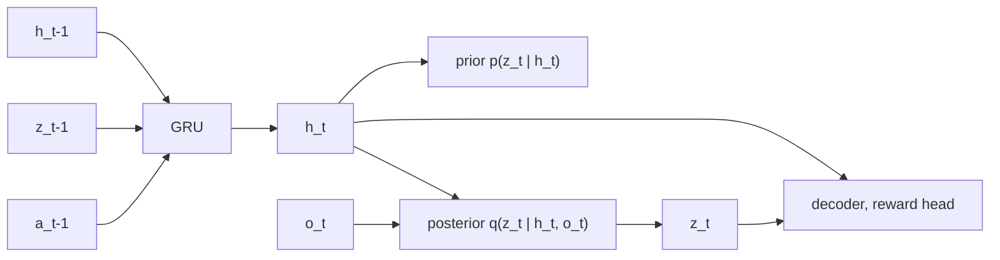

# Dreamer Intuition

> If your world model is differentiable, imagination is not just a place to test plans: you can backpropagate the imagined future straight into the policy.

**Type:** Build
**Languages:** Python
**Prerequisites:** World Models (VAE + RNN), Policy Gradients (this phase), Phase 06 (Autoencoders and Self-Supervised: Variational Autoencoders)
**Time:** ~90 minutes

## Learning Objectives

- Explain the recurrent state-space model (RSSM): a deterministic GRU path plus a stochastic latent with a prior and a posterior
- Train the RSSM with reconstruction, reward prediction and a KL term with free nats
- Compute lambda-returns from imagined rewards and a learned critic
- Train an actor by backpropagating lambda-returns through the learned dynamics
- Run the full Dreamer loop: train the model, learn behavior in imagination, collect new data with the actor

## The Problem

The World Models agent of the previous lesson had three separate training stages, a controller with a few hundred parameters, and a black-box optimizer that scored candidates by brute force. That does not scale: an evolution strategy with a million policy parameters would need an enormous population.

Two observations point to something better. First, the world model is a neural network, so the imagined return is a differentiable function of the actions. Second, imagination is cheap and can be batched, so you can start thousands of imagined trajectories from states you have actually visited. Dreamer (Hafner et al., 2019-2023) combines these: it learns a latent dynamics model and trains an actor-critic purely on imagined trajectories, with the actor's gradient flowing back through the model. DreamerV3 used this recipe to collect diamonds in Minecraft from pixels, without human data.

In this lesson you build the core of Dreamer on a point mass that only reports its noisy position. The agent must infer velocity, learn the dynamics, and learn to stop at the goal, all inside its own model.

## The Concept

### The recurrent state-space model

The RSSM state has two parts: a deterministic `h_t` that carries memory, and a stochastic `z_t` that captures what is uncertain.

```
h_t       = GRU(h_{t-1}, [z_{t-1}, a_{t-1}])      deterministic path
prior     p(z_t | h_t)                            what the model expects before looking
posterior q(z_t | h_t, o_t)                       what it believes after seeing o_t
decoder   p(o_t | h_t, z_t)
reward    p(r_t | h_t, z_t)
```



During training on real sequences, you use the posterior (it has seen the observation). During imagination, there is no observation, so you sample from the prior. The KL term `KL(q || p)` trains the prior to predict what the posterior will see, which is exactly what makes imagination accurate.

### The world model loss

```
L_model = sum_t [ ||decoder(h_t, z_t) - o_t||^2 + (reward(h_t, z_t) - r_t)^2 + max(free_nats, KL(q_t || p_t)) ]
```

Free nats: below a threshold, the KL is not penalized. Without it, the model can satisfy the KL term by making the posterior ignore the observation, which wrecks the representation.

### Learning behavior in imagination

Start from posterior states of a real batch, roll the prior forward `H` steps with actions from the actor, and predict rewards. A critic `v(s)` estimates the value beyond the horizon. The lambda-return mixes short and long bootstrapped estimates:

```
R_t^lambda = r_t + gamma * [ (1 - lambda) v(s_{t+1}) + lambda R_{t+1}^lambda ]
R_H^lambda = v(s_H)
```

- **Actor:** maximize `mean(R^lambda)`. The actions are reparameterized samples (`tanh(mean + std * eps)`), so gradients flow from the return through the reward head, the GRU and the prior into the actor's parameters. This is analytic gradient through the model, not REINFORCE.
- **Critic:** regress `v(s_t)` to the detached `R_t^lambda`.

```
real data  -->  RSSM (posterior)  -->  start states
                                         |
                    actor --a--> RSSM prior --> z, h --> reward head, critic
                      ^                                         |
                      +------------ d(lambda-return)/d(a) ------+
```

The world model's weights are frozen during the actor update, so the actor cannot "improve" the return by bending the model.

### The Dreamer loop

```
repeat:
    train RSSM on sequences from the replay data
    imagine from those posterior states; update actor and critic
    run the actor (with exploration noise) in the real environment; add episodes to the data
```

## Build It

### Step 1: A partially observed point mass

`PointMassWorld` has position and velocity in `[-1, 1]^2`, friction 0.8 and a continuous 2D force. The observation is position plus Gaussian noise of 0.01; velocity is never observed. Reward is minus the distance to the origin. The data starts with 64 random episodes of 40 steps.

### Step 2: The RSSM

```python
def obs_step(self, h, z, action, obs, generator=None):
    h, prior_mean, prior_std = self.img_step(h, z, action)
    post_mean, post_std = gaussian(self.posterior_net(torch.cat([h, obs], -1)))
    z = post_mean + post_std * torch.randn(post_mean.shape, generator=generator)
    return h, z, (prior_mean, prior_std), (post_mean, post_std)
```

`img_step` advances the GRU and returns the prior; `obs_step` adds the posterior on top. `observe` loops `obs_step` over a sequence and stacks everything. Standard deviations go through `softplus` plus a minimum of 0.1 so they never collapse to zero.

### Step 3: World model loss with a hand-written KL

```python
def gaussian_kl(mean_q, std_q, mean_p, std_p):
    return (torch.log(std_p / std_q) + (std_q**2 + (mean_q - mean_p) ** 2) / (2 * std_p**2) - 0.5).sum(-1)
```

`world_model_loss` weights reconstruction and reward MSE by 100 (the observations are small numbers) and applies `torch.clamp(kl, min=free_nats)` with 1 free nat.

### Step 4: Imagination and lambda-returns

```python
def lambda_returns(rewards, values, gamma, lam):
    returns = torch.zeros_like(rewards)
    next_return = values[:, -1]
    for t in reversed(range(rewards.shape[1])):
        next_return = rewards[:, t] + gamma * ((1 - lam) * values[:, t + 1] + lam * next_return)
        returns[:, t] = next_return
    return returns
```

`imagine` rolls 15 steps from every posterior state of the batch (32 sequences of 16 steps, so 512 start states). In `train_behavior` the RSSM parameters have `requires_grad_(False)`, the actor loss is `-returns.mean()`, and the critic is fitted to `returns.detach()`.

### Step 5: Run the loop

Five rounds, each with 100 model and behavior updates followed by 16 new real episodes from the exploring actor. A typical run:

- round 0: the actor has barely trained, the model is poor, and the real reward is worse than random (it pushes into a wall)
- round 2: reward jumps to about -0.14 and the final distance to the goal drops to about 0.1
- round 4: about -0.1, close to a hand-tuned PD controller (-0.09) that estimates velocity from frame differences

The saved plot shows one real trajectory and an open-loop dream from step 10, where the model imagines the same actions without new observations. The dream drifts: errors compound, which is why Dreamer re-starts imagination from fresh posterior states at every update and keeps horizons short.

## Use It

The KL between two diagonal Gaussians is built into `torch.distributions`:

```python
library = kl_divergence(Normal(qm, qs), Normal(pm, ps)).sum(-1).mean()
```

It matches `gaussian_kl` exactly. The real Dreamer adds several pieces you can read about in the papers: a convolutional encoder and decoder for pixels, discrete categorical latents with straight-through gradients (DreamerV2), KL balancing that trains the prior faster than the posterior, symlog-scaled rewards and returns, and return normalization so one set of hyperparameters works across many domains (DreamerV3). The structure of the training loop is the one you just wrote.

## Exercises

1. **Easy.** Set `free_nats=0` and rerun. Watch the KL and the real reward per round. What happens to the posterior and why?
2. **Medium.** Replace the analytic actor gradient with REINFORCE inside imagination: detach the features, compute `log pi(a|s)` for the sampled actions, and weight them by `returns - values`. Compare the learning speed of the two estimators with the same number of updates.
3. **Hard.** Change the imagination horizon to 5 and 30, and lambda to 0 and 1. Build a small table of real reward after five rounds. Explain the result using what you learned about compounding model error and about bootstrapping.

## Key Terms

| Term | What people say | What it actually means |
|------|----------------|----------------------|
| RSSM | "Dreamer's world model" | A latent dynamics model with a deterministic recurrent state `h` and a stochastic state `z` |
| Prior | "The model's guess" | `p(z_t \| h_t)`: the distribution of the latent before seeing the observation; used in imagination |
| Posterior | "The model's belief" | `q(z_t \| h_t, o_t)`: the latent after incorporating the observation; used on real data |
| Free nats | "KL floor" | A threshold below which the KL is not penalized, preventing posterior collapse |
| Imagination | "Latent rollouts" | Trajectories generated by the prior and the actor without touching the environment |
| Lambda-return | "TD(lambda) target" | An exponentially weighted mix of n-step returns that trades bias against variance |
| Dynamics backpropagation | "Pathwise gradient" | Differentiating the imagined return with respect to the actor through the model's transitions |
| Actor-critic | "Policy plus value" | A policy network trained using value estimates from a separately trained critic |

## Further Reading

- [Hafner et al., Dream to Control: Learning Behaviors by Latent Imagination (DreamerV1, 2019)](https://arxiv.org/abs/1912.01603) - the actor-critic in imagination with gradients through the model
- [Hafner et al., Learning Latent Dynamics for Planning from Pixels (PlaNet, 2018)](https://arxiv.org/abs/1811.04551) - introduces the RSSM, with CEM planning instead of an actor
- [Hafner et al., Mastering Diverse Domains through World Models (DreamerV3, 2023)](https://arxiv.org/abs/2301.04104) - the robust version that collects diamonds in Minecraft
- [Danijar Hafner's DreamerV3 repository](https://github.com/danijar/dreamerv3) - the reference implementation
