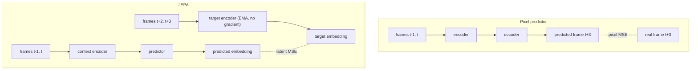

# JEPA and Video Prediction

> Predict the future in the space of ideas, not pixels: a world model only has to know where the ball goes, not the exact noise on every pixel.

**Type:** Build
**Languages:** Python
**Prerequisites:** World Models (VAE + RNN), Dreamer Intuition (this phase), Phase 06 (Autoencoders and Self-Supervised: Contrastive Learning, Masked Autoencoders)
**Time:** ~75 minutes

## Learning Objectives

- Explain the difference between generative (pixel) prediction and joint-embedding predictive architectures (JEPA)
- Build a pixel-space video predictor and a latent-space JEPA predictor on the same data
- Show representation collapse in naive latent prediction and prevent it with an EMA target encoder and stop-gradient
- Evaluate learned representations with linear probes
- Match a hand-written EMA against `torch.optim.swa_utils.AveragedModel`

## The Problem

Every world model so far reconstructed its observations. The VAE in World Models decoded pixels, and Dreamer's loss includes reconstruction. That forces the model to spend capacity on every detail of the input, including details that are irrelevant or unpredictable: the texture of a carpet, leaves moving in the wind, sensor noise. For video, it is worse. The future is uncertain, and a model trained with pixel MSE responds to uncertainty by predicting the average of all possible futures, which is a blur.

Yann LeCun's proposal, the joint-embedding predictive architecture (JEPA), is to predict in representation space instead. Encode the context, encode the target, and train a predictor to map one embedding to the other. The encoder is then free to throw away whatever cannot be predicted. I-JEPA (images) and V-JEPA (video) from Meta use this idea to learn strong visual features without reconstructing pixels, and V-JEPA 2 uses it as a world model for robot planning.

The catch is that predicting your own embedding has a trivial solution: map everything to the same constant vector. Then the prediction is always perfect, and the representation is useless. This lesson shows that collapse happening and the standard fix.

## The Concept

### Two ways to predict the future



| | Pixel prediction | JEPA |
|---|---|---|
| Output | 256 pixel values | 32 numbers |
| Must model | everything, including noise | only what the encoder chooses to keep |
| Under uncertainty | blurry average | an average in feature space, which can still be meaningful |
| Failure mode | wasted capacity, blur | collapse to a constant |

### Collapse and how to avoid it

If the same encoder produces both the prediction input and the target, and gradients flow through both sides, the loss `||predictor(f(x)) - f(y)||^2` is minimized by `f = constant`. Gradient descent finds that quickly.

JEPA, like BYOL before it, breaks the symmetry:

- **Stop-gradient on the target.** The target embedding is treated as a constant, so the loss cannot pull it toward the prediction.
- **EMA target encoder.** The target encoder's weights are an exponential moving average of the context encoder's weights: `theta_target <- d * theta_target + (1 - d) * theta_context` with `d = 0.99`. It changes slowly and follows the context encoder.
- **A predictor.** The asymmetry between the two branches (one has an extra network) also matters.

Why this does not collapse is not fully understood theoretically, but empirically it works. Other JEPA variants add explicit variance and covariance regularizers (VICReg) instead.

### JEPA as a world model

The predictor in this lesson only sees the context. Add the agent's action as an extra input and it becomes an action-conditioned latent dynamics model, the same role the MDN-RNN and the RSSM played in the previous lessons, but trained without any reconstruction:

```
z_t     = encoder(o_{t-1}, o_t)
z_t+k   ~ predictor(z_t, a_t ... a_t+k-1)        compared with target_encoder(o_t+k)
```

A planner can then search over actions to bring the predicted embedding close to the embedding of a goal image. V-JEPA 2-AC does exactly this for robot manipulation.

### Linear probes

How do you know if a representation is good, without a downstream task? Freeze it, then fit a linear model from embeddings to quantities you care about, here the ball's position and velocity. A high R^2 means the information is present and linearly accessible. A collapsed encoder scores 0.

## Build It

### Step 1: Videos with uncertainty and clutter

`make_videos` simulates a ball bouncing in a box. Each step there is a 15% chance of a random kick that changes the direction, so the future is not deterministic. Every frame also gets fresh uniform noise of amplitude 0.35 on every pixel: clutter that is impossible to predict. The data is 3000 training and 1000 test videos of 12 frames. The model's input is two consecutive frames (so velocity is visible) and the target is 3 steps ahead.

### Step 2: The pixel predictor

An MLP encoder maps the 512 input pixels to a 32-dimensional embedding, and a decoder maps it to the 256 pixels of frame `t+3`, trained with MSE. Its error falls to about 0.017, but predicting a flat gray image already gives 0.024. Most of what remains is clutter, which no model can predict and which the loss keeps asking for.

### Step 3: JEPA

```python
prediction = predictor(context_encoder(context))
if collapse:
    target_embedding = context_encoder(target)
else:
    with torch.no_grad():
        target_embedding = target_encoder(target)
loss = F.mse_loss(prediction, target_embedding)
...
with torch.no_grad():
    for p_target, p_online in zip(target_encoder.parameters(), context_encoder.parameters()):
        p_target.mul_(ema_decay).add_((1 - ema_decay) * p_online)
```

The target branch runs under `no_grad` and the target encoder's weights only change through the EMA update after each optimizer step. Watch the "embedding std across batch" column: it grows from about 0.008 to about 0.45, meaning different inputs get different embeddings. The latent loss goes up during training, which is fine: the targets are spreading out, so there is more to predict.

### Step 4: Watch it collapse

With `collapse=True`, the target comes from the context encoder itself and gradients flow into it. Within 500 steps the loss is exactly 0 and the embedding std has shrunk toward 0.001. A perfect loss and a useless representation.

### Step 5: Probe all the encoders

`linear_probe` fits a `Ridge` regression from frozen embeddings of frames `(t-1, t)` to the ball's position and velocity at `t`, and scores on the test videos:

| Encoder | Position R^2 | Velocity R^2 |
|---------|-------------|-------------|
| random init | 0.50 | 0.00 |
| pixel predictor | 0.95 | 0.43 |
| naive (collapsed) | 0.00 | 0.00 |
| JEPA | 0.94 | 0.48 |

JEPA learns the ball's state as well as the pixel predictor, without a decoder and without ever being asked to produce a pixel. On a toy 16x16 world the two are close. The gap grows with the amount of unpredictable detail and with the cost of decoding high-resolution video, which is the regime V-JEPA targets. Velocity is harder for every encoder because the per-frame clutter is large compared with the ball's motion between two frames.

## Use It

PyTorch has a utility for exactly this kind of weight averaging:

```python
library_ema = AveragedModel(context_encoder, multi_avg_fn=get_ema_multi_avg_fn(ema_decay))
...
library_ema.update_parameters(context_encoder)
```

`AveragedModel` keeps its own copy of the module, and `get_ema_multi_avg_fn` implements the EMA update. After training, its weights match the hand-written target encoder to about `1e-6` (float rounding). The same utility is used for stochastic weight averaging and for the EMA weights that diffusion models sample with (Phase 08). Meta's official I-JEPA and V-JEPA code uses Vision Transformer encoders with masking: the context is a set of visible patches and the targets are the embeddings of masked patches, but the loss, the predictor and the EMA target are the same as in this lesson.

## Exercises

1. **Easy.** Change `ema_decay` to 0.9 and to 0.999. How do the embedding std and the probe scores change? What happens with `ema_decay = 0` (the target is a copy of the current encoder, but still with stop-gradient)?
2. **Medium.** Raise the clutter amplitude to 0.8. Retrain the pixel predictor and JEPA and compare the probe scores. Which method degrades more, and why?
3. **Hard.** Add a VICReg-style variance term to the naive (collapsing) setup: penalize `relu(1 - std(embedding, dim=0)).mean()`. Does it prevent collapse without an EMA target? Compare its probe scores with JEPA.

## Key Terms

| Term | What people say | What it actually means |
|------|----------------|----------------------|
| JEPA | "LeCun's world model" | Joint-embedding predictive architecture: predict the embedding of a target from the embedding of a context |
| Generative prediction | "Predict the pixels" | Training a model to output the future observation itself, typically with a pixel loss |
| Representation collapse | "Everything maps to the same point" | A degenerate solution where the encoder outputs a constant, making the prediction loss zero |
| Stop-gradient | "Detach the target" | Treating the target embedding as a constant during backpropagation |
| EMA target encoder | "Momentum encoder" | A slowly updated copy of the encoder whose weights are an exponential moving average of the online weights |
| Linear probe | "Frozen features + linear model" | Measuring what a representation encodes by fitting a linear model on top of it |
| I-JEPA / V-JEPA | "Image / video JEPA" | Meta's JEPA models that predict embeddings of masked image or video regions |

## Further Reading

- [LeCun, A Path Towards Autonomous Machine Intelligence (2022)](https://openreview.net/forum?id=BZ5a1r-kVsf) - the position paper that proposes JEPA as the basis for world models
- [Assran et al., Self-Supervised Learning from Images with a Joint-Embedding Predictive Architecture (I-JEPA, 2023)](https://arxiv.org/abs/2301.08243) - JEPA on images with masked patch prediction
- [Bardes et al., Revisiting Feature Prediction for Learning Visual Representations from Video (V-JEPA, 2024)](https://arxiv.org/abs/2404.08471) - JEPA on video, the setting of this lesson
- [Grill et al., Bootstrap Your Own Latent (BYOL, 2020)](https://arxiv.org/abs/2006.07733) - the EMA target plus predictor recipe that avoids collapse without negatives
