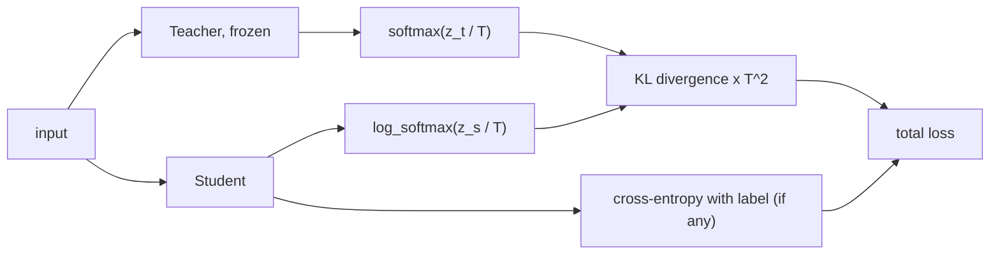

# Knowledge Distillation

> A big model knows more than its top answer: train a small model on the big model's full probability distribution and it inherits the knowledge without the size.

**Type:** Build
**Languages:** Python
**Prerequisites:** Quantization (this phase), Phase 01 (Neural Networks: Loss Functions for Networks), Phase 02 (Training Deep Nets: Dropout and Weight Decay)
**Time:** ~60 minutes

## Learning Objectives

- Explain "dark knowledge": the information in a teacher's non-top probabilities
- Implement softmax with temperature and the distillation loss, including the `T^2` scaling
- Use a teacher to train a 125x smaller student on unlabeled data
- Reproduce Hinton's experiment where a student learns a class it never saw
- Match the hand-written loss against `F.kl_div`

## The Problem

The best model on your validation set is usually big: an ensemble, a deep network trained with heavy regularization, a large pretrained model. The model you can deploy is small: it has to fit on a phone, answer in 10 ms, or cost a fraction of a cent per call. Training the small model directly on your labels usually leaves a lot of accuracy on the table, because a small network learns less from one-hot labels than a big one does.

Knowledge distillation (Hinton, Vinyals and Dean, 2015) trains the small model to imitate the big one. The teacher's output says more than "this is a 3": it says "this is a 3, it looks a bit like a 9, and a little like a 5 or an 8". Those relative probabilities describe how the teacher has organized the input space, and a student can learn that structure much faster than it could discover it from labels. Distillation is how DistilBERT is 40% smaller than BERT while keeping 97% of its language understanding, and how many small production language models are trained from larger ones.

## The Concept

### Temperature

A softmax with temperature `T`:

```
p_i(T) = exp(z_i / T) / sum_j exp(z_j / T)
```

`T = 1` is the usual softmax. A trained teacher is very confident, so at `T = 1` the non-top probabilities are tiny (0.006 or less) and carry almost no gradient. Raising `T` softens the distribution and exposes the ranking:

```
teacher on an image of a 3:
T = 1    3: 0.994   9: 0.006   5: 0.000   8: 0.000
T = 4    3: 0.712   9: 0.201   5: 0.024   8: 0.024
T = 10   3: 0.339   9: 0.204   5: 0.088   8: 0.087
```

This "dark knowledge" says that 3s resemble 9s more than they resemble 5s or 8s, which a one-hot label never could.

### The distillation loss

```
L = alpha * T^2 * KL( p_teacher(T) || p_student(T) )  +  (1 - alpha) * CE(p_student(1), y)
```



Why `T^2`? The gradient of the soft term with respect to the student's logits is `(p_student(T) - p_teacher(T)) / T`, and for large `T` the probability differences themselves shrink like `1/T`. The gradient magnitude falls as `1/T^2`, so multiplying by `T^2` keeps the soft term on the same scale as the hard term when you change the temperature.

The soft term needs no labels at all. Any unlabeled data the teacher can run on becomes training data for the student. This is the "transfer set".

## Build It

### Step 1: Teacher and student

The teacher is an MLP with two hidden layers of 512 units and dropout, trained on 1200 digits: 301,066 parameters, 98.2% test accuracy. The student has one hidden layer of 32 units: 2,410 parameters, 125 times smaller. Both see inputs with a little Gaussian noise during training (a cheap augmentation).

### Step 2: Softmax with temperature and the loss

```python
def softmax_with_temperature(logits, temperature):
    scaled = logits / temperature
    scaled = scaled - scaled.max(dim=1, keepdim=True).values
    exp = scaled.exp()
    return exp / exp.sum(dim=1, keepdim=True)


def distillation_loss(student_logits, teacher_logits, labels, temperature, alpha):
    p_teacher = softmax_with_temperature(teacher_logits, temperature)
    log_p_student = torch.log_softmax(student_logits / temperature, dim=1)
    soft = (p_teacher * (torch.log(p_teacher + 1e-12) - log_p_student)).sum(1).mean() * temperature**2
    if labels is None:
        return soft
    hard = F.cross_entropy(student_logits, labels)
    return alpha * soft + (1 - alpha) * hard
```

Subtracting the max before `exp` prevents overflow. `KL(p || q) = sum p (log p - log q)`; the `p log p` part is constant with respect to the student, but including it makes the loss zero when the student matches the teacher exactly.

### Step 3: Scarce labels, plenty of unlabeled data

Suppose only 100 images are labeled, but you have 1200 images in total. Three students, each averaged over 3 seeds:

| Student | Test accuracy |
|---------|---------------|
| hard labels on the 100 labeled images | 0.886 |
| teacher's argmax as labels on all 1200 | 0.975 |
| teacher's soft targets (T=4) on all 1200 | 0.969 |

Using the teacher to annotate unlabeled data is worth almost 9 points. On this easy dataset the teacher is almost always right, so its hard pseudo-labels work as well as the soft targets. The soft targets show their value in the next experiment, and in harder problems where the teacher is often uncertain.

### Step 4: Learning a digit you never saw

Remove every 3 from the transfer set and train two students: one on hard labels, one only on the teacher's soft targets at `T = 8`:

| Student | Overall | On 3s |
|---------|---------|-------|
| hard labels, no 3s | 0.881 | 0.000 |
| soft targets, no 3s | 0.970 | 0.864 |
| soft targets, bias of class 3 raised by 3 | 0.978 | 0.949 |

The hard-label student cannot output a class that never appears in its labels. The distilled student recognizes 86% of the 3s, purely because the teacher's soft outputs on 5s, 8s and 9s said how much they look like a 3. Its output bias for class 3 is too low (it never saw 3 as the top class), and raising it, as Hinton did in the original paper, brings it to 95%.

## Use It

PyTorch's `F.kl_div` expects the student's log-probabilities as input. With `log_target=True` it also takes the teacher's log-probabilities, which is more numerically stable:

```python
library = F.kl_div(F.log_softmax(s_logits / temperature, 1), F.log_softmax(t_logits / temperature, 1),
                   reduction="batchmean", log_target=True) * temperature**2
```

`reduction="batchmean"` divides by the batch size, which is the mathematically correct KL; the default `"mean"` divides by batch times classes and silently shrinks your loss. The value matches the hand-written one. In practice, distillation also matches intermediate features (FitNets, TinyBERT), uses the same loss with sequences of token distributions for language models, and is often combined with quantization and pruning from the neighboring lessons.

## Exercises

1. **Easy.** Rerun the "no 3s" experiment with `T = 1` and `T = 2`. How does the accuracy on 3s change with the temperature? Connect your answer to the table in "Temperature".
2. **Medium.** Train students with 8, 16, 32 and 64 hidden units, with hard labels on all 1200 images and with distillation (`alpha = 0.9`, `T = 4`). Plot accuracy against size for both. Where does distillation help most?
3. **Hard.** Corrupt 30% of the labels in the training set at random. Train a teacher on the noisy labels, then compare a student trained on the noisy labels with one distilled from the teacher. Explain why distillation can act as a label-noise filter.

## Key Terms

| Term | What people say | What it actually means |
|------|----------------|----------------------|
| Knowledge distillation | "Teacher-student training" | Training a small model to match a larger model's output distribution |
| Teacher | "The big model" | A trained, frozen model whose outputs provide the training targets |
| Student | "The small model" | The model being trained, usually much smaller and faster |
| Soft targets | "Teacher probabilities" | The teacher's full softmax output, as opposed to one-hot labels |
| Temperature | "Softening" | A divisor of the logits before the softmax; higher values flatten the distribution |
| Dark knowledge | "What the teacher knows" | The information in the relative sizes of the non-top probabilities |
| Transfer set | "Distillation data" | The inputs on which the student imitates the teacher; they need no labels |
| `T^2` scaling | "Loss rescale" | Multiplying the soft loss by `T^2` so its gradients keep the same magnitude as `T` changes |

## Further Reading

- [Hinton, Vinyals and Dean, Distilling the Knowledge in a Neural Network (2015)](https://arxiv.org/abs/1503.02531) - the original paper, including the missing-3 experiment
- [Bucila, Caruana and Niculescu-Mizil, Model Compression (2006)](https://dl.acm.org/doi/10.1145/1150402.1150464) - the earlier work that compressed ensembles into single networks
- [Sanh et al., DistilBERT, a distilled version of BERT (2019)](https://arxiv.org/abs/1910.01108) - distillation applied to a large pretrained transformer
- [PyTorch docs: Knowledge Distillation Tutorial](https://pytorch.org/tutorials/beginner/knowledge_distillation_tutorial.html) - distilling a CNN on CIFAR-10, including feature-based losses
