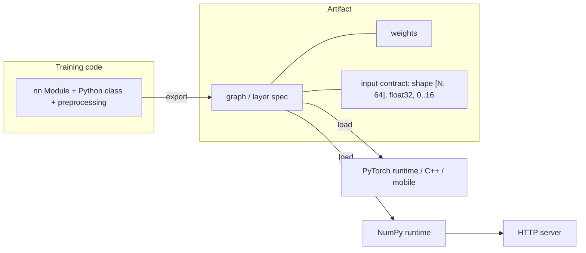

# Export and Serving

> A model is not deployed until something other than your training script can run it: freeze the graph and the weights into an artifact, put a small, strict API in front of it, and verify every step against the original.

**Type:** Build
**Languages:** Python
**Prerequisites:** Profiling, Quantization (this phase), Phase 01 (Neural Networks: PyTorch nn.Module), Phase 02 (Training Deep Nets: Mixed Precision and Checkpointing)
**Time:** ~60 minutes

## Learning Objectives

- Explain what an exported model artifact must contain: computation, weights, and the input contract
- Export a model to a framework-free format (JSON spec plus NumPy weights) and run it without PyTorch
- Serve predictions over HTTP with input validation, health checks and latency percentiles
- Export with `torch.export` using a dynamic batch dimension, save it, reload it and check numerical equality
- Know where TorchScript and ONNX fit today

## The Problem

At the end of training you have a Python object in memory and a `state_dict` on disk. Neither is a deployable model. A `state_dict` is only weights: to use it you need the exact Python class that created it, the same library versions, and the preprocessing code that lived in a notebook somewhere. When the serving team rewrites the preprocessing, a "divide by 16" goes missing and accuracy silently drops to chance.

Exporting turns the model into a self-contained artifact: a description of the computation (including preprocessing), the weights, and the input contract (shapes, dtypes, ranges). Serving wraps that artifact in an interface other programs can call, which must reject bad inputs instead of returning confident garbage. Both steps need a test that the deployed model gives the same outputs as the one you trained.

## The Concept

### What goes in an artifact



| Approach | How the graph is captured | Runs without Python? | Status |
|----------|--------------------------|----------------------|--------|
| `state_dict` + class | not captured | no | training checkpoints only |
| Custom spec (this lesson) | written by hand | yes, with your runtime | fine for small, fixed architectures |
| TorchScript | `torch.jit.script` / `trace` | yes (libtorch) | deprecated |
| `torch.export` | symbolic tracing to an ATen-level graph | yes (AOTInductor, ExecuTorch) | current recommended path |
| ONNX | export to the ONNX operator set | yes (ONNX Runtime, TensorRT, ...) | widely used for cross-framework deployment |

### Put preprocessing inside the model

The model in this lesson takes raw 0-16 pixel values and divides by 16 internally, using a registered buffer. That way the scale is exported with the weights, and no client can forget it. The same applies to normalization constants, tokenizer IDs and label names.

### Dynamic shapes

Tracing a model with an example batch of 2 could bake the number 2 into the graph. `torch.export` lets you declare which dimensions are dynamic (`Dim("batch", min=1, max=1024)`), and it checks that the model's code is valid for every size in that range.

### Serving essentials

A minimal prediction service needs:

- a **health endpoint**, so load balancers know the process is up and the model is loaded
- a **predict endpoint** with a documented JSON schema
- **validation** that returns a 400 error with a clear message for malformed input
- **latency measurement** in percentiles (p50, p99), because averages hide the slow requests users notice

## Build It

### Step 1: The model with built-in preprocessing

```python
class DigitClassifier(nn.Module):
    def __init__(self):
        super().__init__()
        self.register_buffer("scale", torch.tensor(1 / 16.0))
        self.hidden = nn.Linear(64, 128)
        self.out = nn.Linear(128, 10)

    def forward(self, pixels):
        x = pixels * self.scale
        return torch.softmax(self.out(F.relu(self.hidden(x))), dim=-1)
```

It returns probabilities, not logits, so clients get directly usable outputs. Test accuracy is about 97%.

### Step 2: A framework-free export

`export_artifact` writes two files: `model.json` with the input contract, the ordered list of layers and the label names, and `weights.npz` with every tensor from the `state_dict` as a NumPy array.

```python
"layers": [
    {"op": "scale", "param": "scale"},
    {"op": "linear", "weight": "hidden.weight", "bias": "hidden.bias"},
    {"op": "relu"},
    {"op": "linear", "weight": "out.weight", "bias": "out.bias"},
    {"op": "softmax"},
],
```

### Step 3: A tiny runtime

`NumpyRuntime.run` interprets the layer list with NumPy: a multiply, `x @ W.T + b`, `maximum(x, 0)` and a stable softmax. Its outputs match PyTorch to about `5e-7`, which is float32 rounding. This runtime could ship in an environment with no PyTorch at all. It is also a miniature version of what ONNX Runtime does: read a graph of standard operators and execute each one.

### Step 4: An HTTP server

`make_handler` builds a `BaseHTTPRequestHandler` with `GET /health` and `POST /predict`. The predict handler parses JSON, accepts one image or a batch, checks that each image has exactly 64 values, and returns a label and confidence per image. The script starts a `ThreadingHTTPServer` on `127.0.0.1` with port 0 (the operating system picks a free port), calls it with `urllib`, and shuts it down.

- a valid batch of 3 images returns the right labels
- a request with 3 pixels returns `400 {"error": "expected 64 pixels per image, got shape [1, 3]"}`
- 100 sequential requests take about 0.5 ms at the median, with a p99 a few times higher

## Use It

### torch.export

```python
batch = torch.export.Dim("batch", min=1, max=1024)
exported = torch.export.export(model, (x_test[:2],), dynamic_shapes={"pixels": {0: batch}})
torch.export.save(exported, tmp / "model.pt2")
loaded = torch.export.load(tmp / "model.pt2").module()
```

The exported graph contains exactly the operators you would expect: `mul`, `linear`, `relu`, `linear`, `softmax`. It was traced with a batch of 2 and runs on the full test batch of 397 because the batch dimension is dynamic. The reloaded program matches the original exactly. From here, AOTInductor can compile the `.pt2` file into a shared library for C++ servers, and ExecuTorch can run it on phones and microcontrollers.

### TorchScript and ONNX

`torch.jit.script` still works and produces a file loadable from C++, but recent PyTorch releases mark it deprecated in favor of `torch.export` (the script silences the warnings). ONNX export is `torch.onnx.export(model, args, dynamo=True)`, which builds on `torch.export` and needs the `onnx` and `onnxscript` packages; the script skips that step when they are not installed. Production model servers such as TorchServe, NVIDIA Triton and ONNX Runtime Server add the things your 60-line server lacks: request batching (next lesson), multiple model versions, GPU scheduling and metrics.

## Exercises

1. **Easy.** Remove the `scale` buffer from the model and divide by 16 in the training loop instead. Export and serve it, then send raw pixels as a client would. What accuracy does the service have now?
2. **Medium.** Add a `"model_version"` field to `model.json` and to every `/predict` response, and add a `/metadata` endpoint that returns the input contract. Make the server reject inputs outside the documented `[0, 16]` range.
3. **Hard.** Add a convolution layer to `DigitClassifier` and extend `export_artifact` and `NumpyRuntime` with a `conv2d` op (implement it with `np.lib.stride_tricks.sliding_window_view`). Verify that your runtime still matches PyTorch to float32 precision.

## Key Terms

| Term | What people say | What it actually means |
|------|----------------|----------------------|
| Export | "Save the model" | Capturing the computation and weights into a self-contained artifact that does not need the training code |
| Artifact | "The model file" | Everything needed to run inference: graph or layer spec, weights, input contract, labels |
| Input contract | "The API schema" | The shapes, dtypes and value ranges the model expects |
| `torch.export` | "PyTorch's exporter" | Traces a module into an `ExportedProgram`: an ATen-level graph with explicit dynamic-shape constraints |
| Dynamic shape | "Variable batch size" | A dimension declared as symbolic so the exported graph works for a range of sizes |
| TorchScript | "JIT models" | The older PyTorch serialization format, now deprecated in favor of `torch.export` |
| ONNX | "The interchange format" | An open standard of operators and a file format supported by many runtimes and compilers |
| p99 latency | "Tail latency" | The latency below which 99% of requests complete; what the slowest users experience |

## Further Reading

- [PyTorch docs: torch.export](https://pytorch.org/docs/stable/export.html) - the programming model, dynamic shapes and the IR
- [PyTorch docs: Exporting a model to ONNX](https://pytorch.org/tutorials/beginner/onnx/export_simple_model_to_onnx_tutorial.html) - the `dynamo=True` exporter
- [ExecuTorch](https://pytorch.org/executorch/) - running exported PyTorch programs on mobile and edge devices
- [Sculley et al., Hidden Technical Debt in Machine Learning Systems (2015)](https://papers.nips.cc/paper/2015/hash/86df7dcfd896fcaf2674f757a2463eba-Abstract.html) - why the code around the model is where production ML usually breaks
