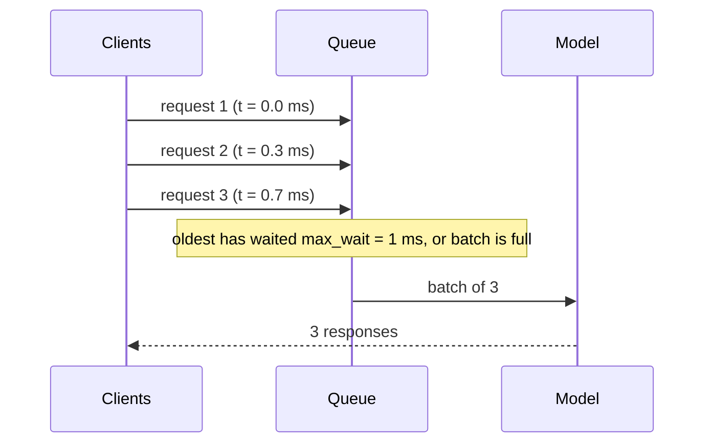

# Batching and Inference Optimization

> Inference is a different job from training: drop the autograd bookkeeping, fold away layers that became constants, and group requests so the hardware works on many at once.

**Type:** Build
**Languages:** Python
**Prerequisites:** Profiling, Export and Serving (this phase), Phase 02 (Training Deep Nets: Batch and Layer Normalization, Mixed Precision and Checkpointing)
**Time:** ~70 minutes

## Learning Objectives

- Measure the cost of autograd at inference and remove it with `torch.no_grad` and `torch.inference_mode`
- Derive and implement BatchNorm folding into the preceding convolution
- Build a service-time table from real measurements and use it to simulate a server
- Implement dynamic batching with a maximum batch size and a maximum wait, and read the latency-throughput trade-off
- Use `fuse_conv_bn_eval` and `torch.autocast`, and know when reduced precision does not help

## The Problem

In the profiling lesson you saw that a GPU processes a batch of 64 images in almost the same time as a single image. A model server, however, receives requests one at a time, from different users, at random moments. If it runs each request as it arrives, it pays the batch-of-1 cost for every request and leaves most of the hardware idle. When traffic grows past what batch-1 serving can handle, the queue grows without bound and latency explodes.

At the same time, the model you trained still carries training-time machinery: autograd records every operation in case you call `backward()`, and BatchNorm layers compute a normalization whose parameters are now fixed. Removing that overhead is free performance. This lesson combines the per-call optimizations with the system-level one, dynamic batching, which is how production servers such as NVIDIA Triton, TorchServe and every large language model server stay efficient.

## The Concept

### Inference mode

With gradients enabled, every operation saves its inputs and builds a node in the autograd graph. `torch.no_grad()` stops that. `torch.inference_mode()` goes further: tensors created inside it are marked as never needing autograd, which also skips version counting and view tracking. Use it for all serving code.

### BatchNorm folding

In eval mode BatchNorm is an affine function with fixed parameters:

```
bn(y) = gamma * (y - mu) / sqrt(var + eps) + beta
```

If `y = W * x + b` is a convolution, the composition is another convolution:

```
factor = gamma / sqrt(var + eps)                (one number per output channel)
W'     = W * factor                             (scale each output filter)
b'     = (b - mu) * factor + beta
bn(conv(x)) = conv'(x)                          exactly, up to float rounding
```

One kernel launch and one pass over memory disappear per BatchNorm. Inference compilers (TensorRT, ONNX Runtime, `torch.compile`) apply this automatically.

### Dynamic batching



The server holds requests in a queue and launches a batch when either the queue reaches `max_batch` or the oldest request has waited `max_wait`. The two knobs trade latency for throughput:

| Load | No batching | Dynamic batching |
|------|-------------|------------------|
| low | lowest latency | adds up to `max_wait` of latency for no benefit |
| above batch-1 capacity | queue grows forever, latency explodes | batches grow automatically, the server keeps up |

The simulation in this lesson uses a discrete-event model: Poisson arrivals, and the service time of each batch taken from a table you measure on your own hardware.

### Reduced precision

`torch.autocast` runs eligible operations (convolutions, matmuls) in float16 or bfloat16. On GPUs with tensor cores this is faster and halves activation memory. On a CPU without native bf16 convolution kernels it can be dramatically slower. Always measure.

## Build It

### Step 1: A model with BatchNorm

`ConvBNNet` is conv-BN-ReLU twice, a max pool and a linear head, trained for a few epochs on the 8x8 digits (about 98.5% test accuracy). The script disables TF32 on GPU so that the folding check below is exact to float32 precision.

### Step 2: Inference mode

The same batch of 256 is timed with gradients enabled, under `no_grad` and under `inference_mode`. On CPU the difference is large (about 12 ms to 8 ms in one run). On GPU this tiny model is dominated by launch overhead, so the three are close.

### Step 3: Fold BatchNorm

```python
def fold_bn(conv, bn):
    factor = bn.weight / torch.sqrt(bn.running_var + bn.eps)
    folded = copy.deepcopy(conv)
    with torch.no_grad():
        folded.weight.copy_(conv.weight * factor[:, None, None, None])
        folded.bias.copy_((conv.bias - bn.running_mean) * factor + bn.bias)
    return folded
```

`FoldedNet` is the same architecture without the BatchNorm modules. Outputs match the original to about `1e-6`, and the forward pass gets roughly 10% faster.

### Step 4: The service-time table

`measure` times the folded model at batch sizes 1 to 64. On a GPU, everything up to batch 16 costs about the same (around 0.2 ms), so throughput grows almost linearly with batch size. On a CPU the curve flattens much earlier. This table is the only hardware-specific input to the simulation.

### Step 5: Simulate the server

```python
while queue_start < n:
    oldest = arrivals[queue_start]
    full_at = arrivals[queue_start + max_batch - 1] if queue_start + max_batch - 1 < n else np.inf
    start = max(server_free, min(oldest + max_wait, full_at))
    end_index = queue_start
    while end_index < n and end_index - queue_start < max_batch and arrivals[end_index] <= start:
        end_index += 1
    size = end_index - queue_start
    finish = start + service_time(size)
    latencies.extend(finish - arrivals[queue_start:end_index])
```

A batch starts at the earliest moment the server is free and the policy allows it (full batch, or the oldest request's wait is over). It contains every queued request that has arrived by then, up to `max_batch`. Each request's latency is its finish time minus its arrival time.

Two loads, each 4000 requests:

- **Half of batch-1 capacity.** Without batching, p50 latency is the bare service time. Dynamic batching serves the same traffic, but every request now waits up to `max_wait`, so p50 rises to about 1 ms. At low load batching only costs you.
- **Twice batch-1 capacity.** Without batching, the server can only handle half the requests per second that arrive, the queue grows for the whole run, and p50 latency is hundreds of milliseconds. With `max_batch=16, max_wait=1 ms`, batches of about 13 form on their own, the server keeps up, and p99 latency stays near 1 ms.

## Use It

```python
library_conv = fuse_conv_bn_eval(model.conv1, model.bn1)

with torch.inference_mode(), torch.autocast(device_type=device, dtype=dtype):
    low = folded(x_test).float()
```

`torch.nn.utils.fusion.fuse_conv_bn_eval` produces the same folded weights as `fold_bn` (and `fuse_linear_bn_eval` does the same for linear layers). With autocast, float16 on the GPU gives identical predictions and a faster pass; bfloat16 on a CPU without native support is many times slower, which is the "always measure" lesson in one line. `torch.compile` can fuse BatchNorm, ReLU and pooling into fewer kernels and reduce launch overhead further, but it needs a C++ toolchain and compilation time, so it is left out of this script. For serving, Triton Inference Server and TorchServe implement exactly the `max_batch` and `max_wait` policy you simulated (Triton calls it `max_queue_delay_microseconds`), and LLM servers such as vLLM extend it to continuous batching, where new sequences join a running batch at every decoding step.

## Exercises

1. **Easy.** Add a third load level at 1.0x batch-1 capacity. Which policy has the best p99 latency there, and why is this load especially bad for the no-batching server?
2. **Medium.** Implement an adaptive policy: if the queue is empty when the server becomes free, run the next request immediately instead of waiting `max_wait`. Compare it with the fixed policy at both loads.
3. **Hard.** Replace the simulation with a real multi-threaded server: one thread generates requests with exponential gaps and puts them in a `queue.Queue`, a worker thread forms batches with the same policy and runs the model. Compare its measured latencies with the simulation's predictions.

## Key Terms

| Term | What people say | What it actually means |
|------|----------------|----------------------|
| `inference_mode` | "Faster no_grad" | A context in which tensors are created without autograd tracking, version counters or view metadata |
| BatchNorm folding | "Fusing BN" | Merging an eval-mode BatchNorm into the preceding convolution or linear layer's weights and bias |
| Kernel fusion | "Fewer launches" | Combining several operations into one kernel so data is read from memory once |
| Dynamic batching | "Server-side batching" | Grouping requests that arrive close in time into one batch before running the model |
| `max_wait` | "Queue delay" | The longest a request may wait for others before its batch is launched |
| Service time | "Model latency" | The time to run one batch of a given size on the hardware |
| Continuous batching | "LLM batching" | Adding and removing sequences from a running batch at every generation step |
| Autocast | "Mixed precision" | Running eligible operations in float16 or bfloat16 while keeping sensitive ones in float32 |

## Further Reading

- [PyTorch docs: Inference mode](https://pytorch.org/docs/stable/generated/torch.inference_mode.html) - what `inference_mode` disables compared with `no_grad`
- [PyTorch tutorial: Fusing Convolution and Batch Norm using Custom Function](https://pytorch.org/tutorials/intermediate/custom_function_conv_bn_tutorial.html) - folding and fusion in more depth
- [NVIDIA Triton Inference Server: Dynamic Batcher](https://docs.nvidia.com/deeplearning/triton-inference-server/user-guide/docs/user_guide/model_configuration.html#dynamic-batcher) - the production version of the policy you simulated
- [Kwon et al., Efficient Memory Management for Large Language Model Serving with PagedAttention (vLLM, 2023)](https://arxiv.org/abs/2309.06180) - continuous batching and memory management for LLM serving
